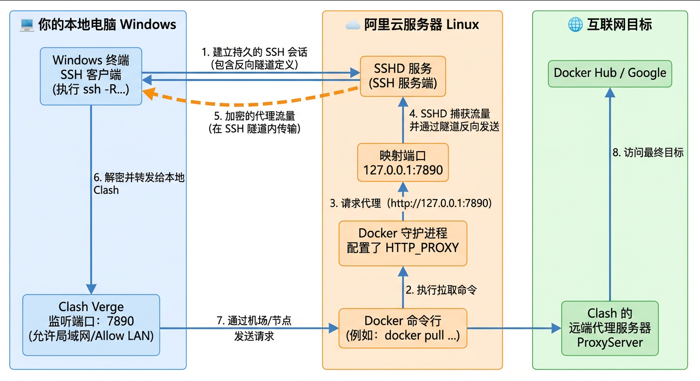

# Docker镜像加速

要让虚拟机通过你本地电脑的 **代理工具** 上网，最稳妥且不需要额外安装复杂软件的方法是使用 **反向SSH 隧道 (Reverse Proxy)**。

## 1 操作

### 第一步：配置本地 代理工具

**开启局域网连接**：在设置中（工具 > 基本配置 > 常规），打开 **局域网代理**，确定**代理端口号**（`7890`）

**查看虚拟机 IP**：`192.168.100.100`

### 第二步：建立反向 SSH 隧道

需要从 **Windows 电脑** 连接到虚拟机。在 Windows 的 PowerShell 或 CMD 中执行以下命令，然后按提示操作

```powershell
ssh -R 7890:localhost:7890 root@192.168.100.100
```

此时，虚拟机的 `127.0.0.1:7890` 就映射到了你本地电脑的代理端口。

### 第三步：配置 Docker 代理

现在虚拟机已经可以通过隧道访问代理了，接下来配置 Docker 守护进程

1. 创建 Docker 代理目录

```bash
sudo mkdir -p /etc/systemd/system/docker.service.d
```

2. 创建代理配置文件

```bash
yum install vim
sudo vim /etc/systemd/system/docker.service.d/http-proxy.conf
```

3. 写入以下内容（注意这里使用 127.0.0.1）

```ini
[Service]
Environment="HTTP_PROXY=http://127.0.0.1:7890"
Environment="HTTPS_PROXY=http://127.0.0.1:7890"
Environment="NO_PROXY=localhost,127.0.0.1,mirrors.aliyun.com"
```

4. 重新加载并重启 Docker

```bash
sudo systemctl daemon-reload
sudo systemctl restart docker
```

### 第四步：验证与拉取镜像

在阿里云服务器上测试网络是否通畅：

```bash
# 测试能否访问 Google
curl -I https://www.google.com --proxy http://127.0.0.1:7890

# 拉取 Milvus 镜像
docker pull milvusdb/milvus:v2.5.5
```

## 2 原理图

