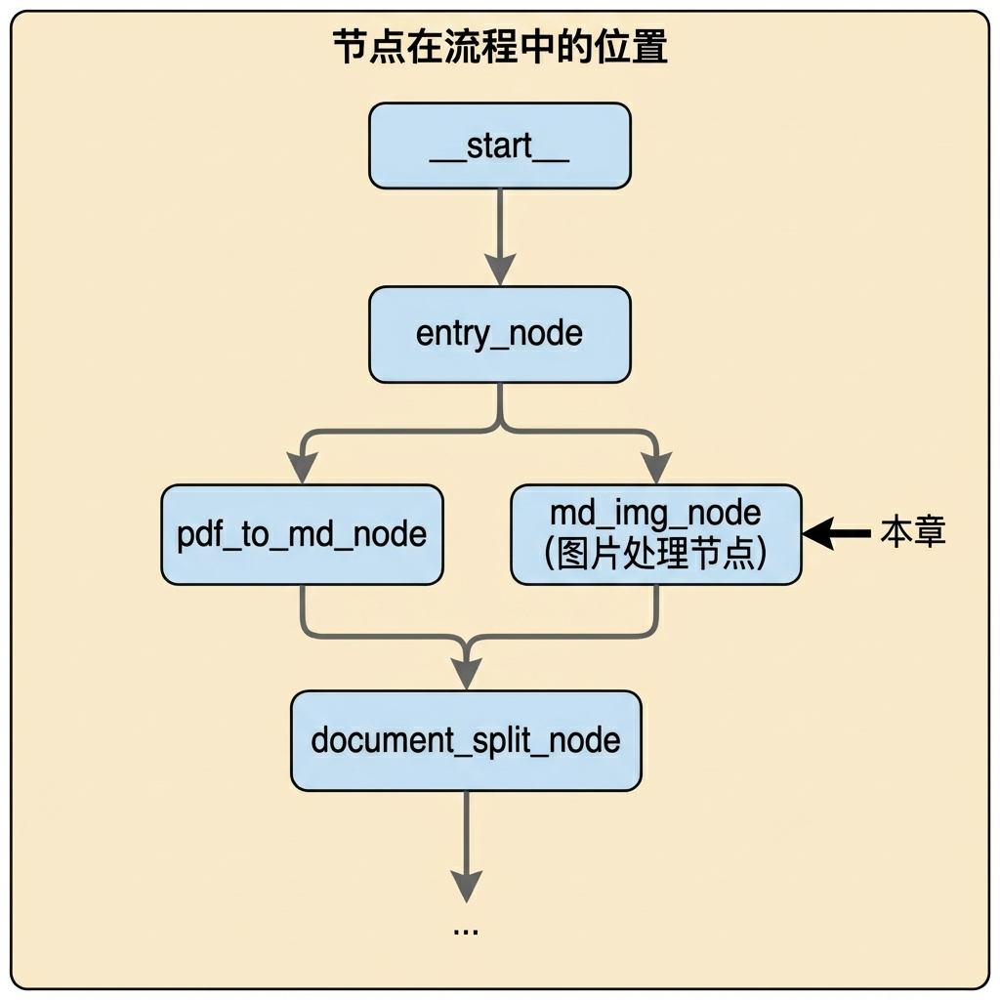
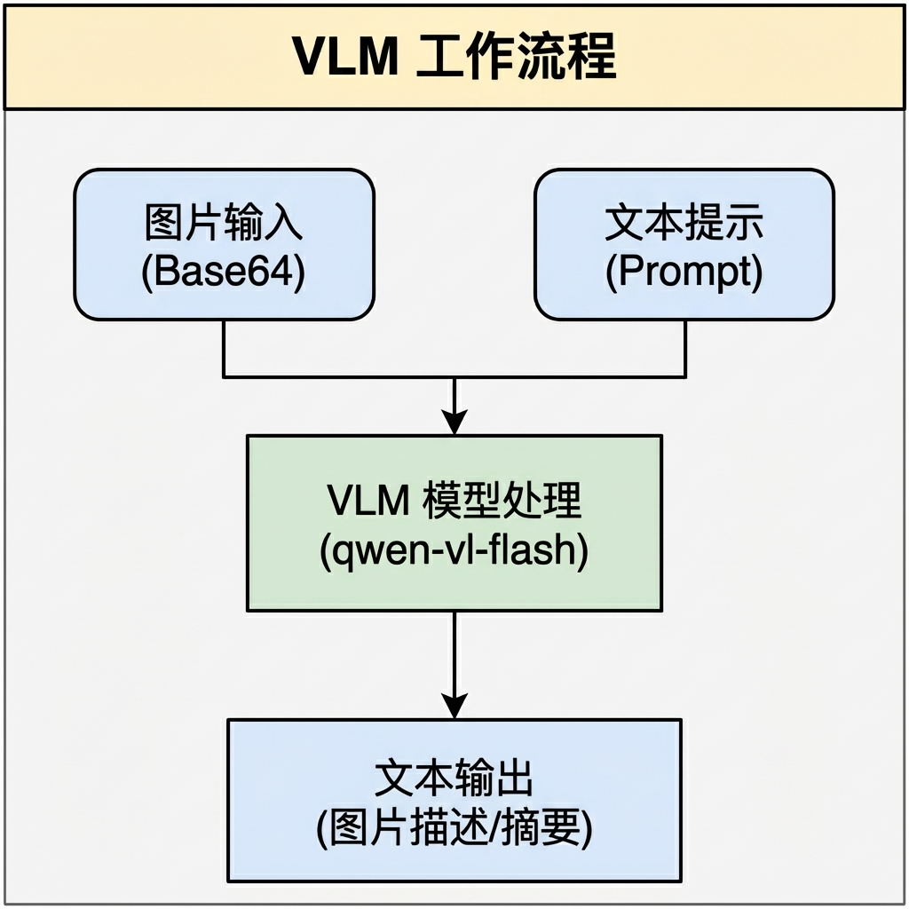
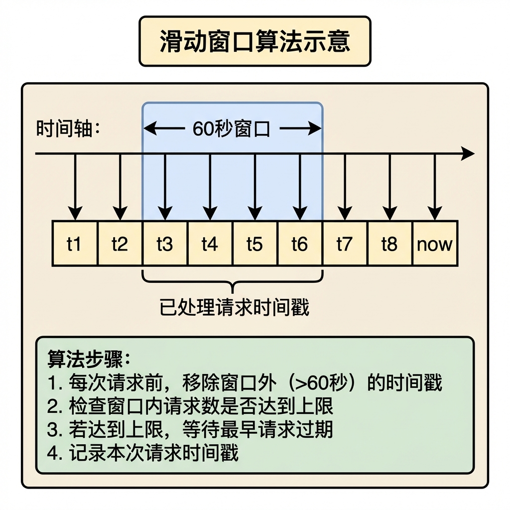
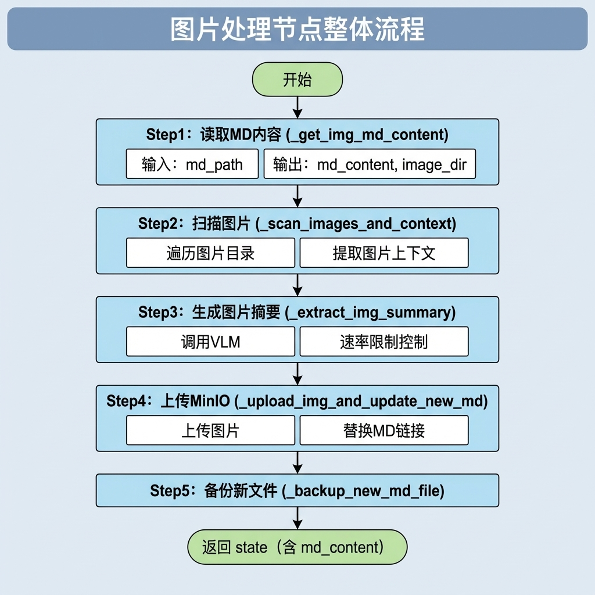
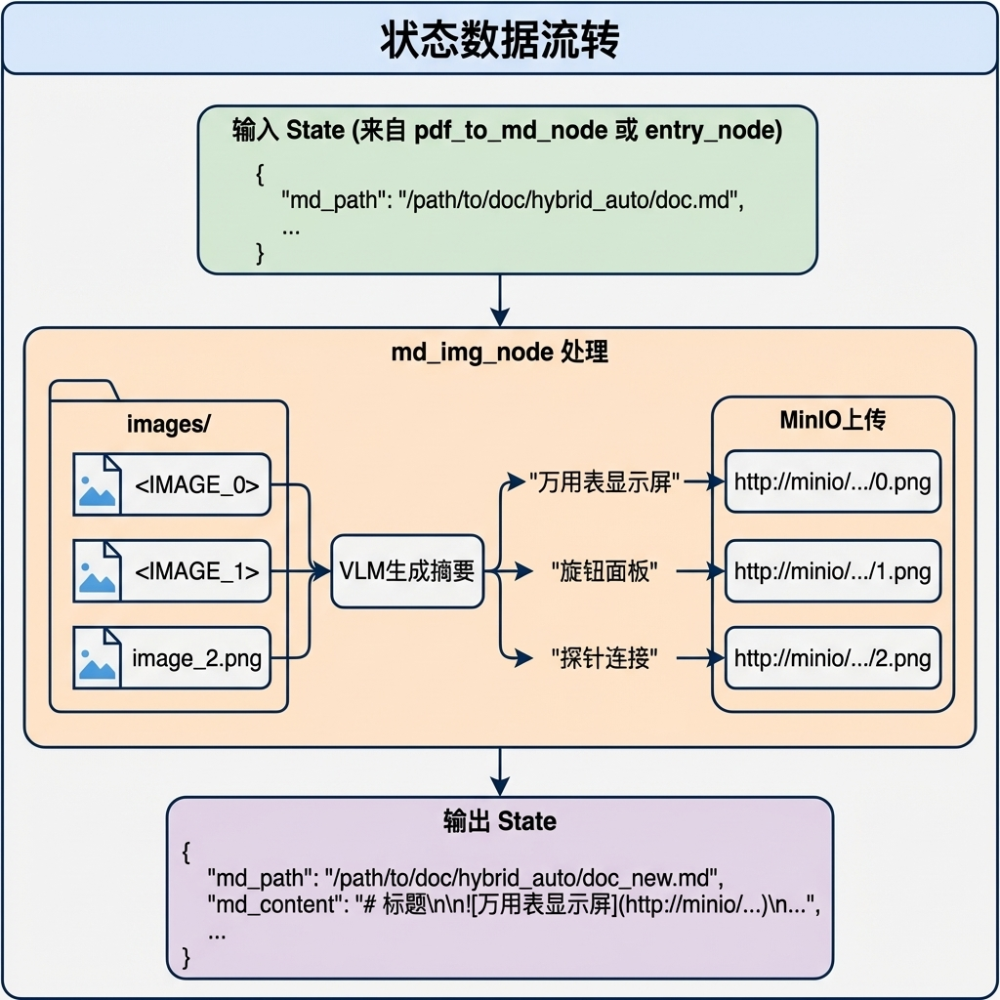
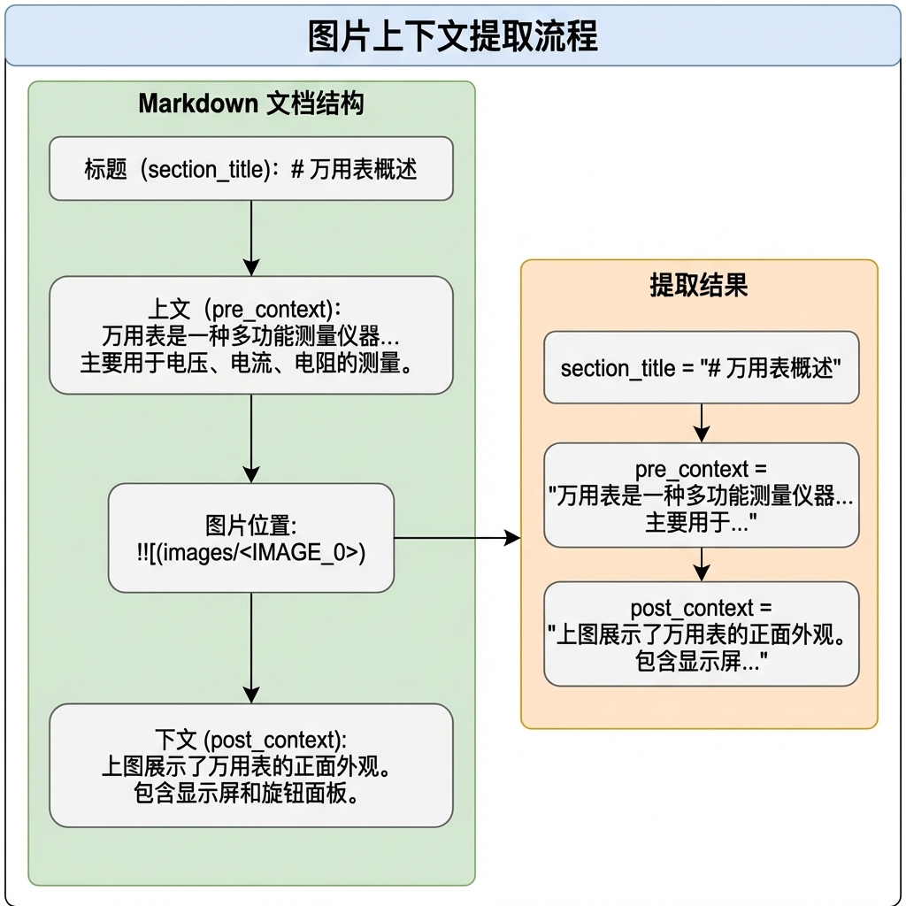
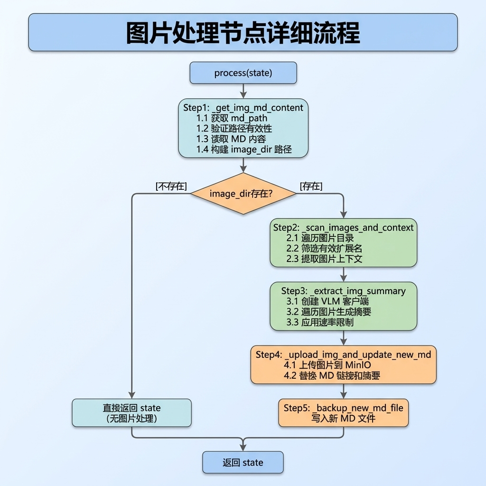

# 图片处理与 MinIO 上传节点

> 本文档详细介绍知识库导入流程中的图片处理节点（MdImgNode），该节点负责处理 Markdown 文档中的本地图片，包括生成图片摘要、上传至 MinIO 对象存储、替换链接等功能。

---

## 1. 任务目标

### 1.1 本章目标

通过本章学习，你将掌握：

1. **MinIO 对象存储**：理解对象存储的概念及 MinIO Python SDK 的使用
2. **多模态模型调用**：学会使用 VLM（Vision-Language Model）生成图片描述
3. **图片上下文提取**：基于 Markdown 语义结构提取图片的上下文信息
4. **正则表达式**：掌握 Markdown 图片语法的匹配与替换
5. **速率限制**：理解并实现 API 调用的 Rate Limiting 机制

### 1.2 涉及文件

```
knowledge/
├── processor/import_process/nodes/
│   └── md_img_node.py      # 图片处理节点（本章重点）
└── utils/
    └── minio_util.py       # MinIO 工具类
```

### 1.3 节点在流程中的位置



---

## 2. 核心概念扫盲

### 2.1 MinIO 对象存储

**MinIO** 是一个高性能的分布式对象存储系统，兼容 Amazon S3 API。

**核心概念：**

| 概念 | 说明 | 类比 |
|------|------|------|
| Bucket | 存储桶，顶级容器 | 文件夹 |
| Object | 对象，存储的基本单元 | 文件 |
| Object Name | 对象名称，包含路径 | 文件路径 |
| Endpoint | MinIO 服务地址 | 服务器地址 |

**Python SDK 基本用法：**

```python
from minio import Minio

# 初始化客户端
client = Minio(
    "localhost:9000",           # MinIO 服务地址
    access_key="minioadmin",    # 访问密钥
    secret_key="minioadmin",    # 秘密密钥
    secure=False                # 是否使用 HTTPS
)

# 检查/创建 Bucket
if not client.bucket_exists("my-bucket"):
    client.make_bucket("my-bucket")

# 上传文件
client.fput_object(
    "my-bucket",                # Bucket 名称
    "images/photo.jpg",         # Object 名称（含路径）
    "/local/path/photo.jpg",    # 本地文件路径
    content_type="image/jpeg"   # MIME 类型
)

# 构建访问 URL
url = f"http://localhost:9000/my-bucket/images/photo.jpg"
```

### 2.2 Vision-Language Model (VLM)

**VLM（视觉-语言模型）** 是能够同时处理图像和文本的多模态大模型。

**工作原理：**



**API 调用示例（OpenAI 兼容格式）：**

```python
from openai import OpenAI
import base64

# 初始化客户端
client = OpenAI(
    api_key="your-api-key",
    base_url="https://api.example.com/v1"
)

# 图片转 Base64
with open("image.jpg", "rb") as f:
    base64_image = base64.b64encode(f.read()).decode("utf-8")

# 调用 VLM
response = client.chat.completions.create(
    model="qwen-vl-plus",  # 视觉模型
    messages=[
        {
            "role": "user",
            "content": [
                {
                    "type": "text",
                    "text": "请描述这张图片的内容"
                },
                {
                    "type": "image_url",
                    "image_url": {
                        "url": f"data:image/jpeg;base64,{base64_image}"
                    }
                }
            ]
        }
    ],
    max_tokens=100
)

summary = response.choices[0].message.content
```

### 2.3 Markdown 图片语法

**标准图片语法：**

```markdown


# 示例


```

**正则表达式匹配：**

```python
import re

md_content = "这是一段文字  后面的文字"

# 匹配所有图片
pattern = r"!\[(.*?)\]\((.*?)\)"
matches = re.findall(pattern, md_content)
# [('图片描述', 'images/photo.jpg')]

# 匹配特定图片文件名
image_filename = "photo.jpg"
specific_pattern = r"!\[.*?\]\(.*?" + re.escape(image_filename) + r".*?\)"
# 注意：使用 re.escape() 转义文件名中的特殊字符
```

### 2.4 Rate Limiting（速率限制）

**概念：** 限制一段时间内的 API 请求次数，避免触发服务端限流。

**滑动窗口算法：**



**Python 实现（使用 deque）：**

```python
from collections import deque
import time

def enforce_rate_limit(
    request_timestamps: deque,  # 存储请求时间戳
    max_requests: int,          # 最大请求数
    window_seconds: int = 60    # 时间窗口（秒）
):
    current_time = time.time()

    # 移除窗口外的旧时间戳
    while request_timestamps and \
          current_time - request_timestamps[0] >= window_seconds:
        request_timestamps.popleft()

    # 如果达到上限，等待
    if len(request_timestamps) >= max_requests:
        sleep_time = window_seconds - (current_time - request_timestamps[0])
        if sleep_time > 0:
            time.sleep(sleep_time)

    # 记录本次请求
    request_timestamps.append(time.time())
```

**为什么使用 deque？**

| 数据结构 | 左侧移除 | 右侧添加 | 适用场景 |
|----------|----------|----------|----------|
| `list` | O(n) | O(1) | 随机访问 |
| `deque` | O(1) | O(1) | 队列/滑动窗口 |

### 2.5 Base64 编码

**概念：** 将二进制数据编码为 ASCII 字符串，常用于在文本协议中传输二进制数据。

```python
import base64

# 编码
with open("image.png", "rb") as f:
    binary_data = f.read()
    base64_string = base64.b64encode(binary_data).decode("utf-8")

# 解码
binary_data = base64.b64decode(base64_string)
```

**在 VLM 中的应用：**

```
  原始图片 (二进制)
        │
        ▼ base64.b64encode()
  Base64 字符串: "iVBORw0KGgoAAAANSUhEUgAA..."
        │
        ▼ 拼接为 Data URL
  "data:image/jpeg;base64,iVBORw0KGgoAAAANSUhEUgAA..."
        │
        ▼ 作为 API 请求的一部分发送
  VLM 模型处理
```

---

## 3. 图片处理业务流程（总）

### 3.1 整体流程概述



### 3.2 数据流转



### 3.3 图片上下文提取策略



---

## 4. 图片处理业务流程（分）

### 4.1 目标

- 读取并解析 Markdown 文档中的图片引用
- 利用 VLM 为每张图片生成语义化的中文摘要
- 将本地图片上传至 MinIO 对象存储
- 替换 Markdown 中的本地路径为远程 URL
- 生成处理后的新 Markdown 文件

### 4.2 需求分析

**输入：**
- `md_path`：Markdown 文件路径
- `images` 目录：与 Markdown 文件同级的图片目录

**输出：**
- `md_content`：处理后的 Markdown 内容

**依赖：**
- MinIO 对象存储服务
- VLM 多模态大模型 API
- OpenAI Python SDK

**边界条件：**

| 场景 | 处理方式 |
|------|----------|
| `md_path` 为空 | 抛出 `ValidationError` |
| `images` 目录不存在 | 跳过图片处理，直接返回 |
| 图片未在 MD 中被引用 | 跳过该图片 |
| VLM 调用失败 | 使用默认描述 "图片描述" |
| MinIO 上传失败 | 记录警告，跳过该图片 |
| 达到 API 速率限制 | 自动等待后重试 |

### 4.3 实现流程

#### 4.3.1 实现流程图



#### 4.3.2 具体实现步骤

| 步骤 | 方法 | 操作 | 说明 |
|------|------|------|------|
| **Step 1** | `_get_img_md_content()` | 读取 MD 内容 | 获取文件内容和图片目录 |
| **Step 2** | `_scan_images_and_context()` | 扫描图片 | 遍历目录，提取上下文 |
| **Step 2.1** | `_find_img_context_with_limit()` | 提取上下文 | 基于语义结构提取 |
| **Step 2.2** | `_extract_img_context_with_limit()` | 提取段落 | 限制字符数，保持完整 |
| **Step 3** | `_extract_img_summary()` | 生成摘要 | 调用 VLM 接口 |
| **Step 3.1** | `_enforce_rate_limit()` | 速率限制 | 滑动窗口算法 |
| **Step 3.2** | `_get_img_summary()` | 调用 VLM | Base64 + API 调用 |
| **Step 4** | `_upload_img_and_update_new_md()` | 上传替换 | MinIO 上传 + 正则替换 |
| **Step 5** | `_backup_new_md_file()` | 备份文件 | 写入新文件 |

**MinIO 对象路径设计：**

```
Bucket: knowledge-base
Object 路径: {文档名称}/{图片文件名}

示例:
knowledge-base/
└── 万用表的使用/
    ├── image_0.png
    ├── image_1.png
    └── image_2.png

访问 URL: http://minio:9000/knowledge-base/万用表的使用/image_0.png
```

### 4.4 代码实现

#### 4.4.1 MinIO 工具类

```python
# knowledge/utils/minio_util.py

import os
import logging

from minio.error import S3Error
from minio import Minio
from dotenv import load_dotenv

load_dotenv()


def get_minio_client():
    """
    获取 MinIO 客户端单例

    Returns:
        Minio 客户端实例，失败返回 None
    """
    # 1. 实例化MinIO客户端
    try:
        client = Minio(
            os.getenv("MINIO_ENDPOINT"),           # 服务端端口
            access_key=os.getenv("MINIO_ACCESS_KEY"),  # 访问的key
            secret_key=os.getenv("MINIO_SECRET_KEY"),  # 访问的秘钥
            secure=False                            # 使用HTTP协议
        )

        # 2. 判断桶是否存在
        bucket_name = os.getenv("MINIO_BUCKET_NAME")
        bucket_exists = client.bucket_exists(bucket_name)
        if not bucket_exists:
            client.make_bucket(bucket_name)
            logging.info(f"桶:{bucket_name} 不存在")
        else:
            logging.info(f"桶:{bucket_name} 已经存在")

        # 3. 返回MinIO客户端
        return client
    except S3Error as e:
        logging.error("MinIO客户端创建失败")
        return None
```

#### 4.4.2 图片处理节点

```python
# knowledge/processor/import_process/nodes/md_img_node.py

"""
Markdown 图片处理节点

处理 MD 文档中的图片：总结、上传 MinIO、替换链接
"""

import logging
import time
import os
import re
import base64
from collections import deque
from pathlib import Path
from typing import Tuple, List, Deque

from openai import OpenAI

from knowledge.utils.minio_util import get_minio_client
from knowledge.processor.import_process.base import BaseNode, setup_logging
from knowledge.processor.import_process.state import ImportGraphState
from knowledge.processor.import_process.exceptions import (
    ValidationError, FileProcessingError, ImageProcessingError
)
from knowledge.processor.import_process.config import get_config


class MarkDownImageNode(BaseNode):
    """
    处理 MarkDown 图片节点类
    """
    name = "md_img_node"

    def process(self, state: ImportGraphState) -> ImportGraphState:
        """
        执行图片处理流程

        Args:
            state: 上一个节点处理之后 state 的最新状态

        Returns:
            当前节点处理之后的 state 最新状态 (md_content=process_md)
        """
        # 1. 获取配置对象
        config = get_config()

        # 2. 处理文件路径 (md内容、md路径、图片目录)
        md_content, md_path_obj, image_dir = self._get_img_md_content(state)
        if not image_dir.exists():
            # 图片不用处理了，直接更新 state 的 md_content
            self.logger.warning(f"文件{md_path_obj.name}暂无图片要处理")
            state['md_content'] = md_content
            return state

        # 3. 扫描并处理图片
        target_images_context = self._scan_images_and_context(
            image_dir, md_content, config
        )

        # 4. 用 VLM 给图片生成图片描述(摘要)
        images_summaries = self._extract_img_summary(
            md_path_obj.stem, target_images_context, config
        )

        # 5. 上传图片到 MinIO 并替换 MD 内容
        new_md_content = self._upload_img_and_update_new_md(
            md_path_obj.stem, md_content, images_summaries,
            target_images_context, config
        )

        # 6. 将更新后的内容备份（调试）
        self._backup_new_md_file(md_path_obj, new_md_content)

        # 7. 更新 state
        state['md_content'] = new_md_content

        # 8. 返回更新后的状态
        return state

    def _get_img_md_content(
        self, state: ImportGraphState
    ) -> Tuple[str, Path, Path]:
        """
        读取 MD 内容并构建图片目录

        Args:
            state: 上一个节点处理之后 state 的最新状态

        Returns:
            md_content: md 的内容
            md_path_obj: md 的路径
            image_dir: 图片目录
        """
        self.log_step("step1", "读取md内容以及构建图片目录")

        # 1. 获取 md_path
        md_path = state.get('md_path', '')

        # 2. 判断路径是否有内容
        if not md_path:
            raise ValidationError("md文件不存在", self.name)

        # 3. 标准化处理
        md_path_obj = Path(md_path)

        # 4. 判断路径是否有效
        if not md_path_obj.exists():
            raise FileProcessingError("md文件路径无效", self.name)

        # 5. 读取 md 内容
        with open(md_path_obj, "r", encoding="utf-8") as f:
            md_content = f.read()

        # 6. 构建图片目录
        image_dir = md_path_obj.parent / "images"

        # 7. 返回
        return md_content, md_path_obj, image_dir

    def _scan_images_and_context(
        self, image_dir: Path, md_content: str, config
    ) -> List[Tuple[str, str, Tuple[str, str, str]]]:
        """
        扫描图片并找到图片的上下文

        Args:
            image_dir: 图片目录
            md_content: md 内容
            config: 配置信息

        Returns:
            List[(图片名字, 图片地址, (标题, 上文, 下文))]
        """
        self.log_step("step2", f"扫描图片文件目录{image_dir}")
        target_images_context = []

        # 1. 遍历图片文件目录
        for img_name in os.listdir(image_dir):
            # 1.1 获取文件的后缀
            file_ext = os.path.splitext(img_name)[1]

            # 1.2 判断后缀是否有效
            if file_ext not in config.image_extensions:
                continue

            # 1.3 构建 image_path 转成字符串
            img_path = str(image_dir / img_name)

            # 1.4 构建图片上下文
            img_context = self._find_img_context_with_limit(
                md_content, img_name, config.img_content_length
            )

            # 1.5 如果该图片没有上下文
            if not img_context:
                self.logger.warning("MD文件中暂未提取到可用的图片")
                continue

            # 1.6 提取当前图片的唯一上下文内容
            primary_img_context = img_context[0]

            # 1.7 图片的完整信息构建到列表
            target_images_context.append(
                (img_name, img_path, primary_img_context)
            )

        # 1.8 返回所有图片完整信息
        self.logger.info(f"找到{len(target_images_context)}有效的图片")
        return target_images_context

    def _find_img_context_with_limit(
        self, md_content: str, img_name: str, max_chars=200
    ) -> List[Tuple[str, str, str]]:
        """
        从 MD 文档中提取图片上下文信息

        Args:
            md_content: 操作的 MD
            img_name: 图片名字
            max_chars: 最大的字符数限制

        Returns:
            List[(离图片最近的上面一个标题, 图片的上文, 图片的下文)]
        """
        # 1. 定义找图片的正则规则
        re_pattern = re.compile(
            r"!\[.*?\]\(.*?" + re.escape(img_name) + r".*?\)"
        )

        # 2. 切分 md 内容
        md_lines = md_content.split("\n")
        imgs_context = []

        # 3. 遍历 md
        for line_idx, line in enumerate(md_lines):
            # 3.1 是否是图片
            if not re_pattern.search(line):
                continue

            # 3.2 找上文标题内容和标题索引
            head_title = ""
            head_index = -1
            for i in range(line_idx - 1, -1, -1):
                if re.match(r"^#{1,6}\s+", md_lines[i]):
                    head_title = md_lines[i]
                    head_index = i
                    break

            pre_content_start_index = head_index + 1
            pre_content = md_lines[pre_content_start_index:line_idx]

            # 3.3 找上文的内容
            img_pre_context = self._extract_img_context_with_limit(
                pre_content, max_chars, direction="front"
            )

            # 3.4 找下文标题索引
            section_index = len(md_lines)
            for i in range(line_idx + 1, section_index):
                if re.match(r"^#{1,6}\s+", md_lines[i]):
                    section_index = i
                    break

            post_content_start_index = line_idx + 1
            post_content = md_lines[post_content_start_index:section_index]

            # 3.5 找下文的内容
            img_post_context = self._extract_img_context_with_limit(
                post_content, max_chars, direction="end"
            )

            # 3.6 构建该图片的上下文信息
            imgs_context.append((head_title, img_pre_context, img_post_context))

        return imgs_context

    def _extract_img_context_with_limit(
        self, extract_content: list, max_chars: int, direction: str
    ) -> str:
        """
        提取图片上下文之间的内容（段落）

        Args:
            extract_content: 提取到的内容
            max_chars: 最大字符数
            direction: 方向 (front: 自下而上, end: 自上而下)

        Returns:
            str: 上下文信息
        """
        current_paragraph = []
        final_paragraph = []

        # 1. 遍历每一行收集段落
        for line in extract_content:
            clen_strip = line.strip()
            if not clen_strip:
                if current_paragraph:
                    final_paragraph.append("\n".join(current_paragraph))
                    current_paragraph = []
            else:
                if re.match(r"^!\[.*?\]\(.*?\)$", clen_strip):
                    if current_paragraph:
                        final_paragraph.append("\n".join(current_paragraph))
                        current_paragraph = []
                    continue
                current_paragraph.append(line)

        # 2. 处理最后一个段落
        if current_paragraph:
            final_paragraph.append("\n".join(current_paragraph))

        # 3. 处理上文
        if direction == "front":
            final_paragraph.reverse()

        # 4. 收集最终返回的段落
        total = 0
        selected = []
        for para in final_paragraph:
            para_len = len(para)
            if total + para_len > max_chars and selected:
                break
            selected.append(para)
            total += para_len

        # 5. 处理上文
        if direction == "front":
            selected.reverse()

        return "\n\n".join(selected)

    def _extract_img_summary(
        self,
        document_title: str,
        target_images_context: List[Tuple[str, str, Tuple[str, str, str]]],
        config
    ):
        """
        所有图片生成图片摘要 VLM

        Args:
            document_title: 文档名字
            target_images_context: 所有图片信息
            config: 配置信息

        Returns:
            Dict{图片名字: 摘要}
        """
        self.log_step("step3", "准备提取图片摘要")

        summaries = {}
        request_timestamps: Deque[float] = deque()

        # 1. 构建 OpenAI 客户端
        try:
            client = OpenAI(
                api_key=config.openai_api_key,
                base_url=config.openai_api_base
            )
        except Exception as e:
            logging.error(f"VLM客户端创建失败")
            return summaries

        # 2. 发送请求（提取摘要）
        for img_name, img_path, images_context in target_images_context:
            self._enforce_rate_limit(
                request_timestamps, config.requests_per_minute, 60
            )
            summary = self._get_img_summary(
                config, client, document_title, img_path, images_context
            )
            summaries[img_name] = summary

        logging.info(f"生成{len(summaries)}图片摘要")
        return summaries

    def _enforce_rate_limit(
        self,
        request_timestamps: Deque[float],
        max_requests: int,
        window_seconds: int = 60
    ):
        """
        强制执行 API 请求速率限制

        Args:
            request_timestamps: 请求时间戳队列
            max_requests: 窗口内最大请求数
            window_seconds: 时间窗口大小（秒）
        """
        current_time = time.time()

        # 移除窗口外的时间戳
        while request_timestamps and current_time - request_timestamps[0] >= window_seconds:
            request_timestamps.popleft()

        # 达到上限则等待
        if len(request_timestamps) >= max_requests:
            sleep_duration = window_seconds - (current_time - request_timestamps[0])
            if sleep_duration > 0:
                self.logger.info(f"达到速率限制，暂停 {sleep_duration:.2f} 秒...")
                time.sleep(sleep_duration)

            current_time = time.time()
            while request_timestamps and current_time - request_timestamps[0] >= window_seconds:
                request_timestamps.popleft()

        request_timestamps.append(current_time)

    def _get_img_summary(
        self, config, client, document_title: str, img_path: str,
        images_context: Tuple[str, str, str]
    ) -> str:
        """
        调用 VLM 生成图片摘要
        """
        # 1. 解包构建上下文
        section_title, pre_context, post_context = images_context

        context_parts = []
        if section_title:
            context_parts.append(section_title)
        if pre_context:
            context_parts.append(pre_context)
        if post_context:
            context_parts.append(post_context)

        final_context = "\n".join(context_parts) if context_parts else "暂无可用上下文"

        # 2. 读取图片文件
        local_img_content = ""
        try:
            with open(img_path, "rb") as f:
                local_img_content = base64.b64encode(f.read()).decode("utf-8")
        except Exception as e:
            return "暂无图片"

        # 3. 调用 VLM
        try:
            response = client.chat.completions.create(
                model=config.vl_model,
                messages=[
                    {
                        "role": "user",
                        "content": [
                            {
                                "type": "text",
                                "text": f"""任务：为Markdown文档中的图片生成一个简短的中文标题。
背景信息：
    1. 所属文档标题："{document_title}"
    2. 图片上下文：{final_context}
请结合图片视觉内容和上述上下文信息，用中文简要总结这张图片的内容，
生成一个精准的中文标题（不要包含"图片"二字）。""",
                            },
                            {
                                "type": "image_url",
                                "image_url": {
                                    "url": f"data:image/jpeg;base64,{local_img_content}"
                                }
                            }
                        ]
                    }
                ]
            )
            summary = response.choices[0].message.content.strip()
            return summary
        except Exception as e:
            self.logger.warning(f"图片摘要生成失败 {img_path}: {e}")
            return "图片描述"

    def _upload_img_and_update_new_md(
        self, document_name, md_content, images_summaries,
        target_images_context, config
    ):
        """
        上传图片到 MinIO 以及替换 MD 中的图片 URL 和摘要
        """
        self.log_step("step5", "上传图片到minio并且更新md的摘要和图片地址")

        remote_urls = {}

        # 1. 构建 MinIO 客户端
        minio_client = get_minio_client()

        if minio_client is None:
            self.logger.warning(f"无法将本地的图片上传到minio")

        # 2. 遍历图片信息列表
        for img_name, img_path, _ in target_images_context:
            object_name = f"{document_name}/{img_name}"

            try:
                minio_client.fput_object(
                    config.minio_bucket,
                    object_name,
                    img_path,
                )
                remote_url = config.get_minio_base_url() + "/" + \
                            config.minio_bucket + "/" + object_name
                self.logger.info(f"{img_name}图片上传到minio成功")
                remote_urls[img_name] = remote_url

            except Exception as e:
                self.logger.warning(f"{img_name}上传到minio失败")
                remote_urls[img_name] = "http://minio_mock/" + document_name + "/" + img_name

        self.logger.info(f"成功上传{len(remote_urls)}图片到minio")

        # 3. 替换（摘要和图片地址）到 MD 内容中
        new_md_content = md_content
        for img_name, images_summary in images_summaries.items():
            remote_url = remote_urls.get(img_name)
            if not remote_url:
                continue

            replace_pattern = re.compile(
                r"!\[(.*?)\]\((.*?" + re.escape(img_name) + r".*?)\)",
                re.IGNORECASE
            )
            new_md_content = replace_pattern.sub(
                f"", new_md_content
            )

        return new_md_content

    def _backup_new_md_file(self, md_path_obj: Path, new_md_content: str) -> str:
        """
        备份新的 MD 文件
        """
        self.log_step("step_5", "备份新文件")

        new_file_path = md_path_obj.with_name(
            f"{md_path_obj.stem}_new{md_path_obj.suffix}"
        )

        try:
            with open(new_file_path, "w", encoding="utf-8") as f:
                f.write(new_md_content)
            self.logger.info(f"处理后的文件已备份至: {new_file_path}")
        except IOError as e:
            self.logger.error(f"写入新文件失败 {new_file_path}: {e}")
            raise ImageProcessingError(f"文件写入失败: {e}", node_name=self.name)

        return str(new_file_path)


if __name__ == '__main__':
    setup_logging()
    img_md_node = MarkDownImageNode()

    state = {
        "md_path": r"D:\test_data\万用表的使用\hybrid_auto\万用表的使用.md"
    }

    img_md_node.process(state)
```

---

## 5. 测试运行

### 5.1 运行测试

```bash
# 进入项目目录
cd knowledge

# 激活虚拟环境
.venv\Scripts\activate

# 运行测试
python -m knowledge.processor.import_process.nodes.md_img_node
```

### 5.2 预期输出

```
2026-02-23 10:00:00 - import.md_img_node - INFO - --- md_img_node 开始 ---
2026-02-23 10:00:00 - import.md_img_node - INFO - [step1] 读取md内容以及构建图片目录
2026-02-23 10:00:00 - import.md_img_node - INFO - [step2] 扫描图片文件目录D:\...\images
2026-02-23 10:00:00 - import.md_img_node - INFO - 找到5有效的图片
2026-02-23 10:00:00 - import.md_img_node - INFO - [step3] 准备提取图片摘要
2026-02-23 10:00:05 - import.md_img_node - INFO - image_0.png图片上传到minio成功
...
2026-02-23 10:00:10 - import.md_img_node - INFO - 成功上传5图片到minio
2026-02-23 10:00:10 - import.md_img_node - INFO - [step_5] 备份新文件
2026-02-23 10:00:10 - import.md_img_node - INFO - 处理后的文件已备份至: D:\...\万用表的使用_new.md
2026-02-23 10:00:10 - import.md_img_node - INFO - --- md_img_node 完成 ---
```

### 5.3 处理前后对比

**处理前 (原始 Markdown)：**
```markdown
# 万用表概述

万用表是一种多功能测量仪器。


上图展示了万用表的正面外观。
```

**处理后 (新 Markdown)：**
```markdown
# 万用表概述

万用表是一种多功能测量仪器。


上图展示了万用表的正面外观。
```

---

## 6. 总结

### 6.1 节点功能概览

| 功能模块 | 说明 |
|----------|------|
| **MD 解析** | 读取文件、提取图片引用 |
| **上下文提取** | 基于 Markdown 语义结构 |
| **VLM 调用** | 多模态模型生成图片描述 |
| **MinIO 上传** | 对象存储持久化 |
| **链接替换** | 正则表达式批量替换 |
| **速率限制** | 滑动窗口算法 |

### 6.2 设计要点

1. **语义感知的上下文提取**
   - 不是简单的字符截取
   - 基于 Markdown 标题结构
   - 保持段落完整性

2. **优雅的错误处理**
   - 每个步骤都有降级方案
   - 单张图片失败不影响整体流程

3. **可配置的速率限制**
   - 避免触发 API 限流
   - 配置驱动，易于调整

4. **MinIO 集成**
   - 单例模式客户端
   - 自动创建 Bucket
   - 构造可访问的 URL

---