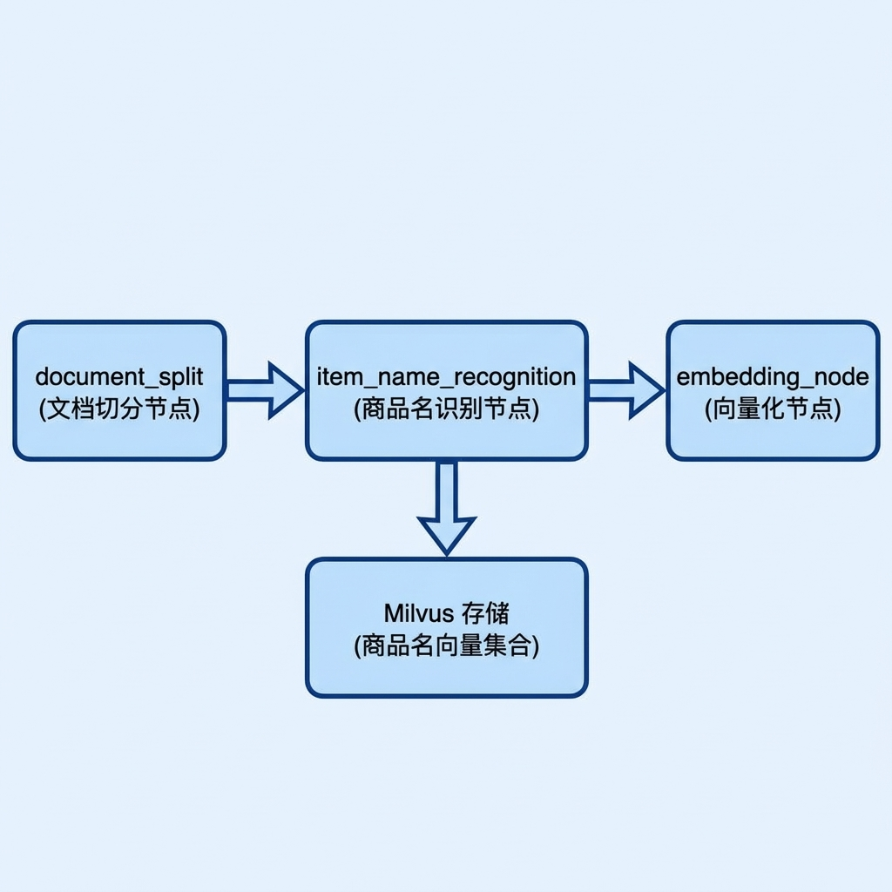
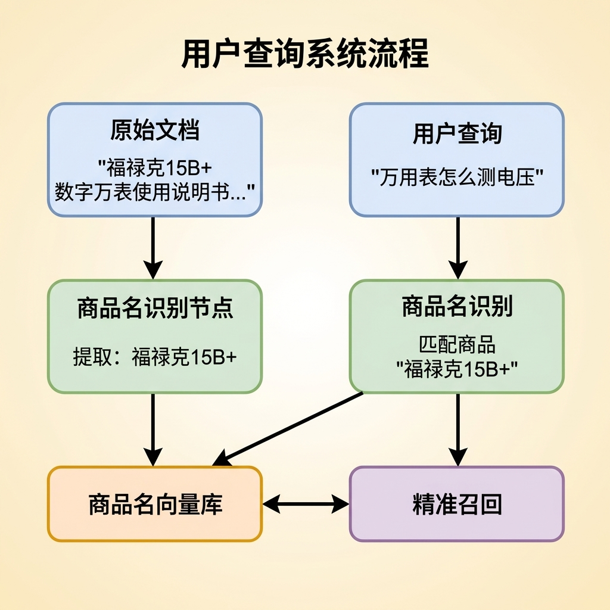
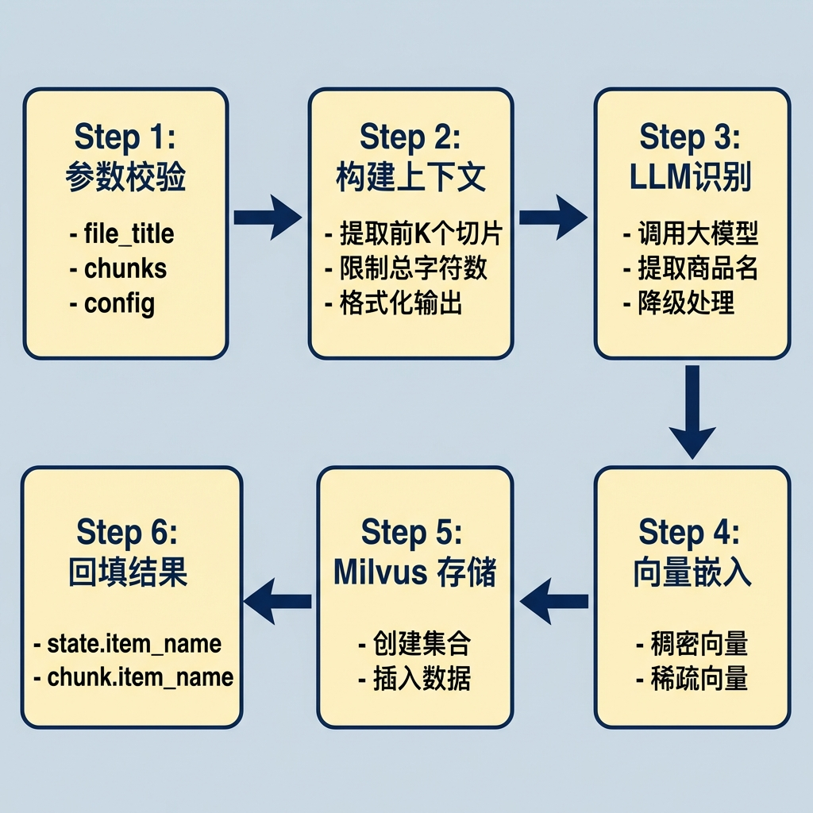
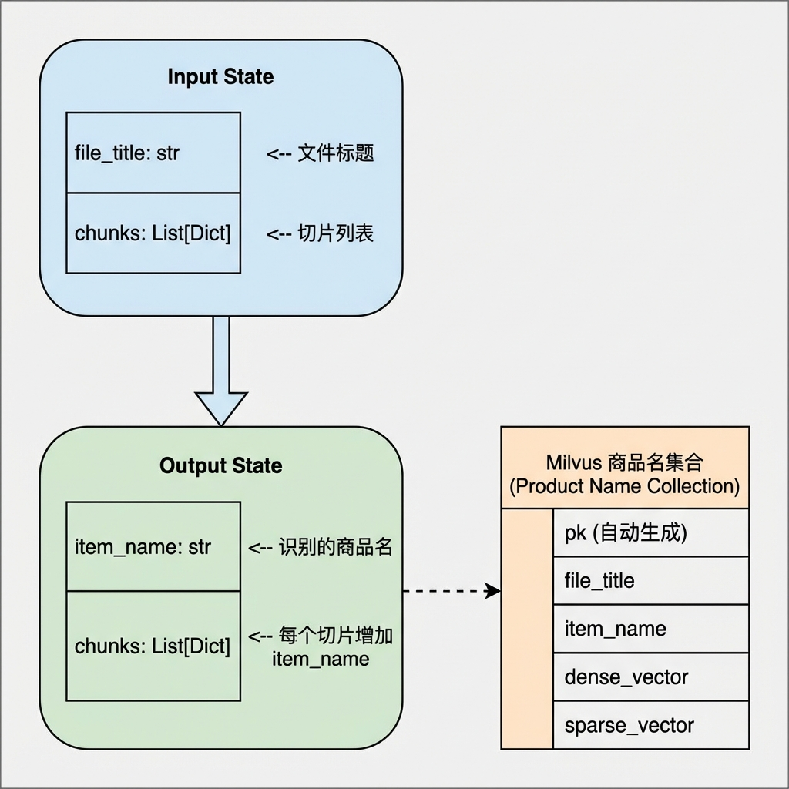
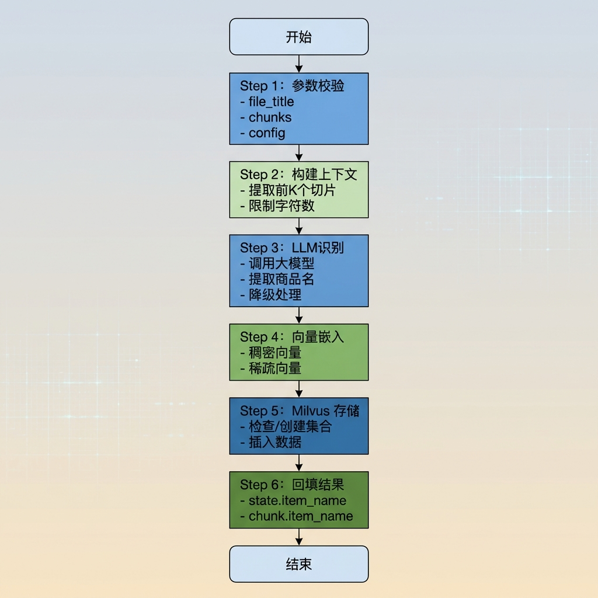

# 商品名识别节点

> 本文档详细介绍知识库导入流程中的商品名识别节点（ItemNameRecognitionNode），该节点负责从文档切片中识别商品/产品名称，并将识别结果向量化后存储到 Milvus 向量数据库，为后续的商品级检索提供基础数据。

---

## 1. 任务目标

### 1.1 本章目标

通过本章学习，你将掌握：

1. **LLM 调用**：学会使用 LangChain 封装调用大语言模型进行信息提取
2. **Prompt 工程**：理解商品名识别的提示词设计思路
3. **BGE-M3 混合嵌入**：掌握同时生成稠密向量和稀疏向量的技术
4. **Milvus 集合管理**：学会创建带索引的向量集合并插入数据
5. **状态回填**：理解如何将识别结果回填到图状态和切片中

### 1.2 涉及文件

```
knowledge/
├── processor/import_process/nodes/
│   └── item_name_recognition_node.py    # 商品名识别节点（本章重点）
│
├── utils/
│   ├── llm_client_util.py               # LLM 客户端工具
│   ├── bge_m3_embedding_util.py         # 向量嵌入工具（BGE-M3）
│   └── milvus_util.py                   # Milvus 连接管理
│
└── prompts/upload/
    └── import_prompt.py                 # 提示词模板
```

### 1.3 节点在流程中的位置



---

## 2. 核心概念扫盲

### 2.1 为什么需要商品名识别？

在知识库系统中，**商品名称**是连接文档与用户查询的关键桥梁：


**业务价值：**



### 2.2 LLM 信息提取

**大语言模型（LLM）** 是从非结构化文本中提取结构化信息的利器：


**LangChain 调用方式：**

```python
from langchain_openai import ChatOpenAI
from langchain_core.messages import SystemMessage, HumanMessage

# 1. 创建 LLM 客户端
llm = ChatOpenAI(
    model="qwen3-32b",
    temperature=0.1,           # 低温度 = 更确定性输出
    api_key="...",
    base_url="...",
)

# 2. 构建消息
messages = [
    SystemMessage(content="你是商品识别专家，只输出字符串。"),
    HumanMessage(content="请从以下信息中识别商品名称：..."),
]

# 3. 调用并获取响应
response = llm.invoke(messages)
item_name = response.content.strip()
```

### 2.3 BGE-M3 混合嵌入

**BGE-M3** 是一个强大的嵌入模型，能同时生成**稠密向量**和**稀疏向量**：


**为什么需要混合嵌入？**

| 向量类型 | 优势 | 劣势 | 适用场景 |
|----------|------|------|----------|
| **稠密向量** | 语义理解强，能识别同义词 | 可能丢失关键词信息 | "如何使用万用表" ↔ "万用表操作方法" |
| **稀疏向量** | 精确匹配关键词 | 语义理解弱 | "福禄克15B+" 精确匹配型号 |
| **混合检索** | 兼顾语义和关键词 | 计算成本略高 | 生产环境推荐方案 |

**代码示例：**

```python
from pymilvus.model.hybrid import BGEM3EmbeddingFunction

# 1. 加载模型
bge_m3 = BGEM3EmbeddingFunction(
    model_name="BAAI/bge-m3",
    device="cuda:0",
    use_fp16=True,
)

# 2. 生成嵌入
embeddings = bge_m3.encode_documents(["福禄克15B+数字万用表"])

# 3. 提取向量
dense_vector = embeddings["dense"][0].tolist()   # List[float], 长度 1024
sparse_matrix = embeddings["sparse"]              # CSR 稀疏矩阵

# 4. 从 CSR 矩阵提取稀疏向量
start_idx = sparse_matrix.indptr[0]
end_idx = sparse_matrix.indptr[1]
token_ids = sparse_matrix.indices[start_idx:end_idx].tolist()
weights = sparse_matrix.data[start_idx:end_idx].tolist()
sparse_vector = dict(zip(token_ids, weights))    # Dict[int, float]
```

### 2.4 Milvus 向量数据库

**Milvus** 是专为向量检索设计的开源数据库：

```
+------------------+
|   Application    |
+------------------+
         |
         v
+------------------+
|   Milvus Client  |
+------------------+
         |
    +----+----+----+
    |    |    |    |
    v    v    v    v
+------+ +------+ +------+
|Collection| |Collection| |Collection|
| item_name| | chunks | |  ...  |
+------+ +------+ +------+
```

**集合 Schema 设计：**

```python
from pymilvus import DataType

# 创建 Schema
schema = client.create_schema()

# 添加字段
schema.add_field(
    field_name="pk",
    datatype=DataType.VARCHAR,
    is_primary=True,
    auto_id=True,        # 自动生成主键
    max_length=100
)
schema.add_field(
    field_name="file_title",
    datatype=DataType.VARCHAR,
    max_length=65535
)
schema.add_field(
    field_name="item_name",
    datatype=DataType.VARCHAR,
    max_length=65535
)
schema.add_field(
    field_name="dense_vector",
    datatype=DataType.FLOAT_VECTOR,
    dim=1024             # BGE-M3 输出维度
)
schema.add_field(
    field_name="sparse_vector",
    datatype=DataType.SPARSE_FLOAT_VECTOR
)
```

**索引配置：**

```python
index_params = client.prepare_index_params()

# 稠密向量索引（自动选择最优算法）
index_params.add_index(
    field_name="dense_vector",
    index_name="dense_vector_index",
    index_type="AUTOINDEX",       # 自动选择 HNSW 等算法
    metric_type="COSINE"          # 余弦相似度
)

# 稀疏向量索引（倒排索引）
index_params.add_index(
    field_name="sparse_vector",
    index_name="sparse_inverted_index",
    index_type="SPARSE_INVERTED_INDEX",
    metric_type="IP"
)
```

---

## 3. 商品名识别业务处理流程（总）

### 3.1 整体流程概述



### 3.2 数据流转



---

## 4. 商品名识别业务处理流程（分）

### 4.1 目标

- 从文档切片中准确识别商品/产品名称（包含品牌、型号）
- 将识别结果回填到图状态和每个切片中
- 生成商品名称的混合嵌入向量（稠密 + 稀疏）
- 将商品名及向量持久化到 Milvus 向量数据库

### 4.2 需求分析

**输入：**
- `file_title`：文件标题（如 "万用表的使用"）
- `chunks`：文档切片列表，每个切片包含 title 和 content

**输出：**
- `item_name`：识别出的商品名称
- 更新后的 `chunks`：每个切片增加 `item_name` 字段
- Milvus 中新增一条商品名记录

**配置参数：**
- `item_name_chunk_k`：用于识别的切片数量
- `item_name_chunk_size`：上下文最大字符数
- `item_name_collection`：商品名集合名称

**边界条件处理：**

| 场景 | 处理方式 |
|------|----------|
| `file_title` ���空 | 抛出 `ValidationError` |
| `chunks` 为空或无效 | 抛出 `ValidationError` |
| LLM 调用失败 | 使用 `file_title` 作为 `item_name` |
| LLM 返回空字符串或 UNKNOWN | 使用 `file_title` 作为 `item_name` |
| 向量生成失败 | 抛出 `EmbeddingError` |
| Milvus 操作失败 | 记录错误日志，不影响流程 |

### 4.3 实现流程

#### 4.3.1 实现流程图



#### 4.3.2 具体实现步骤

##### Step 1: 参数校验

**功能描述：**
验证输入状态中的必要字段，确保后续处理有有效数据。

**实现要点：**

1. **获取 file_title**
   - 从 `state.get('file_title')` 获取文件标题
   - 这是商品名识别的重要参考信息

2. **获取 chunks**
   - 从 `state.get('chunks')` 获取切片列表
   - 切片内容用于辅助 LLM 识别

3. **验证参数有效性**
   - `file_title` 不能为空
   - `chunks` 必须是非空列表
   - `item_name_chunk_k` 必须大于 0

**代码片段：**

```python
def _validate_inputs(self, state: ImportGraphState):
    self.log_step("step1", "检验输入参数")
    config = get_config()

    # 1. 获取state的file_title以及 chunks
    file_title = state.get('file_title')
    chunks = state.get('chunks')

    # 2. 判断提取到的参数
    if not file_title:
        raise ValidationError("文件标题为空", self.name)

    if not chunks or not isinstance(chunks, list):
        raise ValidationError("chunk为空或者无效", self.name)

    item_name_chunk_k = config.item_name_chunk_k
    if not item_name_chunk_k or item_name_chunk_k <= 0:
        raise ValidationError("item_name_chunk_k为空或者无效", self.name)

    self.logger.info(f"检测到文件：{file_title},对应的切片长度:{len(chunks)}")
    # 3. 返回
    return file_title, chunks, config
```

---

##### Step 2: 构建识别上下文

**功能描述：**
从前 K 个切片中提取关键信息，构造供 LLM 识别的上下文文本。

**实现要点：**

1. **确定取样数量**
   - 默认取前 K 个切片（K 由配置 `item_name_chunk_k` 决定）
   - 前几个切片通常包含商品概述、型号等关键信息

2. **遍历切片提取信息**
   - 获取每个切片的 content
   - 跳过非字典类型

3. **格式化输出**
   - 使用 "【切片】- N - content" 格式
   - 结构化的输入有助于 LLM 理解

4. **限制总长度**
   - 最终上下文不超过 `item_name_chunk_size`
   - 累计字符数达到阈值后停止添加

**代码片段：**

```python
def _prepare_item_name_context(self, chunks: Optional[List[Dict[str, Any]]], config):
    self.log_step("step2", "构建商品名提取的上下文")
    result = []
    total = 0

    for index, chunk in enumerate(chunks[:config.item_name_chunk_k]):
        # 1. 判断chunk的类型
        if not isinstance(chunk, dict):
            continue

        # 2. 提取
        content = chunk.get('content')
        spices = f"【切片】- {index + 1} - {content}"

        # 3. 计算长度
        total += len(spices)
        result.append(spices)

        # 4. 判断是收集到的长度否超���阈值设定
        if total > config.item_name_chunk_size:
            break

    return "\n\n".join(result)[:config.item_name_chunk_size]
```

---

##### Step 3: 调用 LLM 识别

**功能描述：**
调用大语言模型从文件标题和切片内容中识别商品名称。

**实现要点：**

1. **获取 LLM 客户端**
   - 使用 `get_llm_client()` 获取客户端
   - 如果初始化失败，回退使用 file_title

2. **构建提示词**
   - 使用模板格式化用户提示词
   - 包含文件标题和上下文内容

3. **调用 LLM**
   - 使用 `llm.invoke([SystemMessage, HumanMessage])` 执行调用
   - 从响应中提取 content 字段

4. **处理返回结果**
   - 去除首尾空白字符
   - 空结果或 UNKNOWN 使用 file_title 回退

5. **异常处理**
   - LLM 调用失败时记录错误日志
   - 回退使用 file_title 确保流程继续

**代码片段：**

```python
def _recognition_item_name_by_llm(self, file_title: str, item_name_context: str) -> str:
    self.log_step("step3", "LLM识别商品名")

    # 1. 获取LLM客户端
    llm_client = get_llm_client()
    if llm_client is None:
        self.logger.error(f"LLM初始化失败,商品名安全回退到标题名：{file_title}")
        return file_title

    # 2. 构建LLM提示词(格式化用户提示词模版)
    prompt = ITEM_NAME_USER_PROMPT_TEMPLATE.format(
        file_title=file_title,
        context=item_name_context
    )

    # 3. 调用模型
    try:
        llm_response = llm_client.invoke([
            SystemMessage(content=ITEM_NAME_SYSTEM_PROMPT),
            HumanMessage(content=prompt)
        ])

        # 3.1 获取模型的输出内容
        item_name = getattr(llm_response, 'content', '').strip()

        # 3.2 判断
        if not item_name or item_name.upper() == 'UNKNOWN':
            self.logger.warning(f"LLM无法提取有效的商品名,安全回退到标题名：{file_title}")
            return file_title

        # 3.3 真正返回提取到的商品名
        self.logger.info(f"提取到的商品名:{item_name}")
        return item_name

    # 4. 降级（安全处理）
    except Exception as e:
        self.logger.error(f"LLM调用失败,商品名安全回退到标题名：{file_title}")
        return file_title
```

**提示词模板示例：**

```python
# System Prompt
ITEM_NAME_SYSTEM_PROMPT = "你是商品识别专家，只输出商品名称字符串。"

# User Prompt Template
ITEM_NAME_USER_PROMPT_TEMPLATE = """
请从以下信息中识别出商品名称与型号：
文件名：{file_title}

正文切片（用于辅助识别）：
{context}

要求：
1. 返回内容为字符串形式，最好是带品牌、型号和名称的完整商品名称；
2. 返回结果应该只包含商品名称，不要添加任何解释或其他内容；
3. 如果无法识别商品名称,请返回 UNKNOWN。
"""
```

---

##### Step 4: 向量嵌入

**功能描述：**
使用 BGE-M3 模型为商品名称生成稠密向量和稀疏向量。

**实现要点：**

1. **获取 BGE-M3 模型**
   - 使用 `get_beg_m3_embedding_model()` 获取模型
   - 首次调用会加载模型到 GPU

2. **调用嵌入方法**
   - 使用 `encode_documents([item_name])` 生成嵌入
   - 输入是列表，即使只有一个文本

3. **提取稠密向量**
   - 从 `embedding_result['dense'][0]` 获取稠密向量
   - 使用 `.tolist()` 转换为 Python 列表

4. **提取稀疏向量**
   - 稀疏向量存储为 CSR（压缩稀疏行）矩阵格式
   - 使用 `indptr` 确定行边界
   - 使用 `indices` 获取词 ID
   - 使用 `data` 获取权重
   - 组合为 `{token_id: weight}` 字典

5. **异常处理**
   - 模型调用失败时抛出 `EmbeddingError`

**代码片段：**

```python
def _embedding_item_name(self, item_name: str) -> Optional[Tuple[list, dict[Any, Any]]]:
    self.log_step("step4", "embedding模型嵌入商品名")

    try:
        # 1. 获取嵌入模型
        embedding_model = get_beg_m3_embedding_model()

        # 2. 嵌入item_name
        embedding_result = embedding_model.encode_documents([item_name])

        # 3. 获取稠密和稀疏向量
        dense = embedding_result['dense'][0].tolist()

        start_index = embedding_result['sparse'].indptr[0]
        end_index = embedding_result['sparse'].indptr[1]
        weights = embedding_result['sparse'].data[start_index:end_index].tolist()
        tokenIds = embedding_result['sparse'].indices[start_index:end_index].tolist()
        sparse = dict(zip(tokenIds, weights))

        return dense, sparse

    except Exception as e:
        self.log_step(f"嵌入商品名:{item_name}失败,原因是：{str(e)}")
        raise EmbeddingError(f"嵌入商品名:{item_name}失败,原因是：{str(e)}", self.name)
```

---

##### Step 5: 保存到 Milvus

**功能描述：**
将商品名称及其向量持久化到 Milvus 向量数据库。

**实现要点：**

1. **参数检验**
   - 验证 `dense_vector` 和 `sparse_vector` 是否存在
   - 缺失则跳过入库

2. **获取 Milvus 客户端**
   - 使用 `get_milvus_client()` 获取客户端

3. **检查/创建集合**
   - 使用 `client.has_collection()` 检查集合是否存在
   - 不存在则调用 `_create_item_name_collection()` 创建

4. **构建数据字典**
   - `file_title`：文件名字
   - `item_name`：商品名字
   - `dense_vector`：稠密向量（list）
   - `sparse_vector`：稀疏向量（dict）

5. **执行插入**
   - 使用 `client.insert()` 插入数据
   - 数据需要包装为列表 `[data]`

6. **异常处理**
   - 捕获所有异常，记录错误日志

**代码片段：**

```python
def _save_to_milvus(self, file_title, item_name, dense_vector, sparse_vector, config):
    self.log_step("step5", "保存到向量数据库中")

    # 1. 参数检验
    if not dense_vector or not sparse_vector:
        self.logger.warning(f"[{item_name}] 向量生成不完整，跳过入库！")
        return

    # 2. 操作MilVus
    try:
        # 2.1 获取Milvus的客户端
        milvus_client = get_milvus_client()
        if milvus_client is None:
            return

        # 2.2 获取集合的名字
        collection_name = config.item_name_collection

        # 2.3 幂等性校验（不存在则创建新的）
        if not milvus_client.has_collection(collection_name=collection_name):
            self._create_item_name_collection(milvus_client, collection_name)

        # 2.4 构建字典结构数据
        data = {
            "file_title": file_title,
            "item_name": item_name,
            "dense_vector": dense_vector,
            "sparse_vector": sparse_vector
        }

        # 2.5 插入数据到Milvus
        result = milvus_client.insert(collection_name=collection_name, data=[data])
        self.logger.info(f"已成功保存到 Milvus，ID: {result['ids'][0]}")

    except Exception as e:
        self.logger.error(f"Milvus 数据库保存操作彻底失败: {e}")
```

---

##### 辅助方法: 创建集合

**功能描述：**
创建商品名集合的 Schema 和索引。

**实现要点：**

1. **创建 Schema**
   - 主键 `pk`：VARCHAR 类型，自动生成
   - 标量字段：`file_title`、`item_name`
   - 向量字段：`dense_vector`、`sparse_vector`

2. **创建索引**
   - 稠密向量使用 AUTOINDEX + COSINE
   - 稀疏向量使用 SPARSE_INVERTED_INDEX + IP

3. **创建集合**
   - 将 schema 和 index_params 一起传入

**代码片段：**

```python
def _create_item_name_collection(self, client, collection_name):
    self.logger.info(f"正在创建集合: {collection_name}")

    # 1. 创建约束
    schema = client.create_schema()

    # 1.1 主键字段的约束
    schema.add_field(
        field_name="pk",
        datatype=DataType.VARCHAR,
        is_primary=True,
        auto_id=True,
        max_length=100
    )

    # 1.2 标量字段的约束
    schema.add_field(field_name="file_title", datatype=DataType.VARCHAR, max_length=65535)
    schema.add_field(field_name="item_name", datatype=DataType.VARCHAR, max_length=65535)

    # 1.3 向量字段的约束
    schema.add_field(field_name="dense_vector", datatype=DataType.FLOAT_VECTOR, dim=1024)
    schema.add_field(field_name="sparse_vector", datatype=DataType.SPARSE_FLOAT_VECTOR)

    # 2. 创建索引
    index_params = client.prepare_index_params()

    # 2.1 创建稠密向量字段索引
    index_params.add_index(
        field_name="dense_vector",
        index_name="dense_vector_index",
        index_type="AUTOINDEX",
        metric_type="COSINE"
    )

    # 2.2 创建稀疏向量字段索引
    index_params.add_index(
        field_name="sparse_vector",
        index_name="sparse_inverted_index",
        index_type="SPARSE_INVERTED_INDEX",
        metric_type="IP"
    )

    # 3. 创建集合
    client.create_collection(
        collection_name=collection_name,
        schema=schema,
        index_params=index_params
    )
    self.logger.info(f"集合 {collection_name} 创建成功并构建了索引")
```

---

##### Step 6: 回填结果

**功能描述：**
将识别出的商品名称回填到状态和每个切片中。

**实现要点：**

1. **更新 chunks**
   - 为每个 chunk 字典添加 `item_name` 字段
   - 方便下游节点参考

2. **更新 state**
   - 设置 `state['item_name']`
   - 程序员使用时更加方便

**代码片段：**

```python
def _fill_item_name(self, item_name: str, state: ImportGraphState, chunks: List[Dict[str, Any]]):
    self.log_step("step6", "回填商品名信息")

    for chunk in chunks:
        chunk['item_name'] = item_name  # 方便下游模型能有参考

    state['item_name'] = item_name  # 程序员使用的时候更加方便
```

---

### 4.4 代码实现

```python
# knowledge/processor/import_process/nodes/item_name_recognition_node.py

"""
商品名称识别节点

从文档切片中识别商品/产品名称，向量化后存储到 Milvus
"""

from typing import List, Dict, Any, Optional, Tuple
from langchain_core.messages import SystemMessage, HumanMessage
from pymilvus import DataType

from knowledge.processor.import_process.base import BaseNode, setup_logging
from knowledge.processor.import_process.state import ImportGraphState
from knowledge.processor.import_process.exceptions import ValidationError, EmbeddingError
from knowledge.processor.import_process.config import get_config

from knowledge.utils.llm_client_util import get_llm_client
from knowledge.utils.milvus_util import get_milvus_client
from knowledge.utils.bge_m3_embedding_util import get_beg_m3_embedding_model

from knowledge.prompts.upload.import_prompt import (
    ITEM_NAME_SYSTEM_PROMPT,
    ITEM_NAME_USER_PROMPT_TEMPLATE
)


class ItemNameRecognitionNode(BaseNode):
    """
    商品名称识别节点

    处理流程：
    1. 参数校验
    2. 构建 LLM 上下文
    3. 调用 LLM 识别商品名
    4. 嵌入商品名（稠密 + 稀疏向量）
    5. 存储到 Milvus
    6. 回填 item_name 到 state 和 chunks
    """

    name = "item_name_recognition"

    def process(self, state: ImportGraphState) -> ImportGraphState:
        # 1. 参数校验
        file_title, chunks, config = self._validate_inputs(state)

        # 2. 构建LLM的上下文（提取商品名）
        item_name_context = self._prepare_item_name_context(chunks, config)

        # 3. 调用LLM模型
        item_name = self._recognition_item_name_by_llm(file_title, item_name_context)

        # 4. 嵌入商品名
        dense_vector, sparse_vector = self._embedding_item_name(item_name)

        # 5. 存储到Milvus数据库
        self._save_to_milvus(file_title, item_name, dense_vector, sparse_vector, config)

        # 6. 回填item_name信息
        self._fill_item_name(item_name, state, chunks)

        return state

    def _validate_inputs(self, state: ImportGraphState):
        """验证输入参数"""
        self.log_step("step1", "检验输入参数")
        config = get_config()

        file_title = state.get('file_title')
        chunks = state.get('chunks')

        if not file_title:
            raise ValidationError("文件标题为空", self.name)

        if not chunks or not isinstance(chunks, list):
            raise ValidationError("chunk为空或者无效", self.name)

        item_name_chunk_k = config.item_name_chunk_k
        if not item_name_chunk_k or item_name_chunk_k <= 0:
            raise ValidationError("item_name_chunk_k为空或者无效", self.name)

        self.logger.info(f"检测到文件：{file_title},对应的切片长度:{len(chunks)}")
        return file_title, chunks, config

    def _prepare_item_name_context(self, chunks: Optional[List[Dict[str, Any]]], config):
        """构建商品名提取的上下文"""
        self.log_step("step2", "构建商品名提取的上下文")
        result = []
        total = 0

        for index, chunk in enumerate(chunks[:config.item_name_chunk_k]):
            if not isinstance(chunk, dict):
                continue

            content = chunk.get('content')
            spices = f"【切片】- {index + 1} - {content}"
            total += len(spices)
            result.append(spices)

            if total > config.item_name_chunk_size:
                break

        return "\n\n".join(result)[:config.item_name_chunk_size]

    def _recognition_item_name_by_llm(self, file_title: str, item_name_context: str) -> str:
        """调用 LLM 识别商品名"""
        self.log_step("step3", "LLM识别商品名")

        llm_client = get_llm_client()
        if llm_client is None:
            self.logger.error(f"LLM初始化失败,商品名安全回退到标题名：{file_title}")
            return file_title

        prompt = ITEM_NAME_USER_PROMPT_TEMPLATE.format(
            file_title=file_title,
            context=item_name_context
        )

        try:
            llm_response = llm_client.invoke([
                SystemMessage(content=ITEM_NAME_SYSTEM_PROMPT),
                HumanMessage(content=prompt)
            ])

            item_name = getattr(llm_response, 'content', '').strip()

            if not item_name or item_name.upper() == 'UNKNOWN':
                self.logger.warning(f"LLM无法提取有效的商品名,安全回退到标题名：{file_title}")
                return file_title

            self.logger.info(f"提取到的商品名:{item_name}")
            return item_name

        except Exception as e:
            self.logger.error(f"LLM调用失败,商品名安全回退到标题名：{file_title}")
            return file_title

    def _embedding_item_name(self, item_name: str) -> Optional[Tuple[list, dict[Any, Any]]]:
        """嵌入商品名"""
        self.log_step("step4", "embedding模型嵌入商品名")

        try:
            embedding_model = get_beg_m3_embedding_model()
            embedding_result = embedding_model.encode_documents([item_name])

            dense = embedding_result['dense'][0].tolist()
            start_index = embedding_result['sparse'].indptr[0]
            end_index = embedding_result['sparse'].indptr[1]
            weights = embedding_result['sparse'].data[start_index:end_index].tolist()
            tokenIds = embedding_result['sparse'].indices[start_index:end_index].tolist()
            sparse = dict(zip(tokenIds, weights))

            return dense, sparse

        except Exception as e:
            self.log_step(f"嵌入商品名:{item_name}失败,原因是：{str(e)}")
            raise EmbeddingError(f"嵌入商品名:{item_name}失败,原因是：{str(e)}", self.name)

    def _save_to_milvus(self, file_title, item_name, dense_vector, sparse_vector, config):
        """保存到向量数据库"""
        self.log_step("step5", "保存到向量数据库中")

        if not dense_vector or not sparse_vector:
            self.logger.warning(f"[{item_name}] 向量生成不完整，跳过入库！")
            return

        try:
            milvus_client = get_milvus_client()
            if milvus_client is None:
                return

            collection_name = config.item_name_collection

            if not milvus_client.has_collection(collection_name=collection_name):
                self._create_item_name_collection(milvus_client, collection_name)

            data = {
                "file_title": file_title,
                "item_name": item_name,
                "dense_vector": dense_vector,
                "sparse_vector": sparse_vector
            }

            result = milvus_client.insert(collection_name=collection_name, data=[data])
            self.logger.info(f"已成功保存到 Milvus，ID: {result['ids'][0]}")

        except Exception as e:
            self.logger.error(f"Milvus 数据库保存操作彻底失败: {e}")

    def _create_item_name_collection(self, client, collection_name):
        """创建商品名集合"""
        self.logger.info(f"正在创建集合: {collection_name}")

        schema = client.create_schema()
        schema.add_field(field_name="pk", datatype=DataType.VARCHAR,
                        is_primary=True, auto_id=True, max_length=100)
        schema.add_field(field_name="file_title", datatype=DataType.VARCHAR, max_length=65535)
        schema.add_field(field_name="item_name", datatype=DataType.VARCHAR, max_length=65535)
        schema.add_field(field_name="dense_vector", datatype=DataType.FLOAT_VECTOR, dim=1024)
        schema.add_field(field_name="sparse_vector", datatype=DataType.SPARSE_FLOAT_VECTOR)

        index_params = client.prepare_index_params()
        index_params.add_index(
            field_name="dense_vector",
            index_name="dense_vector_index",
            index_type="AUTOINDEX",
            metric_type="COSINE"
        )
        index_params.add_index(
            field_name="sparse_vector",
            index_name="sparse_inverted_index",
            index_type="SPARSE_INVERTED_INDEX",
            metric_type="IP"
        )

        client.create_collection(
            collection_name=collection_name,
            schema=schema,
            index_params=index_params
        )
        self.logger.info(f"集合 {collection_name} 创建成功并构建了索引")

    def _fill_item_name(self, item_name: str, state: ImportGraphState, chunks: List[Dict[str, Any]]):
        """回填商品名信息"""
        self.log_step("step6", "回填商品名信息")

        for chunk in chunks:
            chunk['item_name'] = item_name

        state['item_name'] = item_name
```

**关键设计点设计**

1. **LLM 识别 + 降级策略**
   - LLM 调用失败时回退使用文件标题
   - 确保流程不会因单点故障中断

2. **混合嵌入**
   - 稠密向量捕捉语义相似性
   - 稀疏向量保留关键词匹配

3. **集合自动创建**
   - 首次运行时自动创建 Schema 和索引
   - 简化部署流程

4. **状态回填**
   - 同时更新 state 和每个 chunk
   - 方便下游节点使用

---

## 5. 测试运行

### 5.1 测试代码

```python
import json

if __name__ == '__main__':
    # 1. 读取chunk.json
    chunk_json_path = r"D:\...\chunks.json"
    with open(chunk_json_path, "r", encoding="utf-8") as f:
        chunk_content = json.load(f)

    # 2. 构建state
    state = {
        "file_title": "万用表的使用",
        "chunks": chunk_content
    }

    # 3. 实例化节点
    item_name_recognition_node = ItemNameRecognitionNode()

    # 4. 调用process
    result = item_name_recognition_node.process(state)

    # 5. 输出
    print(json.dumps(result, ensure_ascii=False, indent=4))
```

### 5.2 运行测试

```bash
# 进入项目目录
cd knowledge

# 激活虚拟环境
.venv\Scripts\activate

# 运行测试
python -m knowledge.processor.import_process.nodes.item_name_recognition_node
```

### 5.3 预期输出

```
2026-03-26 10:00:00 - import.item_name_recognition - INFO - --- item_name_recognition 开始 ---
2026-03-26 10:00:00 - import.item_name_recognition - INFO - [step1] 检验输入参数
2026-03-26 10:00:00 - import.item_name_recognition - INFO - 检测到文件：万用表的使用,对应的切片长度:5
2026-03-26 10:00:00 - import.item_name_recognition - INFO - [step2] 构建商品名提取的上下文
2026-03-26 10:00:00 - import.item_name_recognition - INFO - [step3] LLM识别商品名
2026-03-26 10:00:01 - import.item_name_recognition - INFO - 提取到的商品名:福禄克15B+数字万用表
2026-03-26 10:00:01 - import.item_name_recognition - INFO - [step4] embedding模型嵌入商品名
2026-03-26 10:00:02 - import.item_name_recognition - INFO - [step5] 保存到向量数据库中
2026-03-26 10:00:02 - import.item_name_recognition - INFO - 已成功保存到 Milvus，ID: 449234567890123456
2026-03-26 10:00:02 - import.item_name_recognition - INFO - [step6] 回填商品名信息
2026-03-26 10:00:02 - import.item_name_recognition - INFO - --- item_name_recognition 完成 ---

{
    "file_title": "万用表的使用",
    "item_name": "福禄克15B+数字万用表",
    "chunks": [
        {
            "title": "# 万用表的使用",
            "content": "...",
            "item_name": "福禄克15B+数字万用表"
        },
        ...
    ]
}
```

---

## 6. 总结

### 6.1 节点功能概览

| 功能模块 | 说明 |
|----------|------|
| **参数校验** | 检查 file_title、chunks、config 的有效性 |
| **上下文构建** | 从前 K 个切片提取关键信息供 LLM 识别 |
| **LLM 识别** | 调用大语言模型从文本中提取商品名称 |
| **向量嵌入** | 使用 BGE-M3 生成混合嵌入（稠密 + 稀疏） |
| **Milvus 存储** | 创建集合并持久化商品名向量 |
| **状态回填** | 将识别结果写入 state 和每个 chunk |

### 6.2 设计要点

1. **LLM Prompt 设计**
   - 使用模板化提示词
   - 明确输入格式（文件名 + 切片）
   - 明确输出格式（只返回商品名称）

2. **优雅降级**
   - LLM 初始化失败 → 使用文件标题
   - LLM 返回空或 UNKNOWN → 使用文件标题
   - 确保流程不会因单点故障中断

3. **混合嵌入**
   - 稠密向量捕捉语义相似性
   - 稀疏向量保留关键词匹配
   - 两者结合提升检索准确率

4. **集合自动创建**
   - 首次运行时自动创建 Schema 和索引
   - 简化部署流程，无需预先建表