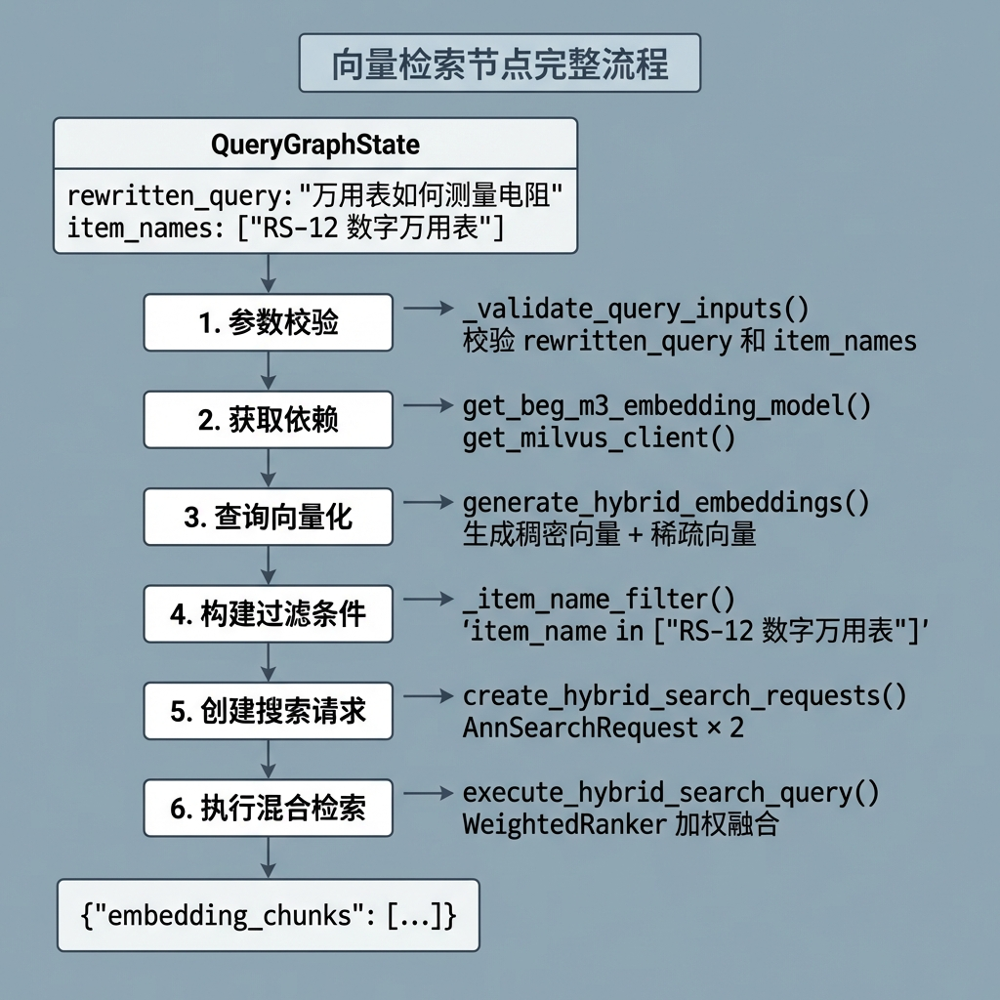
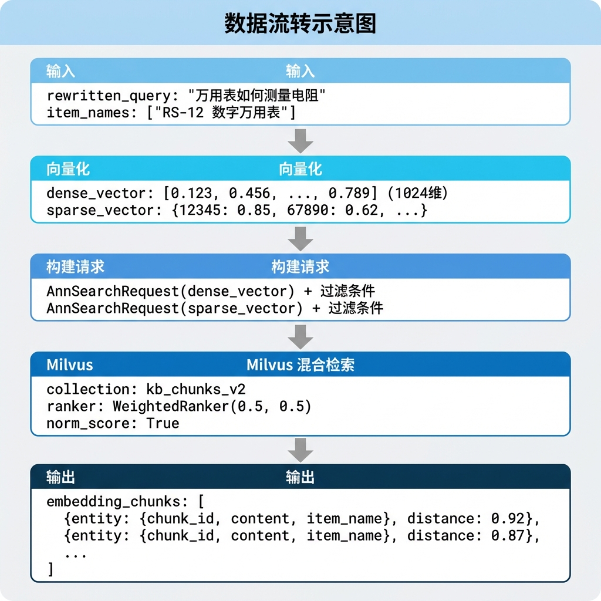
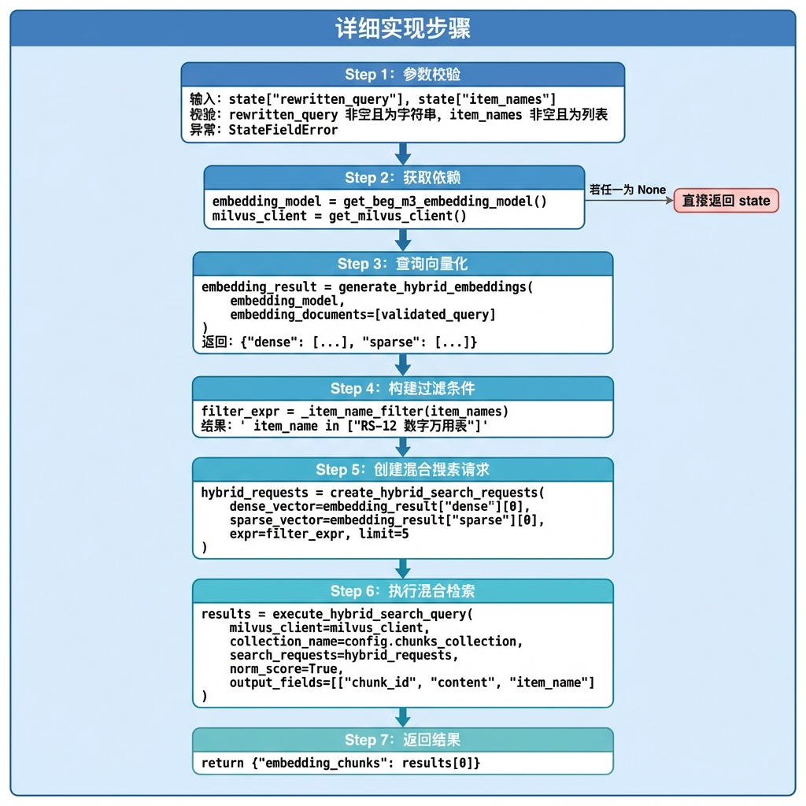
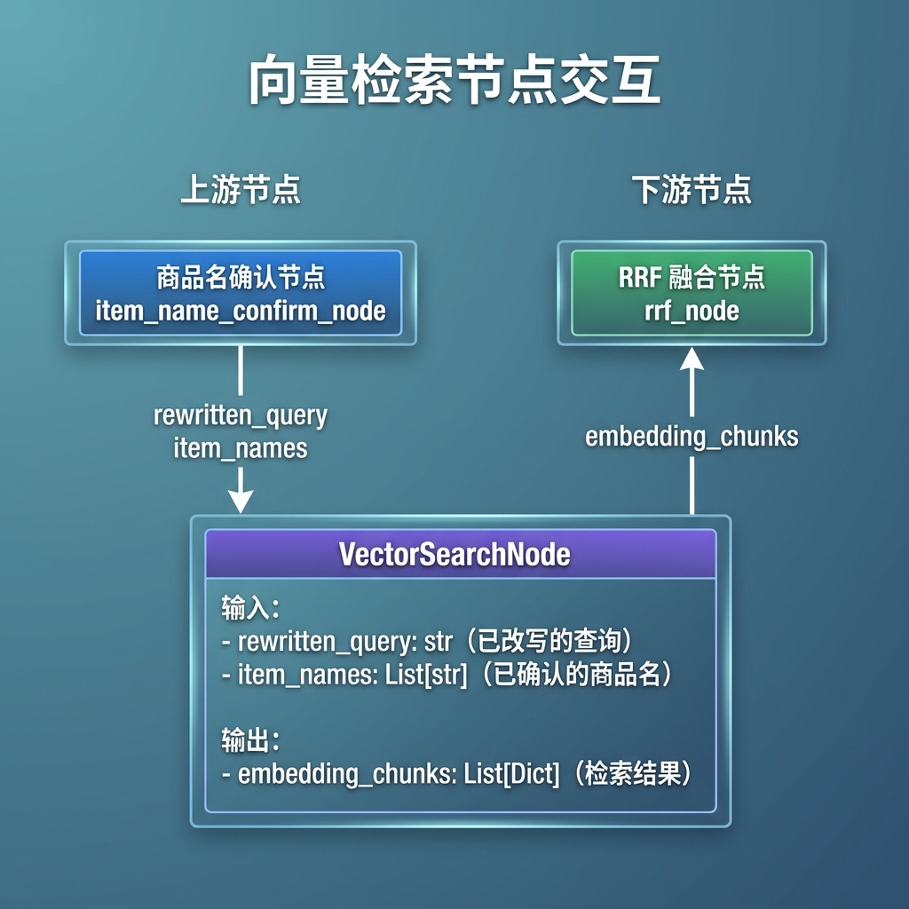

# 知识库查询 —— 向量检索节点

> 本文档详细介绍向量检索节点（vector_search_node）的设计与实现，该节点是多路并行检索中的核心检索通道，负责将用户查询向量化并在 Milvus 中执行混合搜索。

---

## 1. 任务目标

### 1.1 本章目标

通过本章学习，你将掌握：

1. **理解混合向量检索原理**：掌握稠密向量 + 稀疏向量的混合检索策略
2. **学会 BGE-M3 模型的使用**：生成同时包含稠密和稀疏表示的嵌入向量
3. **掌握 Milvus 混合搜索 API**：使用 AnnSearchRequest 和 WeightedRanker
4. **理解过滤表达式构建**：基于商品名称精准过滤检索结果
5. **实现可测试的检索节点**：通过 `if __name__ == "__main__"` 验证节点功能

### 1.2 涉及文件

```
knowledge/processor/query_process/
├── nodes/
│   └── vector_search_node.py   # 向量检索节点（本章重点）
├── state.py                    # 状态定义
├── base.py                     # 基类定义
└── exceptions.py               # 自定义异常

knowledge/utils/
├── bge_m3_embedding_util.py    # BGE-M3 嵌入工具
└── milvus_util.py              # Milvus 向量数据库工具
```

### 1.3 节点在流程中的位置


---

## 2. 核心概念扫盲

### 2.1 为什么需要混合检索？

传统的向量检索方式各有优缺点：

| 检索方式 | 优点 | 缺点 |
|----------|------|------|
| **稠密向量** | 语义理解强，支持同义词匹配 | 对专业术语、型号等精确匹配较弱 |
| **稀疏向量** | 精确匹配强，对关键词敏感 | 语义理解弱，无法处理同义词 |
| **混合检索** | 兼具两者优点 | 需要额外的融合策略 |

**示例对比：**

```
查询: "万用表怎么测电压"

稠密向量检索:
  ✓ "数字万用表电压测量方法"     (语义相似)
  ✓ "使用多用电表测量电势差"     (同义词匹配)
  ✗ "RS-12型万用表"             (缺少语义关联)

稀疏向量检索:
  ✓ "万用表测量电压的步骤"       (关键词匹配)
  ✓ "RS-12万用表电压档位说明"   (包含关键词)
  ✗ "数字仪表电势测定"           (无共同词汇)

混合检索:
  ✓ 同时召回以上所有相关结果
  ✓ 通过加权融合得到最优排序
```

### 2.2 BGE-M3 模型

**BGE-M3** 是北京智源人工智能研究院（BAAI）开发的多功能嵌入模型：

| 特性 | 说明 |
|------|------|
| **Multi-Linguality** | 支持 100+ 语言 |
| **Multi-Functionality** | 同时生成稠密和稀疏向量 |
| **Multi-Granularity** | 支持短文本和长文档 |

**输出结构：**

```python
embeddings = bge_m3_model(["查询文本"])
# embeddings = {
#     "dense": [[0.123, 0.456, ...]],      # 1024 维稠密向量
#     "sparse": <CSR 稀疏矩阵>              # 词汇表 ID → 权重
# }
```

### 2.3 稀疏向量表示

稀疏向量使用字典格式存储非零元素：

```python
sparse_vector = {
    12345: 0.85,   # 词汇表中第 12345 个词，权重 0.85
    67890: 0.62,   # 词汇表中第 67890 个词，权重 0.62
    ...
}
```

**特点：**

- 大部分维度为 0，只存储非零项
- 词汇表通常有 25 万+ 个词
- 需要归一化以保证检索效果

### 2.4 Milvus 混合搜索 API

Milvus 提供了原生的混合搜索支持：

```python
from pymilvus import AnnSearchRequest, WeightedRanker

# 1. 构建两路搜索请求
dense_req = AnnSearchRequest(
    data=[dense_vector],
    anns_field="dense_vector",
    param={"metric_type": "IP"},
    limit=10,
)

sparse_req = AnnSearchRequest(
    data=[sparse_vector],
    anns_field="sparse_vector",
    param={"metric_type": "IP"},
    limit=10,
)

# 2. 使用加权融合器
ranker = WeightedRanker(0.5, 0.5)  # 稠密:稀疏 = 0.5:0.5

# 3. 执行混合搜索
results = client.hybrid_search(
    collection_name="chunks",
    reqs=[dense_req, sparse_req],
    ranker=ranker,
    limit=5,
)
```

### 2.5 过滤表达式

Milvus 支持在向量检索时添加标量过滤条件：

```python
# 单值过滤
filter_expr = 'item_name == "万用表RS-12"'

# 多值过滤（IN 语法）
filter_expr = 'item_name in ["万用表RS-12", "示波器DS-100"]'

# 组合过滤
filter_expr = 'item_name == "万用表RS-12" and category == "电子仪器"'
```

---

## 3. 向量检索业务处理流程（总）

### 3.1 整体流程图



### 3.2 数据流转



---

## 4. 向量检索业务处理流程（分）

### 4.1 目标

实现一个能够：

1. 将用户查询转换为混合向量表示（稠密 + 稀疏）
2. 根据已确认的商品名称构建过滤条件
3. 在 Milvus 中执行高效的混合检索
4. 返回相关度最高的文档切片

### 4.2 需求分析

#### 4.2.1 功能需求

1. **参数校验**：验证 rewritten_query 和 item_names 的有效性
2. **查询向量化**：使用 BGE-M3 模型生成稠密和稀疏向量
3. **过滤表达式构建**：将商品名称列表转换为 Milvus 过滤语法
4. **混合搜索请求构建**：创建稠密和稀疏两路 AnnSearchRequest
5. **混合检索执行**：调用 Milvus hybrid_search API
6. **结果返回**：返回包含 chunk_id、content、item_name 的结果列表

#### 4.2.2 技术依赖

| 依赖 | 用途 |
|------|------|
| **BGE-M3** | 生成混合向量（稠密 + 稀疏） |
| **Milvus** | 向量数据库，支持混合检索 |
| **pymilvus** | Milvus Python SDK |

#### 4.2.3 配置参数

```python
# 检索配置
LIMIT = 5                              # 返回结果数
RANKER_WEIGHTS = (0.5, 0.5)           # 稠密:稀疏权重（默认）
OUTPUT_FIELDS = ["chunk_id", "content", "item_name"]  # 返回字段
COLLECTION_NAME = config.chunks_collection  # 向量集合名称
```

### 4.3 实现流程

#### 4.3.1 实现流程图



#### 4.3.2 具体实现步骤

##### Step 1: 参数校验

**目的：** 确保输入参数的有效性，避免后续处理出错。

**实现逻辑：**

1. 获取 `rewritten_query` 和 `item_names`
2. 检查 rewritten_query 是否为非空字符串
3. 检查 item_names 是否为非空列表
4. 校验失败时抛出自定义异常 `StateFieldError`

**代码片段：**

```python
def _validate_query_inputs(self, state: QueryGraphState) -> Tuple[str, List[str]]:
    """校验输入参数"""

    # 1. 获取 state 的 rewritten_query
    rewritten_query = state.get('rewritten_query', "")

    # 2. 获取 state 的 item_names
    item_names = state.get('item_names', "")

    # 3. 校验
    if not rewritten_query or not isinstance(rewritten_query, str):
        raise StateFieldError(
            node_name=self.name,
            field_name="rewritten_query",
            expected_type=str
        )

    if not item_names or not isinstance(item_names, list):
        raise StateFieldError(
            node_name=self.name,
            field_name="item_names",
            expected_type=list
        )

    # 4. 返回
    return rewritten_query, item_names
```

**StateFieldError 异常：**

```python
# knowledge/processor/query_process/exceptions.py

class StateFieldError(Exception):
    """状态字段错误异常"""

    def __init__(self, node_name: str, field_name: str, expected_type):
        self.node_name = node_name
        self.field_name = field_name
        self.expected_type = expected_type
        super().__init__(
            f"[{node_name}] 状态字段 '{field_name}' 错误，期望类型: {expected_type}"
        )
```

---

##### Step 2: 获取依赖

**目的：** 获取嵌入模型和 Milvus 客户端单例。

**代码片段：**

```python
# 2. 获取嵌入模型 & milvus 客户端
embedding_model = get_beg_m3_embedding_model()
milvus_client = get_milvus_client()

if embedding_model is None or milvus_client is None:
    return state  # 依赖获取失败，直接返回原状态
```

**单例模式说明：**

```python
# knowledge/utils/bge_m3_embedding_util.py

_bge_m3_model = None

def get_beg_m3_embedding_model():
    """获取 BGE-M3 模型单例"""
    global _bge_m3_model
    if _bge_m3_model is None:
        _bge_m3_model = BGEM3EmbeddingFunction(
            model_name="BAAI/bge-m3",
            device="cpu",
            use_fp16=False
        )
    return _bge_m3_model
```

---

##### Step 3: 查询向量化

**目的：** 使用 BGE-M3 模型将查询文本转换为稠密向量和稀疏向量。

**代码片段：**

```python
# 3. 对问题向量化(稀疏向量做了字典的处理)
embedding_result = generate_hybrid_embeddings(
    embedding_model,
    embedding_documents=[validated_query]
)

if not embedding_result:
    return state
```

**工具函数详解：**

```python
# knowledge/utils/bge_m3_embedding_util.py

def generate_hybrid_embeddings(
    embedding_model,
    embedding_documents: List[str]
) -> Dict[str, Any]:
    """
    为一组文本生成混合嵌入（稠密向量 + 稀疏向量）

    Args:
        embedding_model: BGE-M3 模型实例
        embedding_documents: 待嵌入的文本列表

    Returns:
        {
            "dense": [[...], ...],      # 稠密向量列表
            "sparse": [{...}, ...]      # 稀疏向量字典列表
        }
    """
    # 1. 调用模型推理
    raw_embeddings = embedding_model(embedding_documents)

    # 2. 转换稠密向量
    dense_vectors = [emb.tolist() for emb in raw_embeddings["dense"]]

    # 3. 提取并归一化稀疏向量
    sparse_vectors = _extract_sparse_vectors(raw_embeddings, len(embedding_documents))

    return {
        "dense": dense_vectors,
        "sparse": sparse_vectors,
    }


def _extract_sparse_vectors(raw_embeddings, text_count) -> List[Dict[int, float]]:
    """从 CSR 稀疏矩阵中提取稀疏向量"""

    sparse_matrix = raw_embeddings["sparse"]
    sparse_vectors = []

    for i in range(text_count):
        # CSR 矩阵按行存储，通过 indptr 定位每行的起止位置
        row_start = sparse_matrix.indptr[i]
        row_end = sparse_matrix.indptr[i + 1]

        # 提取该行的非零元素：{token_id: weight}
        sparse_dict = dict(zip(
            sparse_matrix.indices[row_start:row_end].tolist(),
            sparse_matrix.data[row_start:row_end].tolist(),
        ))

        # 归一化
        sparse_vectors.append(normalize_sparse_vector(sparse_dict))

    return sparse_vectors
```

---

##### Step 4: 构建过滤条件

**目的：** 将商品名称列表转换为 Milvus 的过滤表达式语法。

**代码片段：**

```python
def _item_name_filter(self, validate_item_names: List[str]) -> str:
    """
    构建商品名过滤表达式

    Args:
        validate_item_names: 已校验的商品名列表

    Returns:
        ' item_name in ["商品A", "商品B"]'
    """
    # 拼接引号包裹的商品名
    quoted = ", ".join(f'"{v}"' for v in validate_item_names)

    # 构建过滤表达式（注意前面有空格）
    return f" item_name in [{quoted}]"
```

**示例：**

```python
item_names = ["RS-12 数字万用表", "华为擎云L420"]
filter_expr = _item_name_filter(item_names)
# 结果: ' item_name in ["RS-12 数字万用表", "华为擎云L420"]'
```

---

##### Step 5: 创建混合搜索请求

**目的：** 为稠密向量和稀疏向量分别创建 AnnSearchRequest 对象。

**代码片段：**

```python
# 5. 创建混合搜索请求
hybrid_requests = create_hybrid_search_requests(
    dense_vector=embedding_result['dense'][0],
    sparse_vector=embedding_result['sparse'][0],
    expr=item_name_filter_expr,
    limit=5
)
```

**工具函数详解：**

```python
# knowledge/utils/milvus_util.py

def create_hybrid_search_requests(
    dense_vector: List[float],
    sparse_vector: Dict[int, float],
    expr: str = None,
    limit: int = 5
) -> List[AnnSearchRequest]:
    """
    创建混合检索请求

    Args:
        dense_vector: 稠密向量
        sparse_vector: 稀疏向量字典
        expr: 过滤表达式
        limit: 返回结果数

    Returns:
        [dense_request, sparse_request]
    """
    # 稠密向量搜索请求
    dense_request = AnnSearchRequest(
        data=[dense_vector],
        anns_field="dense_vector",
        param={"metric_type": "IP"},
        expr=expr,
        limit=limit,
    )

    # 稀疏向量搜索请求
    sparse_request = AnnSearchRequest(
        data=[sparse_vector],
        anns_field="sparse_vector",
        param={"metric_type": "IP"},
        expr=expr,
        limit=limit,
    )

    return [dense_request, sparse_request]
```

---

##### Step 6: 执行混合检索

**目的：** 调用 Milvus 的 hybrid_search API，融合两路检索结果。

**代码片段：**

```python
# 6. 执行混合搜索请求
reps = execute_hybrid_search_query(
    milvus_client=milvus_client,
    collection_name=self.config.chunks_collection,
    search_requests=hybrid_requests,
    norm_score=True,
    output_fields=["chunk_id", "content", "item_name"]
)

if not reps or not reps[0]:
    return state
```

**工具函数详解：**

```python
# knowledge/utils/milvus_util.py

def execute_hybrid_search_query(
    milvus_client,
    collection_name: str,
    search_requests: List[AnnSearchRequest],
    ranker_weights: Tuple[float, float] = (0.5, 0.5),
    norm_score: bool = False,
    output_fields: List[str] = None
) -> Optional[List]:
    """
    执行混合检索（稠密 + 稀疏加权融合）

    Args:
        milvus_client: Milvus 客户端
        collection_name: 集合名称
        search_requests: 搜索请求列表
        ranker_weights: 稠密和稀疏的权重
        norm_score: 是否归一化分数
        output_fields: 返回字段

    Returns:
        检索结果列表
    """
    if output_fields is None:
        output_fields = ["item_name"]

    try:
        # 创建加权融合器
        ranker = WeightedRanker(
            ranker_weights[0],  # 稠密权重
            ranker_weights[1],  # 稀疏权重
            norm_score=norm_score,
        )

        # 执行混合搜索
        results = milvus_client.hybrid_search(
            collection_name=collection_name,
            reqs=search_requests,
            ranker=ranker,
            limit=5,
            output_fields=output_fields,
        )

        logger.info(f"混合检索完成: collection={collection_name}, 命中={len(results[0])}")

        return results

    except Exception as e:
        logger.error(f"混合检索执行失败: {e}")
        return None
```

**WeightedRanker 工作原理：**

```
稠密检索结果:          稀疏检索结果:
Doc A: 0.9             Doc A: 0.7
Doc B: 0.8             Doc C: 0.9
Doc C: 0.6             Doc B: 0.5

融合公式（norm_score=True 时先归一化）:
final_score = 0.5 * dense_score + 0.5 * sparse_score

融合结果:
Doc A: 0.5 * 0.9 + 0.5 * 0.7 = 0.80
Doc C: 0.5 * 0.6 + 0.5 * 0.9 = 0.75
Doc B: 0.5 * 0.8 + 0.5 * 0.5 = 0.65

最终排序: Doc A > Doc C > Doc B
```

---

##### Step 7: 返回结果

**目的：** 将检索结果写入图状态，供后续节点使用。

**代码片段：**

```python
# 7. 更新 state 的 embedding_chunks
return {"embedding_chunks": reps[0]}
```

**返回数据结构：**

```python
{
    "embedding_chunks": [
        {
            "entity": {
                "chunk_id": 12345,
                "content": "万用表测量电压时，首先将旋钮转到...",
                "item_name": "RS-12 数字万用表"
            },
            "distance": 0.9234
        },
        {
            "entity": {
                "chunk_id": 12346,
                "content": "使用直流电压档测量时，需要注意...",
                "item_name": "RS-12 数字万用表"
            },
            "distance": 0.8756
        },
        # ...
    ]
}
```

### 4.4 代码实现

以下是完整的节点实现代码：

```python
# knowledge/processor/query_process/nodes/vector_search_node.py

"""向量检索节点

对用户查询进行向量化，在 Milvus 中执行混合搜索（稠密 + 稀疏），返回相关切片。
"""

import json
import logging
from typing import Dict, Any, List, Tuple, Union

from knowledge.processor.query_process.state import QueryGraphState
from knowledge.processor.query_process.base import BaseNode
from knowledge.processor.query_process.exceptions import StateFieldError
from knowledge.utils.bge_m3_embedding_util import (
    get_beg_m3_embedding_model,
    generate_hybrid_embeddings
)
from knowledge.utils.milvus_util import (
    get_milvus_client,
    create_hybrid_search_requests,
    execute_hybrid_search_query
)

logging.basicConfig(level=logging.INFO)
logger = logging.getLogger(__name__)


class VectorSearchNode(BaseNode):
    """向量检索节点

    流程: 参数校验 → 获取依赖 → 查询向量化 → 构建过滤 → 构建请求 → 执行检索 → 返回结果
    """
    name = "vector_search_node"

    def process(self, state: QueryGraphState) -> Union[QueryGraphState, Dict[str, Any]]:
        """执行向量检索

        Args:
            state: 需包含 rewritten_query 和 item_names

        Returns:
            {"embedding_chunks": [...]} 搜索结果列表
        """
        # 1. 参数校验
        validated_query, validate_item_names = self._validate_query_inputs(state)

        # 2. 获取嵌入模型 & milvus 客户端
        embedding_model = get_beg_m3_embedding_model()
        milvus_client = get_milvus_client()
        if embedding_model is None or milvus_client is None:
            return state

        # 3. 对问题向量化(稀疏向量做了字典的处理)
        embedding_result = generate_hybrid_embeddings(
            embedding_model,
            embedding_documents=[validated_query]
        )
        if not embedding_result:
            return state

        # 4. 构建过滤表达式
        item_name_filter_expr = self._item_name_filter(validate_item_names)

        # 5. 创建混合搜索请求
        hybrid_requests = create_hybrid_search_requests(
            dense_vector=embedding_result['dense'][0],
            sparse_vector=embedding_result['sparse'][0],
            expr=item_name_filter_expr,
            limit=5
        )

        # 6. 执行混合搜索请求
        reps = execute_hybrid_search_query(
            milvus_client=milvus_client,
            collection_name=self.config.chunks_collection,
            search_requests=hybrid_requests,
            norm_score=True,
            output_fields=["chunk_id", "content", "item_name"]
        )
        if not reps or not reps[0]:
            return state

        # 7. 更新 state 的 embedding_chunks
        return {"embedding_chunks": reps[0]}

    def _validate_query_inputs(self, state: QueryGraphState) -> Tuple[str, List[str]]:
        """校验输入参数"""
        # 1. 获取 state 的 rewritten_query
        rewritten_query = state.get('rewritten_query', "")

        # 2. 获取 state 的 item_names
        item_names = state.get('item_names', "")

        # 3. 校验
        if not rewritten_query or not isinstance(rewritten_query, str):
            raise StateFieldError(
                node_name=self.name,
                field_name="rewritten_query",
                expected_type=str
            )

        if not item_names or not isinstance(item_names, list):
            raise StateFieldError(
                node_name=self.name,
                field_name="item_names",
                expected_type=list
            )

        # 4. 返回
        return rewritten_query, item_names

    def _item_name_filter(self, validate_item_names: List[str]) -> str:
        """构建商品名过滤表达式"""
        quoted = ", ".join(f'"{v}"' for v in validate_item_names)
        return f" item_name in [{quoted}]"


# ================================================================== #
#                        测试入口                                   #
# ================================================================== #

if __name__ == '__main__':
    state = {
        "rewritten_query": "万用表如何测量电阻",
        "item_names": ["RS-12 数字万用表"]
    }

    vector_search = VectorSearchNode()
    result = vector_search.process(state)

    for r in result.get('embedding_chunks'):
        print(json.dumps(r, ensure_ascii=False, indent=2))
```

---

## 5. 测试入口

### 5.1 测试代码

```python
if __name__ == '__main__':
    state = {
        "rewritten_query": "万用表如何测量电阻",
        "item_names": ["RS-12 数字万用表"]
    }

    vector_search = VectorSearchNode()
    result = vector_search.process(state)

    for r in result.get('embedding_chunks'):
        print(json.dumps(r, ensure_ascii=False, indent=2))
```

### 5.2 运行测试

```bash
# 进入项目目录
cd knowledge

# 激活虚拟环境
source .venv/bin/activate  # Linux/Mac
# 或
.venv\Scripts\activate     # Windows

# 运行测试
python -m knowledge.processor.query_process.nodes.vector_search_node
```

### 5.3 预期输出

```json
{
  "entity": {
    "chunk_id": 12345,
    "content": "万用表测量电阻时，首先将旋钮转到电阻档（Ω），然后...",
    "item_name": "RS-12 数字万用表"
  },
  "distance": 0.9234
}
{
  "entity": {
    "chunk_id": 12346,
    "content": "使用万用表测量电阻前，需要确保被测电路断电...",
    "item_name": "RS-12 数字万用表"
  },
  "distance": 0.8756
}
...
```

---

## 6. 总结

### 6.1 节点功能概览

| 功能 | 说明 |
|------|------|
| **参数校验** | 验证 rewritten_query 和 item_names 的有效性 |
| **查询向量化** | 使用 BGE-M3 生成稠密向量（1024 维）和稀疏向量 |
| **过滤表达式构建** | 将商品名称列表转换为 Milvus IN 语法 |
| **混合搜索请求** | 同时构建稠密和稀疏两路 AnnSearchRequest |
| **加权融合** | 使用 WeightedRanker 融合两路结果 |
| **结果返回** | 返回 chunk_id、content、item_name、distance |

### 6.2 节点设计要点

**1. 混合检索的优势**

```
稠密向量: 语义理解强，捕捉同义词、上下文关系
稀疏向量: 精确匹配强，捕捉关键词、专业术语

混合检索 = 语义召回 + 关键词召回 = 更高的召回率和精度
```

**2. 单例模式的资源管理**

```python
# BGE-M3 模型单例
_bge_m3_model = None

def get_beg_m3_embedding_model():
    global _bge_m3_model
    if _bge_m3_model is None:
        _bge_m3_model = BGEM3EmbeddingFunction(...)
    return _bge_m3_model
```

- 避免重复加载模型（模型加载耗时约 10-30 秒）
- 全局共享，节省内存

**3. 参数校验的防御性设计**

```python
def _validate_query_inputs(self, state):
    # 校验失败抛出明确异常
    if not rewritten_query or not isinstance(rewritten_query, str):
        raise StateFieldError(...)
```

- 及早发现输入问题
- 异常信息包含节点名、字段名、期望类型

**4. 返回值的精简设计**

```python
return {"embedding_chunks": reps[0]}
```

- 只返回需要更新的字段
- LangGraph 会自动合并到完整状态中
- 避免覆盖其他节点写入的字段

### 6.3 节点交互图

