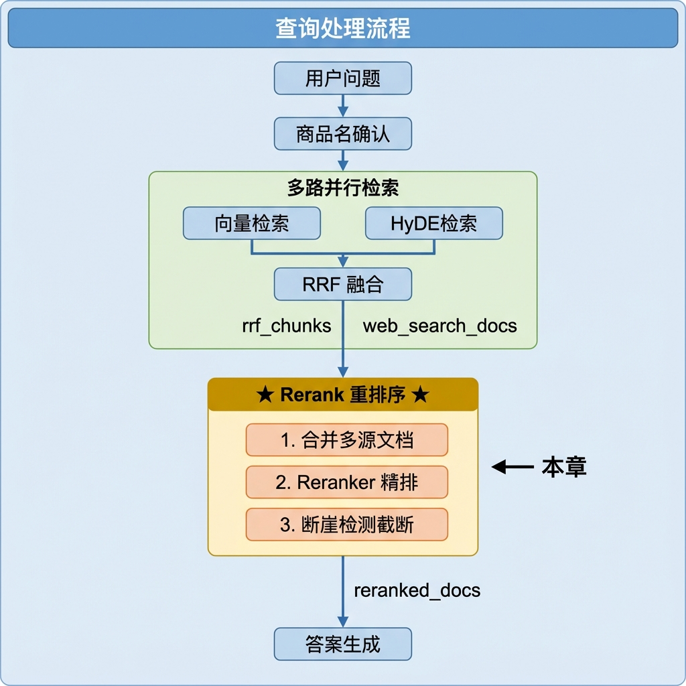
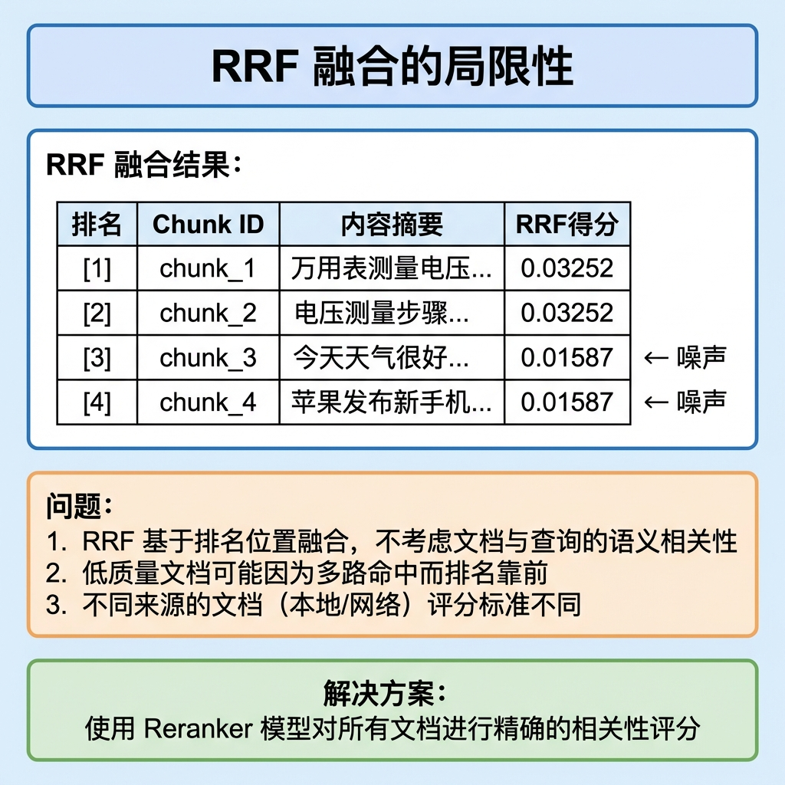
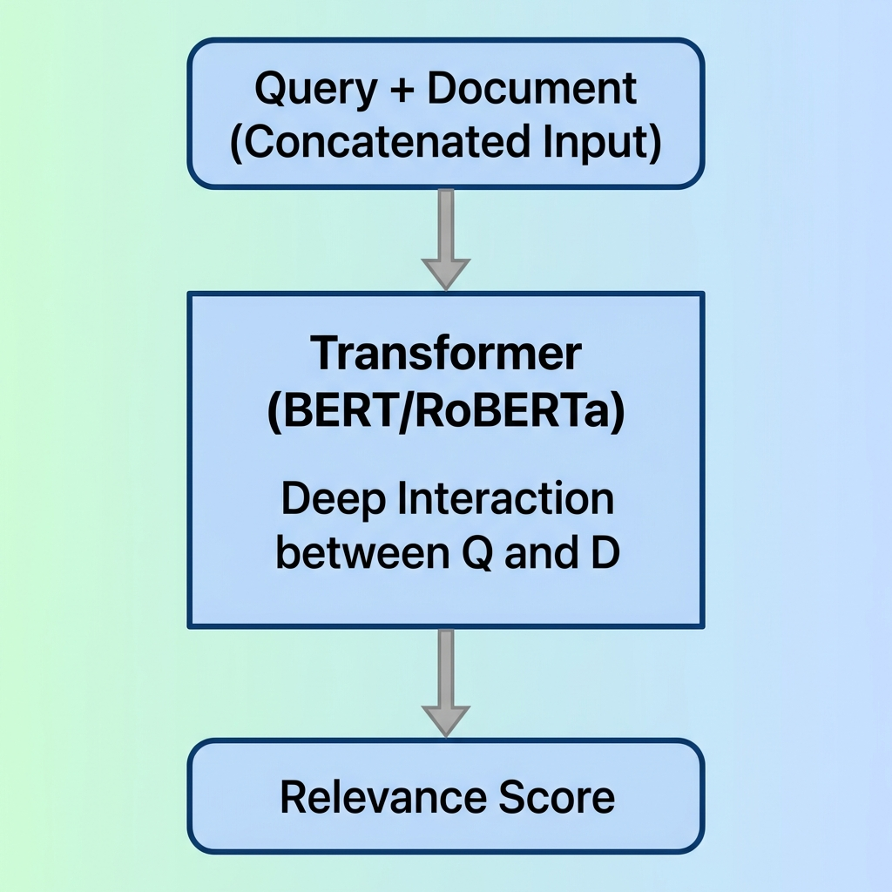
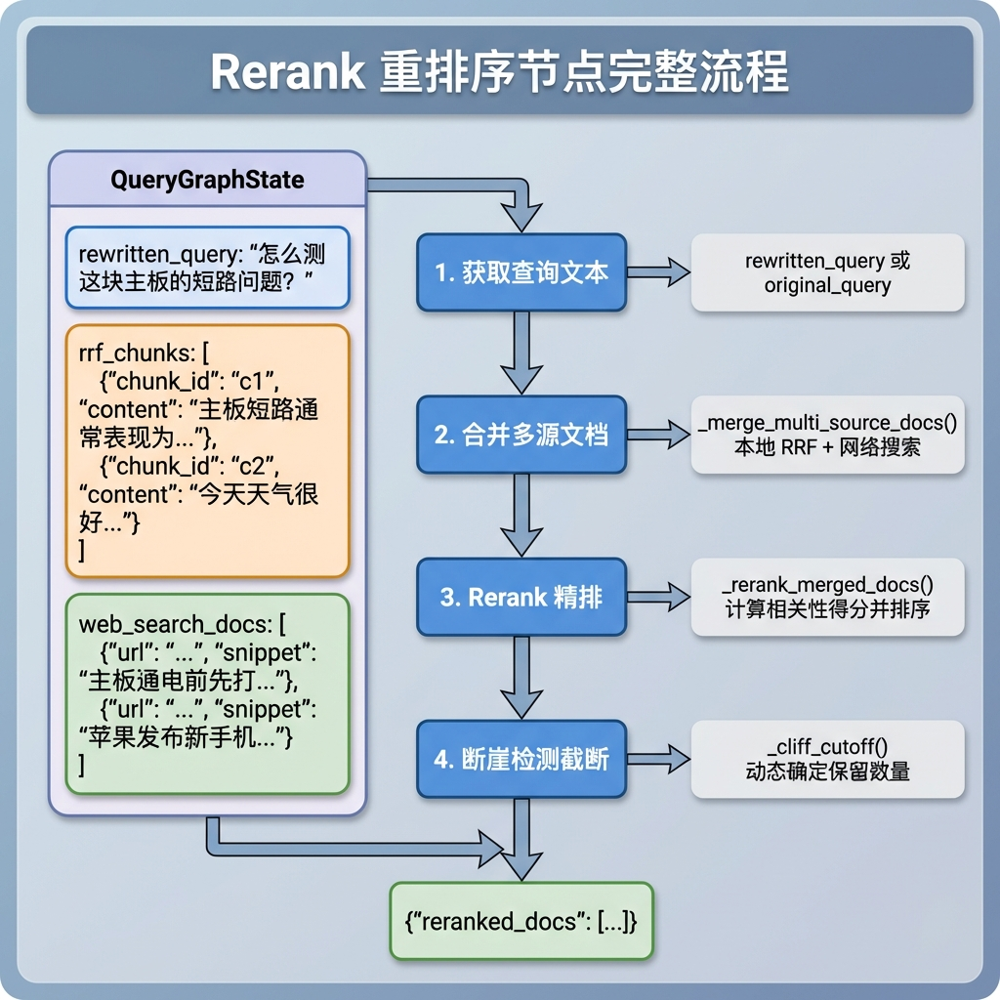
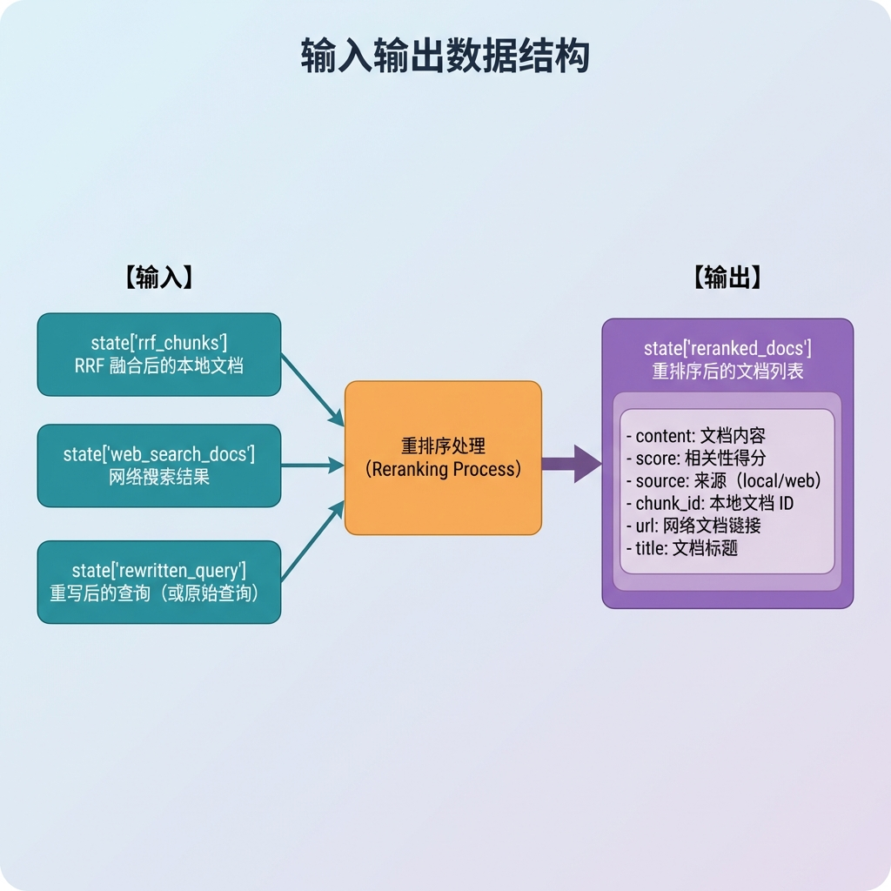
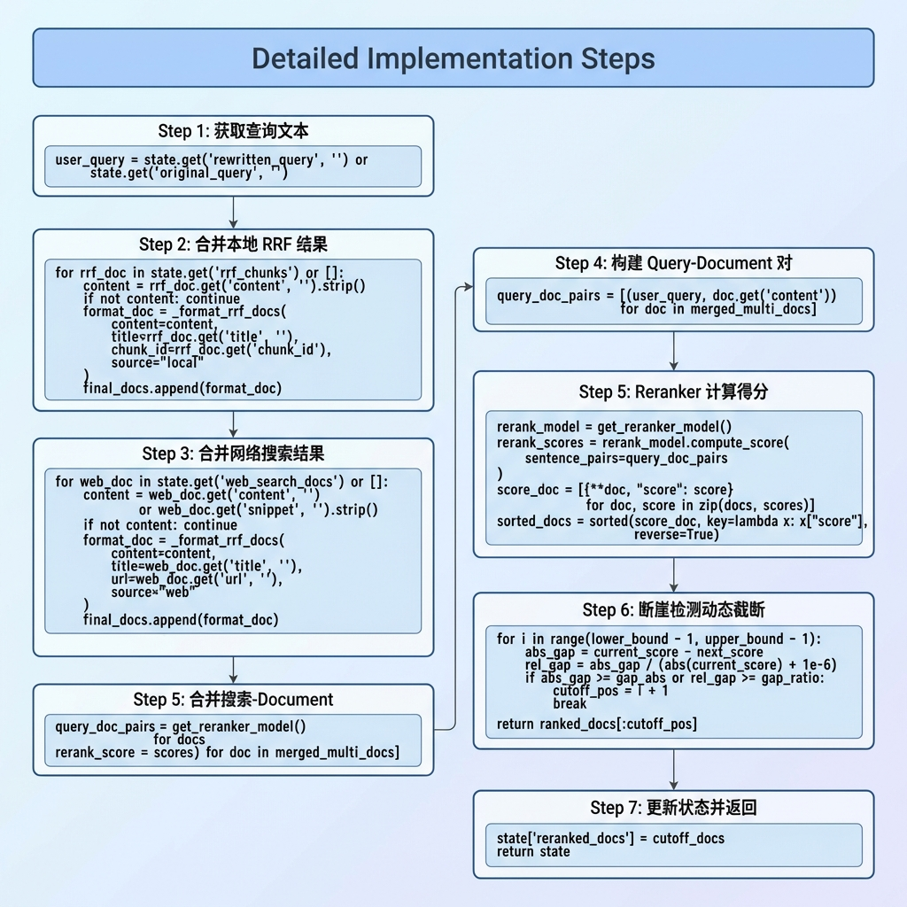
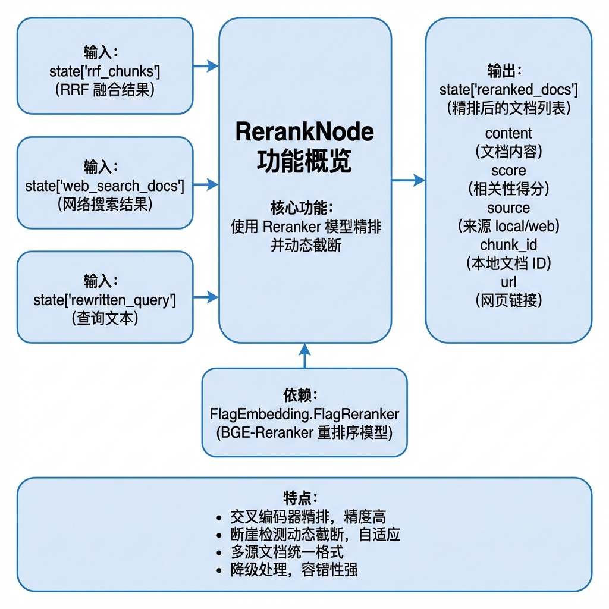
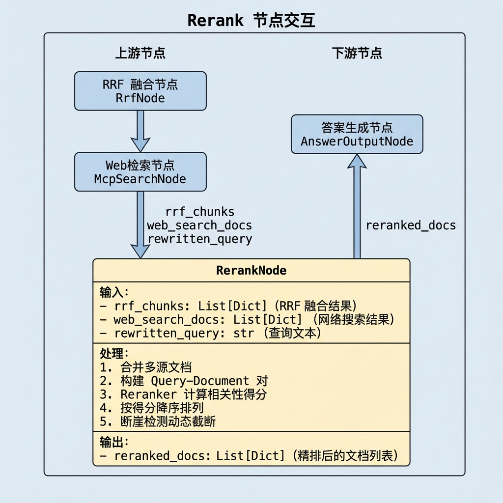

# 知识库查询 —— Rerank 重排序节点

> 本文档详细介绍 Rerank 重排序节点（rerank_node）的设计与实现，该节点使用 Reranker 模型对 RRF 融合结果和网络搜索结果进行精排，并通过断崖检测算法实现动态 TopK 截断。

---

## 1. 任务目标

### 1.1 本章目标

通过本章学习，你将掌握：

1. **理解 Reranker 模型原理**：掌握交叉编码器与双塔模型的区别
2. **学会 BGE-Reranker 模型的使用**：使用 FlagReranker 计算相关性得分
3. **理解断崖检测算法**：实现动态 TopK 截断
4. **掌握多源文档格式统一**：合并本地 RRF 结果和网络搜索结果
5. **实现可测试的重排序节点**：通过 `if __name__ == "__main__"` 验证节点功能

### 1.2 涉及文件

```
knowledge/processor/query_process/
├── nodes/
│   └── rerank_node.py            # Rerank 重排序节点（本章重点）
├── state.py                       # 状态定义
├── base.py                        # 基类定义
└── config.py                      # 配置参数

knowledge/utils/
└── bge_rerank_util.py             # BGE-Reranker 模型工具
```

### 1.3 节点在流程中的位置



---

## 2. 核心概念扫盲

### 2.1 为什么需要重排序？

RRF 融合虽然合并了多路检索结果，但存在局限性：



**重排序的作用：**
- 使用专门的相关性模型进行精排
- 统一评估所有来源的文档（本地 + 网络）
- 过滤低质量文档，提高答案生成质量

### 2.2 双塔模型 vs 交叉编码器

检索系统中有两种主流的文本匹配架构：

#### 双塔模型（Bi-Encoder）


**特点：**
- Query 和 Document 独立编码
- Document 向量可预计算存储
- 速度快，适合召回阶段
- 交互信息有限，精度一般

#### 交叉编码器（Cross-Encoder）



**特点：**
- Query 和 Document 联合编码
- 充分捕获交互信息
- 精度高，适合精排阶段
- 速度慢，无法预计算

**Reranker 模型就是交叉编码器！**

### 2.3 BGE-Reranker 模型

我们使用的 **BGE-Reranker-Large** 是智源研究院开源的中英双语重排序模型：

```python
from FlagEmbedding import FlagReranker

reranker = FlagReranker(
    model_name_or_path="BAAI/bge-reranker-large",
    device="cuda",      # GPU 加速
    use_fp16=True       # 半精度推理
)

# 计算相关性得分
pairs = [
    ["什么是万用表？", "万用表是一种测量电压、电流、电阻的仪器"],
    ["什么是万用表？", "今天天气很好"]
]
scores = reranker.compute_score(pairs)
# 输出: [0.9234, 0.0156]  高分 = 高相关
```

**模型特性：**

| 特性 | 说明 |
|------|------|
| 基座模型 | XLM-RoBERTa-Large |
| 参数量 | 560M |
| 输入长度 | 最大 512 tokens |
| 输出 | 相关性分数（越高越相关） |
| 支持语言 | 中英双语 |

### 2.4 断崖检测算法

重排序后需要决定保留多少文档。传统做法是固定 TopK，但这不够灵活：

```
固定 TopK=5 的问题：

情况 1：前 3 篇高度相关，后 2 篇噪声
得分: [0.95, 0.92, 0.88, 0.12, 0.08]
                        ↑
                  应该在这里截断

情况 2：前 7 篇都相关
得分: [0.95, 0.91, 0.87, 0.83, 0.79, 0.75, 0.71]
                              ↑
                        固定截断会丢失有价值内容
```

**断崖检测的思路：** 寻找得分"断崖式下跌"的位置，在那里截断。

```
断崖检测示例：

得分: [0.95, 0.92, 0.88, 0.12, 0.08]
差值:      0.03   0.04   0.76   0.04
                         ↑
                   断崖！在此截断

结果: 保留前 3 篇
```

**断崖检测公式：**

```python
# 相邻得分差
abs_gap = current_score - next_score

# 相对下降比例
rel_gap = abs_gap / (abs(current_score) + 1e-6)

# 满足任一条件即为断崖
if abs_gap >= gap_abs or rel_gap >= gap_ratio:
    cutoff_pos = i + 1
```

**参数说明：**
- `gap_abs`：绝对差值阈值（默认 0.5）
- `gap_ratio`：相对比例阈值（默认 0.25）
- `min_top_k`：最少保留数量（默认 3）
- `max_top_k`：最多保留数量（默认 10）

---

## 3. 重排序业务处理流程（总）

### 3.1 整体流程图



### 3.2 节点输入输出



---

## 4. 重排序业务处理流程（分）

### 4.1 目标

实现一个重排序节点，将 RRF 融合结果和网络搜索结果统一精排，并通过断崖检测动态筛选最相关的文档。

### 4.2 需求分析

| 需求项 | 说明 |
|--------|------|
| **多源合并** | 合并本地 RRF 结果和网络搜索结果 |
| **格式统一** | 不同来源的文档统一为相同结构 |
| **精确排序** | 使用 Reranker 模型计算相关性得分 |
| **动态截断** | 通过断崖检测自动确定保留数量 |
| **降级处理** | Reranker 失败时返回原序 |
| **来源追溯** | 保留文档来源标识（local/web） |

### 4.3 实现流程

#### 4.3.1 实现流程图



#### 4.3.2 具体实现步骤

##### Step 1: 获取查询文本

**目的：** 从状态中获取用于重排序的查询文本。

**代码片段：**

```python
def process(self, state: QueryGraphState) -> QueryGraphState:
    # 1. 获取 query
    user_query = state.get('rewritten_query', '') or state.get('original_query', '')
```

**为什么优先使用 rewritten_query？**

```
原始查询: "这块主板怎么修？"
重写查询: "主板维修方法和常见故障排查步骤"

重写后的查询更完整，与文档的匹配效果更好。
```

---

##### Step 2: 合并本地 RRF 结果

**目的：** 遍历 RRF 融合结果，转换为统一格式。

**代码片段：**

```python
def _merge_multi_source_docs(self, state: QueryGraphState) -> List[Dict[str, Any]]:
    final_docs = []

    # 1. 获取本地 RRF 的文档
    for rrf_doc in (state.get('rrf_chunks') or []):
        # 1.1 判断当前文档对象类型
        if not isinstance(rrf_doc, dict):
            continue

        # 1.2 获取文档的内容
        content = rrf_doc.get('content', '').strip()

        # 1.3 判断文档内容
        if not content:
            continue

        title = rrf_doc.get('title', '').strip()
        chunk_id = rrf_doc.get('chunk_id')

        # 1.4 格式化本地 RRF 的 chunk 结构
        format_rrf_doc = self._format_rrf_docs(
            content=content,
            title=title,
            chunk_id=chunk_id,
            source="local"
        )
        final_docs.append(format_rrf_doc)

    # ...

    self.logger.info(f"收集到准备进行 Rerank 精排的文档 {len(final_docs)}")
    return final_docs
```

**输入数据示例：**

```python
rrf_chunks = [
    {
        "chunk_id": "chunk_001",
        "title": "万用表使用手册",
        "content": "测量电压时，将旋钮转到V档位..."
    },
    {
        "chunk_id": "chunk_002",
        "title": "电子元件检测",
        "content": "使用蜂鸣档可以快速检测短路..."
    }
]
```

---

##### Step 3: 合并网络搜索结果

**目的：** 遍历网络搜索结果，同样转换为统一格式。

**代码片段：**

```python
# 2. 获取 web 远程的文档
for web_doc in (state.get('web_search_docs') or []):
    # 2.1 判断当前文档对象类型
    if not isinstance(web_doc, dict):
        continue

    # 2.2 获取文档内容(snippet)
    content = web_doc.get('content', '') or web_doc.get('snippet', '').strip()

    # 2.3 判断内容
    if not content:
        continue

    title = web_doc.get('title', '').strip()
    url = web_doc.get('url', '').strip()

    # 2.4 格式化 web 的文档结构
    format_web_doc = self._format_rrf_docs(
        content=content,
        title=title,
        url=url,
        source="web"
    )
    final_docs.append(format_web_doc)
```

**统一文档结构：**

```python
def _format_rrf_docs(
    self, content: str, title: str = "",
    chunk_id=None, url: str = "", source: str = ""
) -> Dict[str, Any]:
    """构建统一的文档结构"""
    return {
        "content": content,      # 文档内容（必填）
        "title": title,          # 标题
        "chunk_id": chunk_id,    # 本地文档 ID
        "url": url,              # 网页链接（仅 web）
        "source": source         # 来源: local / web
    }
```

---

##### Step 4 & 5: Reranker 计算得分

**目的：** 构建 Query-Document 对，调用 Reranker 模型计算相关性得分。

**代码片段：**

```python
def _rerank_merged_docs(
    self, user_query: str, merged_multi_docs: List[Dict[str, Any]]
) -> List[Dict[str, Any]]:
    """
    使用 Reranker 模型对文档进行精排

    Args:
        user_query: 用户输出的查询问题
        merged_multi_docs: 不同来源合并之后的文档

    Returns:
        带有 score 字段的文档列表，按得分降序排列
    """
    # 1. 判断合并后的多源文档是否存在
    if not merged_multi_docs:
        return []

    # 2. 获取 reranker 模型
    rerank_model = get_reranker_model()
    if rerank_model is None:
        self.logger.error("重排序模型获取失败")
        return []

    # 3. 构建 Q->D 的 pair 对 [(Q, D1[content]), (Q, D2:[content]), ...]
    query_doc_content_pairs = [
        (user_query, doc.get('content'))
        for doc in merged_multi_docs
    ]

    try:
        # 4. 计算相关性得分
        rerank_scores = rerank_model.compute_score(
            sentence_pairs=query_doc_content_pairs
        )

        # 5. 映射分数和文档
        score_doc = [
            {**doc, "score": score}
            for doc, score in zip(merged_multi_docs, rerank_scores)
        ]

        # 6. 排序并返回
        sorted_score_docs = sorted(
            score_doc,
            key=lambda x: x["score"],
            reverse=True
        )

        return sorted_score_docs

    except Exception as e:
        self.logger.error(f"Rerank 重排序失败: {str(e)}")
        return [{**merged_multi_docs, "score": None}]
```

**得分计算过程：**

```
Query: "怎么测这块主板的短路问题？"

文档 1: "主板短路通常表现为通电后风扇转一下就停..."
        → score = 0.9156 (高度相关)

文档 2: "主板通电前先打各主供电电感的对地阻值..."
        → score = 0.8823 (相关)

文档 3: "测量电压时，将旋钮转到V档位..."
        → score = 0.4521 (部分相关)

文档 4: "苹果发布新款手机..."
        → score = 0.0234 (不相关)
```

---

##### Step 6: 断崖检测动态截断

**目的：** 从 min_top_k 位置开始检测得分断崖，动态确定保留数量。

**代码片段：**

```python
def _cliff_cutoff(
    self, ranked_docs: List[Dict[str, Any]],
) -> List[Dict[str, Any]]:
    """断崖检测截断：相邻得分差距超过阈值时截断。"""
    if not ranked_docs:
        return []

    upper_bound = min(self.config.rerank_max_top_k, len(ranked_docs))
    lower_bound = min(self.config.rerank_min_top_k, upper_bound)

    cutoff_pos = upper_bound  # 默认取最大值

    for i in range(lower_bound - 1, upper_bound - 1):
        current_score = ranked_docs[i].get("score")
        next_score = ranked_docs[i + 1].get("score")

        if current_score is None or next_score is None:
            continue

        abs_gap = current_score - next_score  # 绝对差值
        rel_gap = abs_gap / (abs(current_score) + 1e-6)  # 相对比例

        # 发现断崖，立即截断
        if abs_gap >= self.config.rerank_gap_abs or rel_gap >= self.config.rerank_gap_ratio:
            cutoff_pos = i + 1
            self.logger.debug(
                f"断崖检测: 位置 {i + 1}, abs_gap={abs_gap:.4f}, rel_gap={rel_gap:.4f}"
            )
            break

    return ranked_docs[:cutoff_pos]
```

**断崖检测示例：**

```
配置: gap_abs=0.5, gap_ratio=0.25, min_top_k=3, max_top_k=10

排序后得分: [0.92, 0.87, 0.45, 0.08, 0.02]
位置:        [1]   [2]   [3]   [4]   [5]

检测过程（从位置 3 开始）:
  位置 3→4: abs_gap = 0.45 - 0.08 = 0.37
            rel_gap = 0.37 / 0.45 = 0.82 (> 0.25)
            → 发现断崖！截断在位置 3

结果: 保留前 3 篇文档
```

**为什么需要两个阈值？**

```
场景 1：高分区间断崖
  得分: [0.95, 0.92, 0.40, ...]
  abs_gap = 0.52 > gap_abs=0.5  ✓ 触发截断

场景 2：低分区间断崖
  得分: [0.30, 0.28, 0.08, ...]
  abs_gap = 0.20 < gap_abs=0.5  ✗
  rel_gap = 0.20/0.28 = 0.71 > gap_ratio=0.25  ✓ 触发截断
```

---

##### Step 7: 更新状态并返回

**目的：** 将融合结果写入状态。

**代码片段：**

```python
# 4. 动态 Top_K 截取(断崖检测)
cutoff_docs = self._cliff_cutoff(reranked_docs)

state['reranked_docs'] = cutoff_docs

return state
```

### 4.4 代码实现

以下是完整的节点实现代码：

```python
# knowledge/processor/query_process/nodes/rerank_node.py

"""Rerank 重排序节点

使用 Reranker 模型对 RRF 融合结果和网络搜索结果进行重排序，
并通过断崖检测实现动态 TopK 截断。
"""

from typing import Dict, Any, List

from knowledge.processor.query_process.state import QueryGraphState
from knowledge.processor.query_process.base import BaseNode, setup_logging
from knowledge.utils.bge_rerank_util import get_reranker_model


class RerankNode(BaseNode):
    """Rerank 重排序节点

    流程: 合并多源文档 → Reranker 计算相关性 → 断崖检测动态截断
    """
    name = "rerank_node"

    def process(self, state: QueryGraphState) -> QueryGraphState:
        """执行重排序

        Args:
            state: 需包含 rrf_chunks、web_search_docs、rewritten_query

        Returns:
            更新后的 state，包含 reranked_docs
        """
        # 1. 获取 query
        user_query = state.get('rewritten_query', '') or state.get('original_query', '')

        # 2. 合并多源文档
        merged_multi_docs: List[Dict[str, Any]] = self._merge_multi_source_docs(state)

        # 3. Rerank 精排(精排打分)
        reranked_docs: List[Dict[str, Any]] = self._rerank_merged_docs(user_query, merged_multi_docs)

        # 4. 动态 Top_K 截取(断崖检测)
        cutoff_docs = self._cliff_cutoff(reranked_docs)

        state['reranked_docs'] = cutoff_docs

        return state

    def _cliff_cutoff(
        self, ranked_docs: List[Dict[str, Any]],
    ) -> List[Dict[str, Any]]:
        """断崖检测截断：相邻得分差距超过阈值时截断。"""
        if not ranked_docs:
            return []

        upper_bound = min(self.config.rerank_max_top_k, len(ranked_docs))
        lower_bound = min(self.config.rerank_min_top_k, upper_bound)

        cutoff_pos = upper_bound
        for i in range(lower_bound - 1, upper_bound - 1):
            current_score = ranked_docs[i].get("score")
            next_score = ranked_docs[i + 1].get("score")

            if current_score is None or next_score is None:
                continue

            abs_gap = current_score - next_score
            rel_gap = abs_gap / (abs(current_score) + 1e-6)

            if abs_gap >= self.config.rerank_gap_abs or rel_gap >= self.config.rerank_gap_ratio:
                cutoff_pos = i + 1
                self.logger.debug(
                    f"断崖检测: 位置 {i + 1}, abs_gap={abs_gap:.4f}, rel_gap={rel_gap:.4f}"
                )
                break

        return ranked_docs[:cutoff_pos]

    def _merge_multi_source_docs(self, state: QueryGraphState) -> List[Dict[str, Any]]:
        """合并本地 RRF 结果和网络搜索结果为统一格式"""
        final_docs = []

        # 1. 获取本地 RRF 的文档
        for rrf_doc in (state.get('rrf_chunks') or []):
            if not isinstance(rrf_doc, dict):
                continue

            content = rrf_doc.get('content', '').strip()
            if not content:
                continue

            title = rrf_doc.get('title', '').strip()
            chunk_id = rrf_doc.get('chunk_id')

            format_rrf_doc = self._format_rrf_docs(
                content=content,
                title=title,
                chunk_id=chunk_id,
                source="local"
            )
            final_docs.append(format_rrf_doc)

        # 2. 获取 web 远程的文档
        for web_doc in (state.get('web_search_docs') or []):
            if not isinstance(web_doc, dict):
                continue

            content = web_doc.get('content', '') or web_doc.get('snippet', '').strip()
            if not content:
                continue

            title = web_doc.get('title', '').strip()
            url = web_doc.get('url', '').strip()

            format_web_doc = self._format_rrf_docs(
                content=content,
                title=title,
                url=url,
                source="web"
            )
            final_docs.append(format_web_doc)

        self.logger.info(f"收集到准备进行 Rerank 精排的文档 {len(final_docs)}")

        return final_docs

    def _format_rrf_docs(
        self, content: str, title: str = "",
        chunk_id=None, url: str = "", source: str = ""
    ) -> Dict[str, Any]:
        """构建统一的文档结构"""
        return {
            "content": content,
            "title": title,
            "chunk_id": chunk_id,
            "url": url,
            "source": source
        }

    def _rerank_merged_docs(
        self, user_query: str, merged_multi_docs: List[Dict[str, Any]]
    ) -> List[Dict[str, Any]]:
        """使用 Reranker 模型对文档进行精排"""
        if not merged_multi_docs:
            return []

        rerank_model = get_reranker_model()
        if rerank_model is None:
            self.logger.error("重排序模型获取失败")
            return []

        query_doc_content_pairs = [
            (user_query, doc.get('content'))
            for doc in merged_multi_docs
        ]

        try:
            rerank_scores = rerank_model.compute_score(
                sentence_pairs=query_doc_content_pairs
            )

            score_doc = [
                {**doc, "score": score}
                for doc, score in zip(merged_multi_docs, rerank_scores)
            ]

            sorted_score_docs = sorted(
                score_doc,
                key=lambda x: x["score"],
                reverse=True
            )

            return sorted_score_docs

        except Exception as e:
            self.logger.error(f"Rerank 重排序失败: {str(e)}")
            return [{**merged_multi_docs, "score": None}]


# ================================================================== #
#                        测试入口                                   #
# ================================================================== #

if __name__ == "__main__":
    from dotenv import load_dotenv

    load_dotenv()
    setup_logging()

    print("=" * 60)
    print("开始测试: 重排序节点 (RerankNode)")
    print("=" * 60)

    mock_state = {
        "rewritten_query": "怎么测这块主板的短路问题？",
        "rrf_chunks": [
            {"chunk_id": "local_1", "title": "主板维修手册",
             "content": "主板短路通常表现为通电后风扇转一下就停，可以使用万用表的蜂鸣档测量。"},
            {"chunk_id": "local_2", "title": "闲聊",
             "content": "今天中午去吃猪脚饭吧，这块主板外观很漂亮。"},
        ],
        "web_search_docs": [
            {"url": "https://example.com/repair", "title": "短路查修指南",
             "snippet": "主板通电前先打各主供电电感对地阻值，阻值偏低就是短路。"},
            {"url": "https://example.com/news", "title": "科技新闻",
             "snippet": "苹果发布新款手机，A系列芯片性能提升20%。"},
        ],
    }

    print("【输入状态】:")
    print(f"  查询: {mock_state['rewritten_query']}")
    print(f"  本地文档: {len(mock_state['rrf_chunks'])} 篇")
    print(f"  网络文档: {len(mock_state['web_search_docs'])} 篇")
    print("-" * 60)

    node = RerankNode()
    result = node.process(mock_state)

    print("\n【重排序结果】:")
    for i, doc in enumerate(result["reranked_docs"], 1):
        score = doc.get('score')
        score_str = f"{score:.4f}" if score is not None else "N/A"
        print(f"[{i}] score={score_str} | {doc['source']:5} | {doc['content'][:50]}...")

    print("-" * 60)
    print("测试完成")
```

---

## 5. 测试运行

### 5.1 运行重排序节点测试

```bash
# 进入项目目录
cd knowledge

# 激活虚拟环境
source .venv/bin/activate  # Linux/Mac
# 或
.venv\Scripts\activate     # Windows

# 运行测试
python -m knowledge.processor.query_process.nodes.rerank_node
```

### 5.2 预期输出

```
============================================================
开始测试: 重排序节点 (RerankNode)
============================================================
【输入状态】:
  查询: 怎么测这块主板的短路问题？
  本地文档: 2 篇
  网络文档: 2 篇
------------------------------------------------------------
[rerank_node] 收集到准备进行 Rerank 精排的文档 4
[rerank_node] 断崖检测: 位置 2, abs_gap=0.4521, rel_gap=0.5123

【重排序结果】:
[1] score=0.9156 | local | 主板短路通常表现为通电后风扇转一下就停，可以使用万用表的蜂鸣档...
[2] score=0.8823 | web   | 主板通电前先打各主供电电感的对地阻值，阻值偏低就是短路...
------------------------------------------------------------
测试完成
```

### 5.3 处理前后对比

| 对比项 | 处理前 | 处理后 |
|--------|--------|--------|
| **文档数量** | 4 篇（rrf 2 + web 2） | 2 篇（断崖截断） |
| **排序依据** | RRF 位置 / 搜索顺序 | Reranker 相关性得分 |
| **文档格式** | 不统一 | 统一结构 |
| **来源标识** | 无 | source: local/web |
| **相关性** | 混杂相关与不相关 | 仅保留高相关文档 |

**数据结构变化：**

```python
# 处理前
state = {
    "rrf_chunks": [
        {"chunk_id": "local_1", "content": "主板短路..."},
        {"chunk_id": "local_2", "content": "今天中午..."},
    ],
    "web_search_docs": [
        {"url": "...", "snippet": "主板通电前..."},
        {"url": "...", "snippet": "苹果发布..."},
    ]
}

# 处理后
state = {
    ...,
    "reranked_docs": [
        {
            "content": "主板短路通常表现为...",
            "score": 0.9156,
            "source": "local",
            "chunk_id": "local_1",
            "title": "主板维修手册",
            "url": ""
        },
        {
            "content": "主板通电前先打各主供电...",
            "score": 0.8823,
            "source": "web",
            "chunk_id": None,
            "title": "短路查修指南",
            "url": "https://example.com/repair"
        }
    ]
}
```

---

## 6. 总结

### 6.1 节点功能概览



### 6.2 节点设计要点

**1. 交叉编码器 vs 双塔模型的选择**

```python
# 双塔模型（召回阶段）
# Query 和 Document 独立编码，可预计算
query_vec = encoder(query)
doc_vec = encoder(doc)        # 可离线计算存储
score = cosine(query_vec, doc_vec)

# 交叉编码器（精排阶段）
# Query 和 Document 联合编码，精度更高
pairs = [(query, doc1), (query, doc2), ...]
scores = reranker.compute_score(pairs)  # 需要在线计算
```

**2. 多源文档格式统一**

```python
# 本地文档
{
    "chunk_id": "...",
    "content": "...",    # 内容字段名不同
    "title": "..."
}

# 网络文档
{
    "url": "...",
    "snippet": "...",    # 内容字段名不同
    "title": "..."
}

# 统一格式
{
    "content": "...",    # 统一使用 content
    "source": "local/web",
    "chunk_id": "...",
    "url": "...",
    "title": "..."
}
```

**3. 断崖检测算法实现**

```python
def _cliff_cutoff(ranked_docs, config):
    for i in range(lower_bound - 1, upper_bound - 1):
        abs_gap = ranked_docs[i]["score"] - ranked_docs[i+1]["score"]
        rel_gap = abs_gap / (abs(ranked_docs[i]["score"]) + 1e-6)

        # 绝对阈值 OR 相对阈值
        if abs_gap >= gap_abs or rel_gap >= gap_ratio:
            return ranked_docs[:i+1]

    return ranked_docs[:upper_bound]
```

**4. 降级处理策略**

```python
try:
    rerank_model = get_reranker_model()
    scores = rerank_model.compute_score(pairs)
    # 正常处理...
except Exception as e:
    # 降级：返回原序，score 设为 None
    self.logger.error(f"Rerank 重排序失败: {str(e)}")
    return [{**merged_multi_docs, "score": None}]
```

**为什么需要降级？**
- Reranker 模型可能加载失败
- GPU 显存不足
- 输入文本过长
- 降级后系统仍可工作，只是精度下降

### 6.3 配置参数说明

```python
# knowledge/processor/query_process/config.py

class QueryConfig:
    # Rerank 相关配置
    rerank_max_top_k: int = 10     # 最多保留文档数
    rerank_min_top_k: int = 3      # 最少保留文档数
    rerank_gap_abs: float = 0.5    # 断崖检测绝对阈值
    rerank_gap_ratio: float = 0.25 # 断崖检测相对阈值
```

| 参数 | 默认值 | 说明 |
|------|--------|------|
| `rerank_max_top_k` | 10 | 最多保留的文档数量 |
| `rerank_min_top_k` | 3 | 最少保留的文档数量 |
| `rerank_gap_abs` | 0.5 | 断崖检测绝对差值阈值 |
| `rerank_gap_ratio` | 0.25 | 断崖检测相对比例阈值 |

### 6.4 节点交互图

