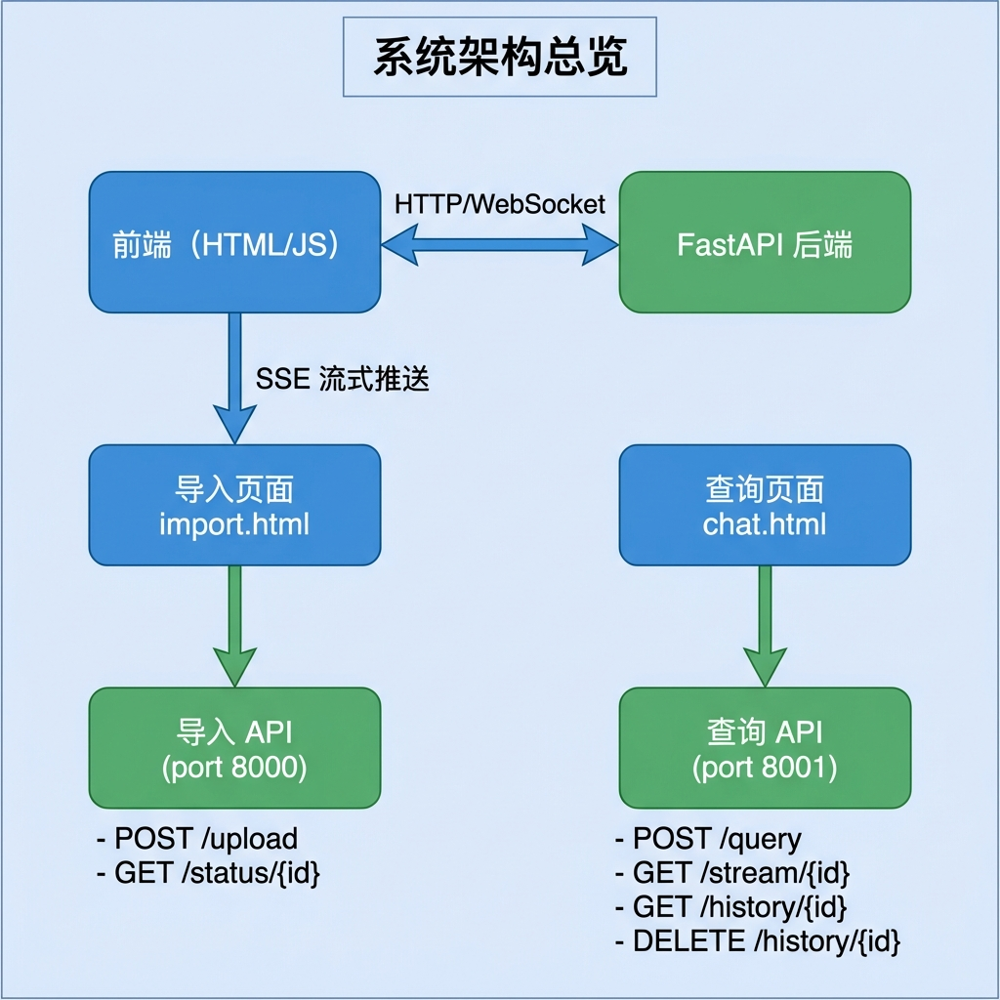
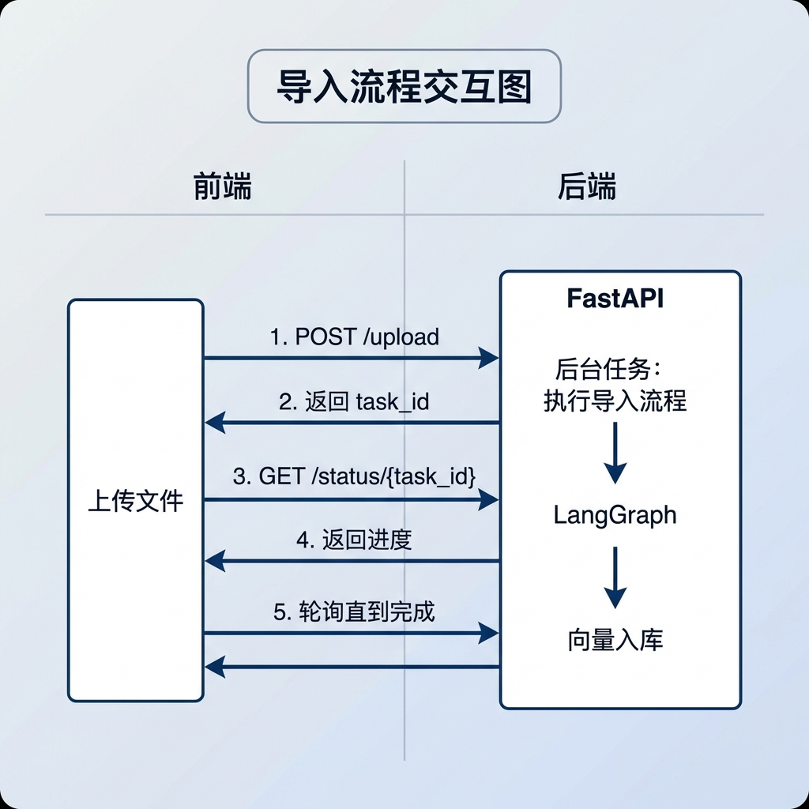
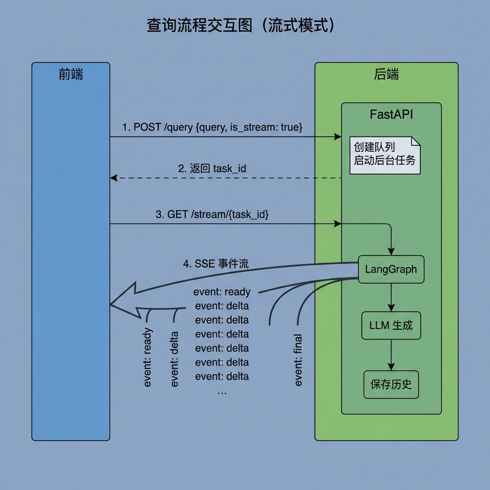
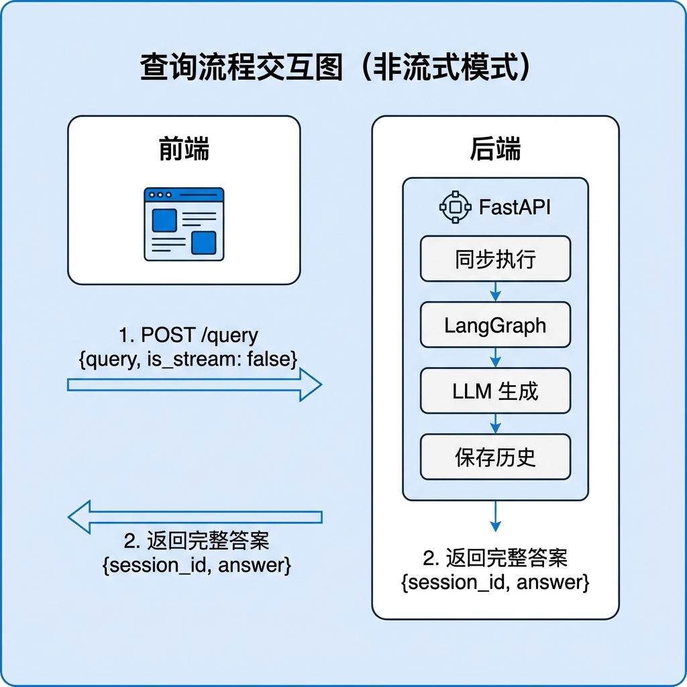
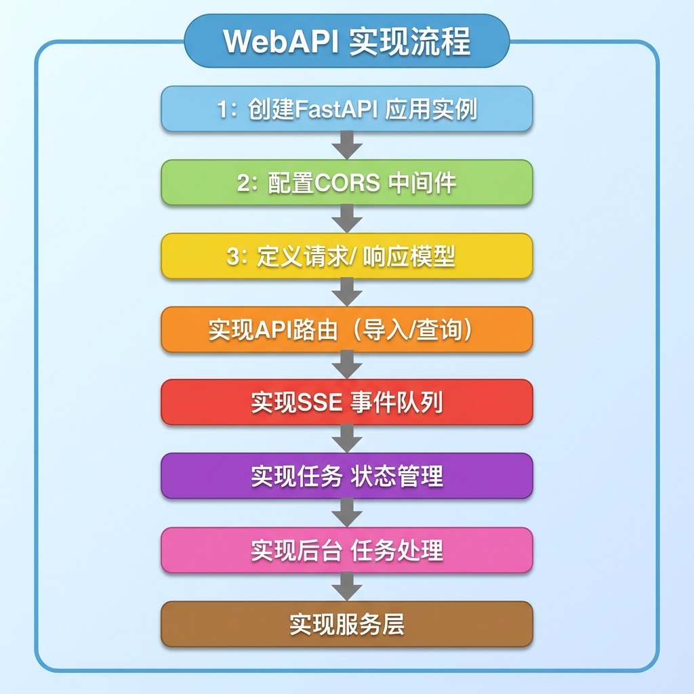
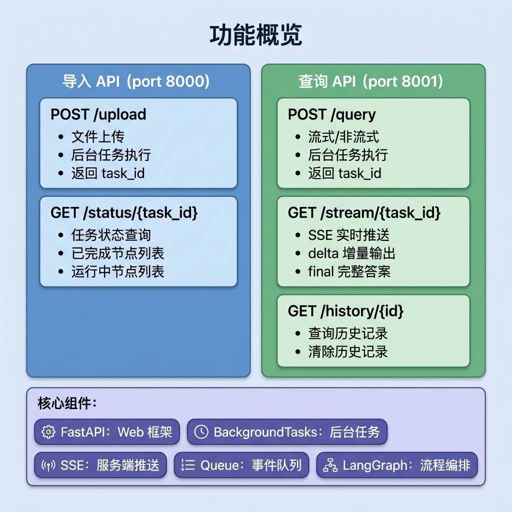

# WebAPI 层与 SSE 流式交互

## 1. 任务目标

本节课将实现知识库系统的 **Web API 层**，包括文件导入和知识查询两套 API。

该层是整个系统与前端交互的入口，负责：
- 接收 HTTP 请求并路由到对应处理逻辑
- 通过 **后台任务** 异步执行长耗时操作
- 使用 **SSE（Server-Sent Events）** 实现实时进度推送和流式答案输出
- 管理会话历史和任务状态

**学完本节你将掌握：**
- FastAPI 框架的核心概念（路由、依赖注入、后台任务）
- SSE 服务端推送技术的原理与实现
- 事件队列（Event Queue）在流式交互中的应用
- 导入流程与查询流程的 API 设计模式
- 前后端实时通信的完整架构

---

## 2. 核心概念扫盲

### 2.1 系统架构总览



### 2.2 FastAPI 核心概念

#### 2.2.1 路由定义

```python
from fastapi import FastAPI

app = FastAPI()

@app.post("/upload")
async def upload_files(files: List[UploadFile]):
    """POST 请求处理"""
    pass

@app.get("/status/{task_id}")
async def get_task(task_id: str):
    """GET 请求处理，路径参数"""
    pass
```

#### 2.2.2 后台任务

```python
from fastapi import BackgroundTasks

@app.post("/upload")
async def upload_files(
    background_tasks: BackgroundTasks,
    file: UploadFile = File(...)
):
    # 立即返回响应
    task_id = str(uuid.uuid4())

    # 将耗时操作放入后台执行
    background_tasks.add_task(run_import_task, task_id, file)

    return {"task_id": task_id, "message": "Processing started"}
```

**后台任务的优势：**
- 快速响应客户端请求
- 异步执行耗时操作
- 适合文件处理、数据导入等场景

#### 2.2.3 依赖注入

```python
from fastapi import Depends

def get_query_service() -> QueryService:
    return QueryService()

@app.post("/query")
async def query(
    request: QueryRequest,
    service: QueryService = Depends(get_query_service),
):
    return service.handle_query(request)
```

#### 2.2.4 Pydantic 数据模型

```python
from pydantic import BaseModel, Field

class QueryRequest(BaseModel):
    """查询请求模型"""
    query: str = Field(..., description="查询内容")
    session_id: Optional[str] = Field(None, description="会话ID")
    is_stream: bool = Field(False, description="是否流式返回")
```

### 2.3 SSE 服务端推送

#### 2.3.1 什么是 SSE？

SSE 是一种服务器向客户端单向推送事件的技术：


#### 2.3.2 SSE 消息格式

```
event: delta
data: {"delta": "根据"}

event: delta
data: {"delta": "参考内容"}

event: final
data: {"answer": "完整答案...", "status": "completed"}
```

#### 2.3.3 SSE vs WebSocket

| 特性 | SSE | WebSocket |
|------|-----|-----------|
| 通信方向 | 单向（服务器→客户端） | 双向 |
| 协议 | HTTP | 独立协议 |
| 自动重连 | 内置支持 | 需手动实现 |
| 浏览器支持 | 原生支持 | 原生支持 |
| 适用场景 | 实时推送、流式输出 | 双向通信、聊天 |

### 2.4 事件队列

事件队列是 SSE 实现的核心数据结构：


```python
import queue
from typing import Dict

# 全局 SSE 任务队列存储
# Key: task_id, Value: queue.Queue
_task_stream: Dict[str, queue.Queue] = {}

def create_sse_queue(task_id: str) -> queue.Queue:
    """创建并注册一个新的 SSE 队列"""
    q = queue.Queue()
    _task_stream[task_id] = q
    return q

def push_sse_event(task_id: str, event: str, data: Dict[str, Any]):
    """向指定任务推送事件"""
    stream_queue = _task_stream.get(task_id)
    if stream_queue:
        stream_queue.put({"event": event, "data": data})
```

### 2.5 任务状态管理

系统使用内存字典管理任务状态：

```python
# 任务状态常量
TASK_STATUS_PENDING = "pending"       # 等待处理
TASK_STATUS_PROCESSING = "processing" # 处理中
TASK_STATUS_COMPLETED = "completed"   # 已完成
TASK_STATUS_FAILED = "failed"         # 失败

# 内存态任务追踪
_tasks_running_list: Dict[str, List[str]] = {}  # 正在运行的节点
_tasks_done_list: Dict[str, List[str]] = {}     # 已完成的节点
_tasks_status: Dict[str, str] = {}              # 任务状态
_tasks_result: Dict[str, Dict[str, str]] = {}   # 任务结果
```

---

## 3. WebAPI 业务处理流程（总）

### 3.1 导入流程交互图



### 3.2 查询流程交互图（流式模式）



### 3.3 查询流程交互图（非流式模式）



---

## 4. WebAPI 业务处理流程（分）

### 4.1 目标

实现两套 FastAPI 应用，分别处理文件导入和知识查询请求，支持同步/异步两种模式，并通过 SSE 实现实时进度推送。

### 4.2 需求分析

| 需求项 | 说明 |
|--------|------|
| 文件上传 | 支持多文件上传，保存到本地和 MinIO |
| 后台处理 | 耗时任务放入后台异步执行 |
| 进度追踪 | 支持查询任务状态和已完成节点 |
| 流式输出 | 支持 SSE 实时推送生成内容 |
| 会话管理 | 支持查询和清除历史记录 |
| 跨域支持 | 允许前端跨域访问 |

### 4.3 实现流程

#### 4.3.1 实现流程图



#### 4.3.2 具体实现步骤

##### Step 1: 创建 FastAPI 应用

创建应用工厂函数，配置中间件和路由：

```python
def create_app() -> FastAPI:
    """创建 FastAPI 应用"""
    app = FastAPI(title="Query Service", description="知识库查询服务")

    # 允许跨域（开发环境）
    app.add_middleware(
        CORSMiddleware,
        allow_origins=["*"],      # 允许所有来源
        allow_credentials=True,   # 允许携带凭证
        allow_methods=["*"],      # 允许所有方法
        allow_headers=["*"],      # 允许所有头部
    )

    # 静态文件挂载（前端页面）
    front_page_dir = get_front_page_dir()
    if front_page_dir and os.path.exists(front_page_dir):
        app.mount("/front", StaticFiles(directory=front_page_dir))

    # 注册路由
    register_routes(app)

    return app
```

**CORS 配置说明：**
- `allow_origins`: 允许访问的前端域名
- `allow_credentials`: 是否允许携带 Cookie
- `allow_methods`: 允许的 HTTP 方法
- `allow_headers`: 允许的请求头

##### Step 2: 定义请求/响应模型

使用 Pydantic 定义数据模型：

```python
# schema/query_schema.py
from typing import Optional
from pydantic import BaseModel, Field

class QueryRequest(BaseModel):
    """查询请求模型"""
    query: str = Field(..., description="查询内容")
    session_id: Optional[str] = Field(None, description="会话ID")
    is_stream: bool = Field(False, description="是否流式返回")

class QueryResponse(BaseModel):
    """查询响应模型"""
    message: str
    session_id: str
    answer: str

class StreamSubmitResponse(BaseModel):
    """流式提交响应"""
    message: str
    session_id: str
    task_id: str
```

```python
# schema/task_schema.py
from typing import List
from pydantic import BaseModel, Field

class TaskStatusResponse(BaseModel):
    """任务状态响应"""
    status: str = Field(..., description="任务状态")
    done_list: List[str] = Field(..., description="已完成节点列表")
    running_list: List[str] = Field(..., description="正在运行节点列表")
```

##### Step 3: 实现查询 API 路由

处理查询请求，支持流式和非流式两种模式：

```python
# api/query_router.py

def register_routes(app: FastAPI):

    @app.get("/chat.html")
    async def chat_page():
        return FileResponse(os.path.join(get_front_page_dir(), "chat.html"))

    @app.post("/query")
    async def query(
        request: QueryRequest,
        background_tasks: BackgroundTasks,
        service: QueryService = Depends(get_query_service),
    ):
        # 1. 解析参数
        session_id = request.session_id or service.generate_session_id()
        task_id = service.generate_task_id()

        # 2. 提交任务
        service.submit_query(task_id, request.is_stream)

        # 3. 根据模式选择处理方式
        if request.is_stream:
            # 流式模式：后台任务 + SSE
            background_tasks.add_task(
                service.run_query_graph, task_id, session_id, request.query, True
            )
            return StreamSubmitResponse(
                message="Query submitted", session_id=session_id, task_id=task_id
            )
        else:
            # 非流式模式：同步执行
            service.run_query_graph(task_id, session_id, request.query, False)
            answer = service.get_answer(task_id)
            return QueryResponse(message="处理完成", session_id=session_id, answer=answer)

    @app.get("/stream/{task_id}")
    async def stream(task_id: str, request: Request):
        """SSE 实时返回结果"""
        return StreamingResponse(
            sse_generator(task_id, request), media_type="text/event-stream"
        )
```

**历史记录管理：**

```python
    @app.get("/history/{session_id}")
    async def get_history(
        session_id: str, limit: int = 50,
        service: QueryService = Depends(get_query_service),
    ):
        """查询当前会话历史记录"""
        items = service.get_history(session_id, limit)
        return {"session_id": session_id, "items": items}

    @app.delete("/history/{session_id}")
    async def clear_chat_history(
        session_id: str,
        service: QueryService = Depends(get_query_service),
    ):
        """清除会话历史记录"""
        count = service.clear_history(session_id)
        return {"message": "History cleared", "deleted_count": count}
```

##### Step 4: 实现导入 API 路由

处理文件上传和状态查询：

```python
# api/import_router.py

def register_router(app: FastAPI):

    @app.get("/import")
    async def import_root():
        return FileResponse(path=os.path.join(get_front_page_dir(), "import.html"))

    @app.post("/upload", response_model=UploadResponse)
    async def upload_file_endpoint(
        background_tasks: BackgroundTasks,
        file: UploadFile = File(...),
        service: ImportFileService = Depends(get_import_file_service),
    ):
        # 1. 上传文件（本地/minio）
        task_id, file_dir, import_file_path = service.process_upload_file(file)

        # 2. 运行后台任务（跑graph的整个流程）
        background_tasks.add_task(service.run_import_graph, task_id, file_dir, import_file_path)

        # 3. 返回
        return UploadResponse(message="文件上传成功", task_id=task_id)

    @app.get("/status/{task_id}", response_model=TaskStatusResponse)
    async def get_status_endpoint(
        task_id: str,
        task_service: TaskService = Depends(get_task_service),
    ):
        """根据任务id 查询任务的状态"""
        task_info = task_service.get_task_info(task_id)
        return TaskStatusResponse(**task_info)
```

##### Step 5: 实现 SSE 事件队列

SSE 工具模块的核心实现：

```python
# utils/sse_util.py

import json
import queue
import asyncio
from typing import Dict, Any, Optional, AsyncGenerator
from fastapi import Request


class SSEEvent:
    """SSE 事件类型常量"""
    READY = "ready"         # 连接建立
    PROGRESS = "progress"   # 任务节点进度
    DELTA = "delta"         # LLM 流式输出增量
    FINAL = "final"         # 最终完整答案


# 全局 SSE 任务队列存储
# Key: task_id, Value: queue.Queue
_task_stream: Dict[str, queue.Queue] = {}


def get_sse_queue(task_id: str) -> Optional[queue.Queue]:
    """获取指定任务的队列"""
    return _task_stream.get(task_id)


def create_sse_queue(task_id: str) -> queue.Queue:
    """创建并注册一个新的 SSE 队列"""
    q = queue.Queue()
    _task_stream[task_id] = q
    return q


def remove_sse_queue(task_id: str):
    """移除指定任务的队列"""
    _task_stream.pop(task_id, None)


def _sse_pack(event: str, data: Dict[str, Any]) -> str:
    """打包 SSE 消息格式"""
    payload = json.dumps(data, ensure_ascii=False)
    return f"event: {event}\ndata: {payload}\n\n"


def push_sse_event(task_id: str, event: str, data: Dict[str, Any]):
    """通过 task_id 推送事件到 SSE 队列"""
    stream_queue = get_sse_queue(task_id)
    if stream_queue:
        stream_queue.put({"event": event, "data": data})
```

**SSE 生成器（异步）：**

```python
async def sse_generator(task_id: str, request: Request) -> AsyncGenerator[str, None]:
    """SSE 生成器，用于 FastAPI 的 StreamingResponse"""
    # 1. 获取队列
    stream_queue = get_sse_queue(task_id)

    # 2. 如果没有对应的队列，直接结束
    if stream_queue is None:
        return

    # 3. 获取当前运行的异步事件循环
    loop = asyncio.get_running_loop()

    try:
        # 4. 发送连接建立信号
        yield _sse_pack(SSEEvent.READY, {})

        while True:
            # 5. 若客户端断开，尽快退出
            if await request.is_disconnected():
                break

            try:
                # 6. 使用 run_in_executor 避免阻塞 async 事件循环
                msg = await loop.run_in_executor(None, stream_queue.get, True, 1.0)
            except queue.Empty:
                # 7. 若 1 秒内队列为空（超时），重新开始检查
                continue

            # 8. 解析消息体
            event = msg.get("event")
            data = msg.get("data")

            # 9. 打包成标准 SSE 格式并推送
            yield _sse_pack(event, data)

    except (ConnectionResetError, BrokenPipeError):
        # 客户端强行刷新页面或关闭标签页，静默退出
        return
    except asyncio.CancelledError:
        # 协程被取消：重新抛出
        raise
    finally:
        # 清理资源（防止内存泄漏）
        remove_sse_queue(task_id)
```

##### Step 6: 实现任务状态管理

任务追踪工具模块：

```python
# utils/task_util.py

from typing import Dict, List

# 内存态任务追踪
_tasks_running_list: Dict[str, List[str]] = {}
_tasks_done_list: Dict[str, List[str]] = {}
_tasks_status: Dict[str, str] = {}
_tasks_result: Dict[str, Dict[str, str]] = {}

# 任务状态常量
TASK_STATUS_PENDING = "pending"
TASK_STATUS_PROCESSING = "processing"
TASK_STATUS_COMPLETED = "completed"
TASK_STATUS_FAILED = "failed"


def add_running_task(task_id: str, node_name: str):
    """添加正在运行的节点任务"""
    if task_id not in _tasks_running_list:
        _tasks_running_list[task_id] = []
    if node_name not in _tasks_running_list[task_id]:
        _tasks_running_list[task_id].append(node_name)


def add_done_task(task_id: str, node_name: str):
    """添加已完成的节点任务"""
    # 从 running 中移除
    if task_id in _tasks_running_list:
        _tasks_running_list[task_id] = [n for n in _tasks_running_list[task_id] if n != node_name]

    # 追加到 done
    if task_id not in _tasks_done_list:
        _tasks_done_list[task_id] = []
    if node_name not in _tasks_done_list[task_id]:
        _tasks_done_list[task_id].append(node_name)


def update_task_status(task_id: str, status: str):
    """更新任务状态"""
    _tasks_status[task_id] = status


def get_task_status(task_id: str) -> str:
    """获取任务状态"""
    return _tasks_status.get(task_id, TASK_STATUS_PENDING)


def get_running_task_list(task_id: str) -> List[str]:
    """获取正在运行的节点列表"""
    return _tasks_running_list.get(task_id, [])


def get_done_task_list(task_id: str) -> List[str]:
    """获取已完成的节点列表"""
    return _tasks_done_list.get(task_id, [])


def get_task_result(task_id: str, key: str, default: Any = None) -> Any:
    """获取任务结果"""
    result = _tasks_result.get(task_id, {})
    return result.get(key, default)
```

##### Step 7: 实现服务层

**查询服务：**

```python
# services/query_service.py

import uuid
import logging
from typing import List, Dict, Any

from knowledge.processor.query_process.main_graph import query_app
from knowledge.utils.task_util import update_task_status, get_task_result, \
    get_task_status, get_done_task_list, get_running_task_list, \
    TASK_STATUS_PROCESSING, TASK_STATUS_COMPLETED
from knowledge.utils.sse_util import create_sse_queue, push_sse_event

logger = logging.getLogger(__name__)


class QueryService:

    def generate_session_id(self) -> str:
        return str(uuid.uuid4())

    def generate_task_id(self) -> str:
        return str(uuid.uuid4())

    def submit_query(self, task_id: str, is_stream: bool):
        """提交查询任务：更新状态 + 流式模式创建 SSE 队列。"""
        update_task_status(task_id, TASK_STATUS_PROCESSING)
        if is_stream:
            create_sse_queue(task_id)

    def run_query_graph(self, task_id: str, session_id: str, user_query: str, is_stream: bool):
        """执行 LangGraph 查询流程。"""
        try:
            default_state = {
                "original_query": user_query,
                "session_id": session_id,
                "task_id": task_id,
                "is_stream": is_stream,
            }
            query_app.invoke(default_state)
        except Exception as e:
            logger.error(f"查询流程执行失败: {e}", exc_info=True)
        finally:
            update_task_status(task_id, TASK_STATUS_COMPLETED)
            if is_stream:
                push_sse_event(task_id, "progress", {
                    "status": get_task_status(task_id),
                    "done_list": get_done_task_list(task_id),
                    "running_list": get_running_task_list(task_id),
                })

    def get_answer(self, task_id: str) -> str:
        return get_task_result(task_id, "answer", "")

    def get_history(self, session_id: str, limit: int = 50) -> List[Dict[str, Any]]:
        from knowledge.utils.mongo_history_util import get_recent_messages
        records = get_recent_messages(session_id, limit=limit)
        return [
            {
                "_id": str(r.get("_id", "")),
                "session_id": r.get("session_id", ""),
                "role": r.get("role", ""),
                "text": r.get("text", ""),
                "rewritten_query": r.get("rewritten_query", ""),
                "item_names": r.get("item_names", []),
                "ts": r.get("ts"),
            }
            for r in records
        ]

    def clear_history(self, session_id: str) -> int:
        from knowledge.utils.mongo_history_util import clear_history
        return clear_history(session_id)
```

**任务服务：**

```python
# services/task_service.py

from knowledge.utils.task_util import (
    add_running_task, add_done_task, update_task_status,
    get_task_status, get_running_task_list, get_done_task_list
)


class TaskService:
    """任务服务类"""

    def mark_node_running(self, task_id: str, node_name: str):
        """标记节点正在运行"""
        add_running_task(task_id, node_name)

    def mark_node_done(self, task_id: str, node_name: str):
        """标记节点运行完成"""
        add_done_task(task_id, node_name)

    def update_task_status(self, task_id: str, status: str):
        """更新任务状态"""
        update_task_status(task_id, status)

    def get_task_info(self, task_id: str):
        """查询任务信息"""
        return {
            "status": get_task_status(task_id),
            "done_list": get_done_task_list(task_id),
            "running_list": get_running_task_list(task_id)
        }
```

---

## 5. 测试运行

### 5.1 运行 API 服务测试

```bash
# 启动导入服务（端口 8000）
python -m knowledge.api.import_router

# 启动查询服务（端口 8001）
python -m knowledge.api.query_router
```

### 5.2 测试代码

#### 测试导入 API

```python
import requests

# 上传文件
files = [('file', ('test.pdf', open('test.pdf', 'rb'), 'application/pdf'))]
response = requests.post('http://localhost:8000/upload', files=files)
print(response.json())
# {"message": "文件上传成功", "task_id": "xxx-xxx-xxx"}

# 查询状态
task_id = response.json()['task_id']
status = requests.get(f'http://localhost:8000/status/{task_id}')
print(status.json())
# {"status": "processing", "done_list": ["上传文件"], "running_list": ["检查文件"]}
```

#### 测试查询 API（非流式）

```python
import requests

response = requests.post('http://localhost:8001/query', json={
    "query": "万用表怎么测电压？",
    "session_id": "test_001",
    "is_stream": False
})
print(response.json())
# {"message": "处理完成", "session_id": "test_001", "answer": "根据参考内容..."}
```

#### 测试查询 API（流式）

```python
import requests
import sseclient

# 1. 提交查询
response = requests.post('http://localhost:8001/query', json={
    "query": "万用表怎么测电压？",
    "is_stream": True
})
task_id = response.json()['task_id']

# 2. 连接 SSE 流
url = f'http://localhost:8001/stream/{task_id}'
response = requests.get(url, stream=True)
client = sseclient.SSEClient(response)

for event in client.events():
    print(f"Event: {event.event}, Data: {event.data}")
```

### 5.3 预期输出

#### 导入流程状态轮询输出

```
第 1 次轮询:
{"status": "processing", "done_list": ["上传文件"], "running_list": ["检查文件"]}

第 2 次轮询:
{"status": "processing", "done_list": ["上传文件", "检查文件", "PDF转Markdown"], "running_list": ["文档切分"]}

第 3 次轮询:
{"status": "completed", "done_list": ["上传文件", "检查文件", "PDF转Markdown", "文档切分", "向量生成", "入库完成"], "running_list": []}
```

#### 查询流程 SSE 输出

```
Event: ready, Data: {}
Event: delta, Data: {"delta": "根据"}
Event: delta, Data: {"delta": "参考内容"}
Event: delta, Data: {"delta": "，"}
Event: delta, Data: {"delta": "万用表"}
Event: delta, Data: {"delta": "测量"}
Event: delta, Data: {"delta": "电压"}
Event: delta, Data: {"delta": "的步骤"}
Event: delta, Data: {"delta": "如下："}
...
Event: final, Data: {"answer": "根据参考内容，万用表测量电压的步骤如下...", "status": "completed"}
```

---

## 6. 总结

### 6.1 功能概览



### 6.2 设计要点

#### 要点 1：后台任务异步处理

```python
@app.post("/upload")
async def upload_files(background_tasks: BackgroundTasks, file: UploadFile = File(...)):
    # 快速返回响应
    task_id = process_file(file)

    # 耗时操作放入后台
    background_tasks.add_task(_run_import_task, task_id, ...)

    return {"task_id": task_id}  # 立即返回
```

**优势：** 用户无需等待处理完成，提升体验。

#### 要点 2：SSE 事件队列模式

```python
# 生产者（后台任务）
def run_query_graph(task_id, ...):
    create_sse_queue(task_id)
    # ... 处理过程中
    push_sse_event(task_id, "delta", {"delta": "内容"})

# 消费者（SSE 生成器）
async def sse_generator(task_id, request):
    queue = get_sse_queue(task_id)
    while True:
        msg = await loop.run_in_executor(None, queue.get, True, 1.0)
        yield _sse_pack(msg["event"], msg["data"])
```

**优势：** 解耦生产者和消费者，支持实时推送。

#### 要点 3：流式/非流式双模式

```python
if is_stream:
    # 流式：后台任务 + SSE
    background_tasks.add_task(run_query_graph, ...)
    return {"task_id": task_id}  # 立即返回
else:
    # 非流式：同步执行
    run_query_graph(...)
    return {"answer": get_answer(...)}  # 等待完成
```

**优势：** 满足不同场景需求（实时交互 vs API 集成）。

#### 要点 4：任务状态追踪

```python
# 节点完成时更新状态
for event in query_app.stream(initial_state):
    for key, value in event.items():
        task_service.mark_node_done(task_id, key)

# 前端轮询获取进度
@app.get("/status/{task_id}")
async def get_task(task_id: str):
    return task_service.get_task_info(task_id)
```

**优势：** 前端可实时展示处理进度。

#### 要点 5：资源自动清理

```python
async def sse_generator(...):
    try:
        while True:
            # 检测客户端断开
            if await request.is_disconnected():
                break
            # ... 推送事件
    finally:
        # 无论如何都清理资源
        remove_sse_queue(task_id)
```

**优势：** 防止内存泄漏，确保资源正确释放。