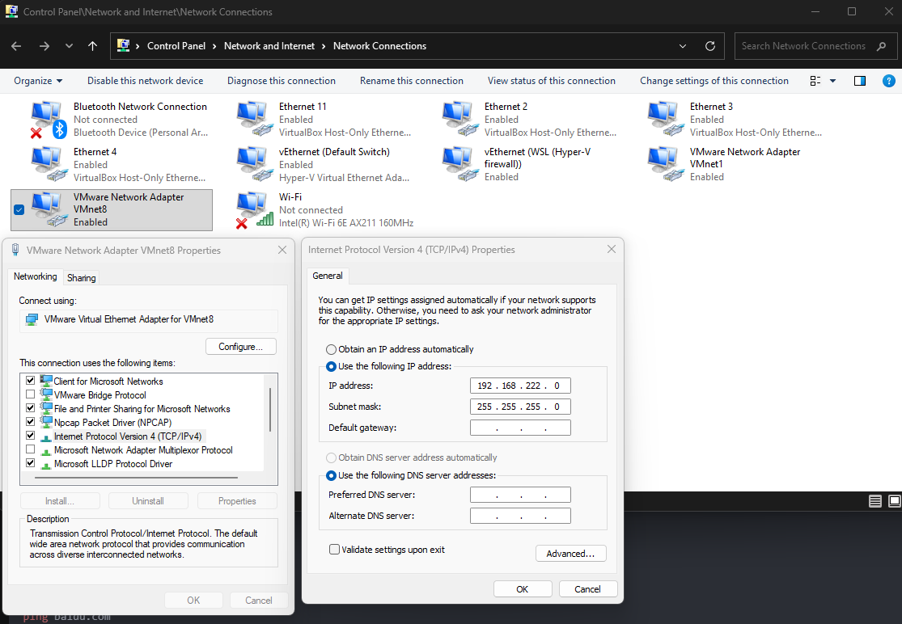
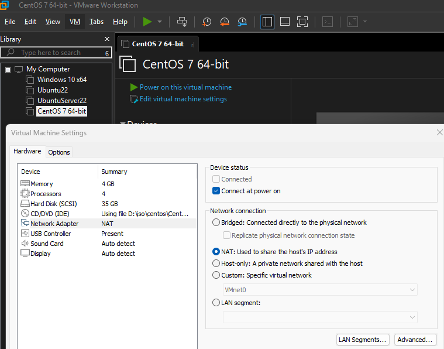
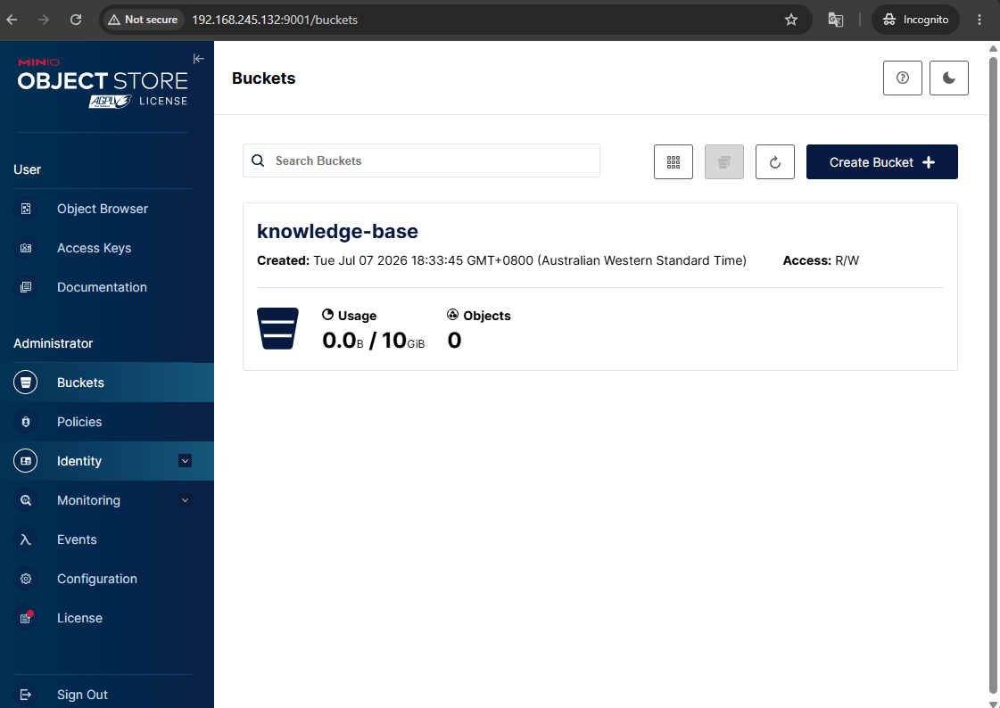
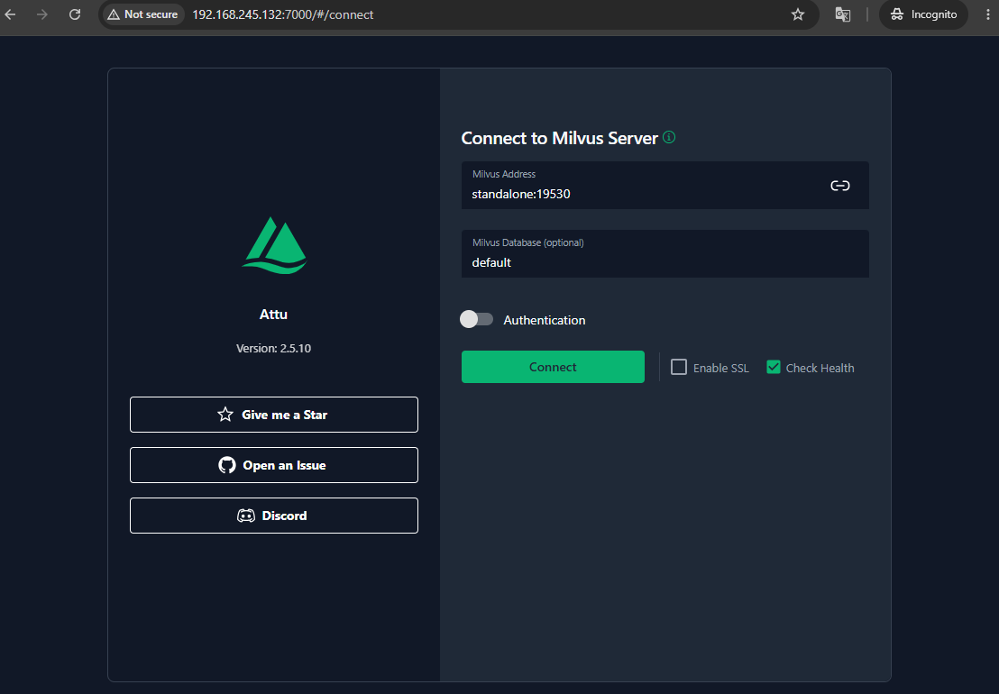
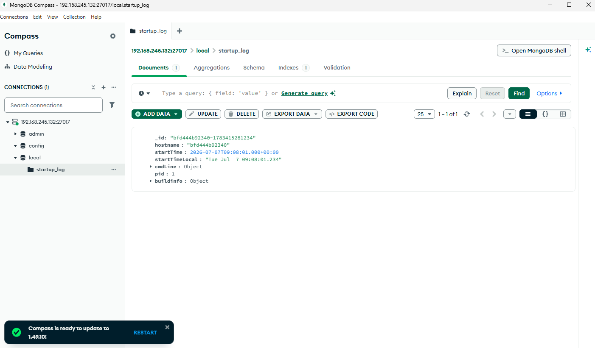

## config VMnet8 adapter on host machine


## config vm network adaptor (NAT)


## update network config in centos vm
```bash
cd /etc/sysconfig/network-scripts 
vi ifcfg-ens33

IPADDR=192.168.100.100
GATEWAY=192.168.100.2
NETMASK=255.255.255.0
DNS1=192.168.100.2
DNS2=8.8.8.8
DNS3=114.114.114.114
ONBOOT=yes

ping 8.8.8.8

ping www.baidu.com
```

## get centos vm ip address

## ping centos vm ip from host machine
```log
Microsoft Windows [Version 10.0.26200.8655]
(c) Microsoft Corporation. All rights reserved.

C:\Users\stan>ping 192.168.245.132

Pinging 192.168.245.132 with 32 bytes of data:
Reply from 192.168.245.132: bytes=32 time=1ms TTL=64
Reply from 192.168.245.132: bytes=32 time<1ms TTL=64

Ping statistics for 192.168.245.132:
    Packets: Sent = 2, Received = 2, Lost = 0 (0% loss),
Approximate round trip times in milli-seconds:
    Minimum = 0ms, Maximum = 1ms, Average = 0ms
Control-C
^C
```

## ssh into centos vm from host machine
```log
C:\Users\stan>ssh 192.168.245.132 -l root
Load key "C:\\Users\\stan/.ssh": Operation not supported on socket
root@192.168.245.132's password:
Last login: Tue Jul  7 01:17:02 2026
[root@localhost ~]#
[root@localhost ~]# df -h
Filesystem               Size  Used Avail Use% Mounted on
devtmpfs                 1.9G     0  1.9G   0% /dev
tmpfs                    1.9G     0  1.9G   0% /dev/shm
tmpfs                    1.9G   12M  1.9G   1% /run
tmpfs                    1.9G     0  1.9G   0% /sys/fs/cgroup
/dev/mapper/centos-root   31G  1.3G   30G   5% /
/dev/sda1               1014M  150M  865M  15% /boot
tmpfs                    378M     0  378M   0% /run/user/0
```

## since wget is not installed in centos vm, and existing repo is not working, download mirror repo source file in host vm from [http://mirrors.aliyun.com/repo/Centos-7.repo]()

## replace exiting repo file with mirror repo source [Centos-7.repo](./Centos-7.repo)
```log
[root@localhost ~]# mv /etc/yum.repos.d/CentOS-Base.repo /etc/yum.repos.d/CentOS-Base.repo.backup
[root@localhost ~]# vi /etc/yum.repos.d/CentOS-Base.repo
```

## install wget
```log
[root@localhost ~]# yum install wget
Loaded plugins: fastestmirror
Loading mirror speeds from cached hostfile
 * base: mirrors.aliyun.com
 * extras: mirrors.aliyun.com
 * updates: mirrors.aliyun.com
base                                                                           | 3.6 kB  00:00:00
extras                                                                         | 2.9 kB  00:00:00
updates                                                                        | 2.9 kB  00:00:00
(1/4): base/7/x86_64/group_gz                                                  | 153 kB  00:00:00
(2/4): extras/7/x86_64/primary_db                                              | 253 kB  00:00:00
(3/4): updates/7/x86_64/primary_db                                             |  27 MB  00:00:07
base/7/x86_64/primary_db       FAILED
http://mirrors.aliyuncs.com/centos/7/os/x86_64/repodata/6d0c3a488c282fe537794b5946b01e28c7f44db79097bb06826e1c0c88bad5ef-primary.sqlite.bz2: [Errno 14] curl#7 - "Failed connect to mirrors.aliyuncs.com:80; Connection refused"
Trying other mirror.
(4/4): base/7/x86_64/primary_db                                                | 6.1 MB  00:00:02
Resolving Dependencies
--> Running transaction check
---> Package wget.x86_64 0:1.14-18.el7_6.1 will be installed
--> Finished Dependency Resolution

Dependencies Resolved

=================================================================================================================================================================================================================
 Package                                        Arch                                             Version                                                    Repository                                      Size
=================================================================================================================================================================================================================
Installing:
 wget                                           x86_64                                           1.14-18.el7_6.1                                            base                                           547 k

Transaction Summary
=================================================================================================================================================================================================================
Install  1 Package

Total download size: 547 k
Installed size: 2.0 M
Is this ok [y/d/N]: y
Downloading packages:
warning: /var/cache/yum/x86_64/7/base/packages/wget-1.14-18.el7_6.1.x86_64.rpm: Header V3 RSA/SHA256 Signature, key ID f4a80eb5: NOKEY
Public key for wget-1.14-18.el7_6.1.x86_64.rpm is not installed
wget-1.14-18.el7_6.1.x86_64.rpm                                                                                                                                                           | 547 kB  00:00:00
Retrieving key from http://mirrors.aliyun.com/centos/RPM-GPG-KEY-CentOS-7
Importing GPG key 0xF4A80EB5:
 Userid     : "CentOS-7 Key (CentOS 7 Official Signing Key) <security@centos.org>"
 Fingerprint: 6341 ab27 53d7 8a78 a7c2 7bb1 24c6 a8a7 f4a8 0eb5
 From       : http://mirrors.aliyun.com/centos/RPM-GPG-KEY-CentOS-7
Is this ok [y/N]: y
Running transaction check
Running transaction test
Transaction test succeeded
Running transaction
  Installing : wget-1.14-18.el7_6.1.x86_64                                                                                                                                                                   1/1
  Verifying  : wget-1.14-18.el7_6.1.x86_64                                                                                                                                                                   1/1

Installed:
  wget.x86_64 0:1.14-18.el7_6.1

Complete!
[root@localhost ~]# yum clean all
Loaded plugins: fastestmirror
Cleaning repos: base extras updates
Cleaning up list of fastest mirrors
[root@localhost ~]# yum makecache
Loaded plugins: fastestmirror
Determining fastest mirrors
 * base: mirrors.aliyun.com
 * extras: mirrors.aliyun.com
 * updates: mirrors.aliyun.com
base                                                                                                                                                                                      | 3.6 kB  00:00:00
extras                                                                                                                                                                                    | 2.9 kB  00:00:00
updates                                                                                                                                                                                   | 2.9 kB  00:00:00
(1/10): base/7/x86_64/group_gz                                                                                                                                                            | 153 kB  00:00:00
(2/10): base/7/x86_64/primary_db                                                                                                                                                          | 6.1 MB  00:00:01
(3/10): base/7/x86_64/filelists_db                                                                                                                                                        | 7.2 MB  00:00:02
(4/10): extras/7/x86_64/primary_db                                                                                                                                                        | 253 kB  00:00:00
(5/10): extras/7/x86_64/filelists_db                                                                                                                                                      | 305 kB  00:00:00
(6/10): extras/7/x86_64/other_db                                                                                                                                                          | 154 kB  00:00:00
(7/10): base/7/x86_64/other_db                                                                                                                                                            | 2.6 MB  00:00:00
(8/10): updates/7/x86_64/filelists_db                                                                                                                                                     |  15 MB  00:00:04
(9/10): updates/7/x86_64/other_db                                                                                                                                                         | 1.6 MB  00:00:00
(10/10): updates/7/x86_64/primary_db                                                                                                                                                      |  27 MB  00:00:07
Metadata Cache Created
```

## update centos yum repo
```log
[root@localhost ~]# yum -y update
Loaded plugins: fastestmirror
Loading mirror speeds from cached hostfile
 * base: mirrors.aliyun.com
 * extras: mirrors.aliyun.com
 * updates: mirrors.aliyun.com
Resolving Dependencies
--> Running transaction check
---> Package NetworkManager.x86_64 1:1.18.8-1.el7 will be updated
---> Package NetworkManager.x86_64 1:1.18.8-2.el7_9 will be an update
---> Package NetworkManager-libnm.x86_64 1:1.18.8-1.el7 will be updated
---> Package NetworkManager-libnm.x86_64 1:1.18.8-2.el7_9 will be an update
---> Package NetworkManager-team.x86_64 1:1.18.8-1.el7 will be updated
---> Package NetworkManager-team.x86_64 1:1.18.8-2.el7_9 will be an update
---> Package NetworkManager-tui.x86_64 1:1.18.8-1.el7 will be updated
---> Package NetworkManager-tui.x86_64 1:1.18.8-2.el7_9 will be an update
---> Package NetworkManager-wifi.x86_64 1:1.18.8-1.el7 will be updated
---> Package NetworkManager-wifi.x86_64 1:1.18.8-2.el7_9 will be an update
---> Package bash.x86_64 0:4.2.46-34.el7 will be updated
---> Package bash.x86_64 0:4.2.46-35.el7_9 will be an update
---> Package bind-export-libs.x86_64 32:9.11.4-26.P2.el7 will be updated
---> Package bind-export-libs.x86_64 32:9.11.4-26.P2.el7_9.16 will be an update
---> Package binutils.x86_64 0:2.27-44.base.el7 will be updated
---> Package binutils.x86_64 0:2.27-44.base.el7_9.1 will be an update
---> Package ca-certificates.noarch 0:2020.2.41-70.0.el7_8 will be updated
---> Package ca-certificates.noarch 0:2023.2.60_v7.0.306-72.el7_9 will be an update
---> Package centos-release.x86_64 0:7-9.2009.0.el7.centos will be updated
---> Package centos-release.x86_64 0:7-9.2009.2.el7.centos will be an update
---> Package coreutils.x86_64 0:8.22-24.el7 will be updated
---> Package coreutils.x86_64 0:8.22-24.el7_9.2 will be an update
---> Package cronie.x86_64 0:1.4.11-23.el7 will be updated
---> Package cronie.x86_64 0:1.4.11-25.el7_9 will be an update
---> Package cronie-anacron.x86_64 0:1.4.11-23.el7 will be updated
---> Package cronie-anacron.x86_64 0:1.4.11-25.el7_9 will be an update
---> Package curl.x86_64 0:7.29.0-59.el7 will be updated
---> Package curl.x86_64 0:7.29.0-59.el7_9.2 will be an update
---> Package cyrus-sasl-lib.x86_64 0:2.1.26-23.el7 will be updated
---> Package cyrus-sasl-lib.x86_64 0:2.1.26-24.el7_9 will be an update
---> Package device-mapper.x86_64 7:1.02.170-6.el7 will be updated
---> Package device-mapper.x86_64 7:1.02.170-6.el7_9.5 will be an update
---> Package device-mapper-event.x86_64 7:1.02.170-6.el7 will be updated
---> Package device-mapper-event.x86_64 7:1.02.170-6.el7_9.5 will be an update
---> Package device-mapper-event-libs.x86_64 7:1.02.170-6.el7 will be updated
---> Package device-mapper-event-libs.x86_64 7:1.02.170-6.el7_9.5 will be an update
---> Package device-mapper-libs.x86_64 7:1.02.170-6.el7 will be updated
---> Package device-mapper-libs.x86_64 7:1.02.170-6.el7_9.5 will be an update
---> Package device-mapper-persistent-data.x86_64 0:0.8.5-3.el7 will be updated
---> Package device-mapper-persistent-data.x86_64 0:0.8.5-3.el7_9.2 will be an update
---> Package dhclient.x86_64 12:4.2.5-82.el7.centos will be updated
---> Package dhclient.x86_64 12:4.2.5-83.el7.centos.2 will be an update
---> Package dhcp-common.x86_64 12:4.2.5-82.el7.centos will be updated
---> Package dhcp-common.x86_64 12:4.2.5-83.el7.centos.2 will be an update
---> Package dhcp-libs.x86_64 12:4.2.5-82.el7.centos will be updated
---> Package dhcp-libs.x86_64 12:4.2.5-83.el7.centos.2 will be an update
---> Package diffutils.x86_64 0:3.3-5.el7 will be updated
---> Package diffutils.x86_64 0:3.3-6.el7_9 will be an update
---> Package dmidecode.x86_64 1:3.2-5.el7 will be updated
---> Package dmidecode.x86_64 1:3.2-5.el7_9.1 will be an update
---> Package expat.x86_64 0:2.1.0-12.el7 will be updated
---> Package expat.x86_64 0:2.1.0-15.el7_9 will be an update
---> Package firewalld.noarch 0:0.6.3-11.el7 will be updated
---> Package firewalld.noarch 0:0.6.3-13.el7_9 will be an update
---> Package firewalld-filesystem.noarch 0:0.6.3-11.el7 will be updated
---> Package firewalld-filesystem.noarch 0:0.6.3-13.el7_9 will be an update
---> Package freetype.x86_64 0:2.8-14.el7 will be updated
---> Package freetype.x86_64 0:2.8-14.el7_9.1 will be an update
---> Package glib2.x86_64 0:2.56.1-7.el7 will be updated
---> Package glib2.x86_64 0:2.56.1-9.el7_9 will be an update
---> Package glibc.x86_64 0:2.17-317.el7 will be updated
---> Package glibc.x86_64 0:2.17-326.el7_9.3 will be an update
---> Package glibc-common.x86_64 0:2.17-317.el7 will be updated
---> Package glibc-common.x86_64 0:2.17-326.el7_9.3 will be an update
---> Package grub2.x86_64 1:2.02-0.86.el7.centos will be updated
---> Package grub2.x86_64 1:2.02-0.87.0.2.el7.centos.14 will be an update
---> Package grub2-common.noarch 1:2.02-0.86.el7.centos will be updated
---> Package grub2-common.noarch 1:2.02-0.87.0.2.el7.centos.14 will be an update
---> Package grub2-pc.x86_64 1:2.02-0.86.el7.centos will be updated
---> Package grub2-pc.x86_64 1:2.02-0.87.0.2.el7.centos.14 will be an update
---> Package grub2-pc-modules.noarch 1:2.02-0.86.el7.centos will be updated
---> Package grub2-pc-modules.noarch 1:2.02-0.87.0.2.el7.centos.14 will be an update
---> Package grub2-tools.x86_64 1:2.02-0.86.el7.centos will be updated
---> Package grub2-tools.x86_64 1:2.02-0.87.0.2.el7.centos.14 will be an update
---> Package grub2-tools-extra.x86_64 1:2.02-0.86.el7.centos will be updated
---> Package grub2-tools-extra.x86_64 1:2.02-0.87.0.2.el7.centos.14 will be an update
---> Package grub2-tools-minimal.x86_64 1:2.02-0.86.el7.centos will be updated
---> Package grub2-tools-minimal.x86_64 1:2.02-0.87.0.2.el7.centos.14 will be an update
---> Package gzip.x86_64 0:1.5-10.el7 will be updated
---> Package gzip.x86_64 0:1.5-11.el7_9 will be an update
---> Package initscripts.x86_64 0:9.49.53-1.el7 will be updated
---> Package initscripts.x86_64 0:9.49.53-1.el7_9.1 will be an update
---> Package iprutils.x86_64 0:2.4.17.1-3.el7 will be updated
---> Package iprutils.x86_64 0:2.4.17.1-3.el7_7 will be an update
---> Package iwl100-firmware.noarch 0:39.31.5.1-79.el7 will be updated
---> Package iwl100-firmware.noarch 0:39.31.5.1-83.el7_9 will be an update
---> Package iwl1000-firmware.noarch 1:39.31.5.1-79.el7 will be updated
---> Package iwl1000-firmware.noarch 1:39.31.5.1-83.el7_9 will be an update
---> Package iwl105-firmware.noarch 0:18.168.6.1-79.el7 will be updated
---> Package iwl105-firmware.noarch 0:18.168.6.1-83.el7_9 will be an update
---> Package iwl135-firmware.noarch 0:18.168.6.1-79.el7 will be updated
---> Package iwl135-firmware.noarch 0:18.168.6.1-83.el7_9 will be an update
---> Package iwl2000-firmware.noarch 0:18.168.6.1-79.el7 will be updated
---> Package iwl2000-firmware.noarch 0:18.168.6.1-83.el7_9 will be an update
---> Package iwl2030-firmware.noarch 0:18.168.6.1-79.el7 will be updated
---> Package iwl2030-firmware.noarch 0:18.168.6.1-83.el7_9 will be an update
---> Package iwl3160-firmware.noarch 0:25.30.13.0-79.el7 will be updated
---> Package iwl3160-firmware.noarch 0:25.30.13.0-83.el7_9 will be an update
---> Package iwl3945-firmware.noarch 0:15.32.2.9-79.el7 will be updated
---> Package iwl3945-firmware.noarch 0:15.32.2.9-83.el7_9 will be an update
---> Package iwl4965-firmware.noarch 0:228.61.2.24-79.el7 will be updated
---> Package iwl4965-firmware.noarch 0:228.61.2.24-83.el7_9 will be an update
---> Package iwl5000-firmware.noarch 0:8.83.5.1_1-79.el7 will be updated
---> Package iwl5000-firmware.noarch 0:8.83.5.1_1-83.el7_9 will be an update
---> Package iwl5150-firmware.noarch 0:8.24.2.2-79.el7 will be updated
---> Package iwl5150-firmware.noarch 0:8.24.2.2-83.el7_9 will be an update
---> Package iwl6000-firmware.noarch 0:9.221.4.1-79.el7 will be updated
---> Package iwl6000-firmware.noarch 0:9.221.4.1-83.el7_9 will be an update
---> Package iwl6000g2a-firmware.noarch 0:18.168.6.1-79.el7 will be updated
---> Package iwl6000g2a-firmware.noarch 0:18.168.6.1-83.el7_9 will be an update
---> Package iwl6000g2b-firmware.noarch 0:18.168.6.1-79.el7 will be updated
---> Package iwl6000g2b-firmware.noarch 0:18.168.6.1-83.el7_9 will be an update
---> Package iwl6050-firmware.noarch 0:41.28.5.1-79.el7 will be updated
---> Package iwl6050-firmware.noarch 0:41.28.5.1-83.el7_9 will be an update
---> Package iwl7260-firmware.noarch 0:25.30.13.0-79.el7 will be updated
---> Package iwl7260-firmware.noarch 0:25.30.13.0-83.el7_9 will be an update
---> Package kbd.x86_64 0:1.15.5-15.el7 will be updated
---> Package kbd.x86_64 0:1.15.5-16.el7_9 will be an update
---> Package kbd-legacy.noarch 0:1.15.5-15.el7 will be updated
---> Package kbd-legacy.noarch 0:1.15.5-16.el7_9 will be an update
---> Package kbd-misc.noarch 0:1.15.5-15.el7 will be updated
---> Package kbd-misc.noarch 0:1.15.5-16.el7_9 will be an update
---> Package kernel.x86_64 0:3.10.0-1160.119.1.el7 will be installed
---> Package kernel-tools.x86_64 0:3.10.0-1160.el7 will be updated
---> Package kernel-tools.x86_64 0:3.10.0-1160.119.1.el7 will be an update
---> Package kernel-tools-libs.x86_64 0:3.10.0-1160.el7 will be updated
---> Package kernel-tools-libs.x86_64 0:3.10.0-1160.119.1.el7 will be an update
---> Package kexec-tools.x86_64 0:2.0.15-51.el7 will be updated
---> Package kexec-tools.x86_64 0:2.0.15-51.el7_9.3 will be an update
---> Package kpartx.x86_64 0:0.4.9-133.el7 will be updated
---> Package kpartx.x86_64 0:0.4.9-136.el7_9 will be an update
---> Package krb5-libs.x86_64 0:1.15.1-50.el7 will be updated
---> Package krb5-libs.x86_64 0:1.15.1-55.el7_9 will be an update
---> Package less.x86_64 0:458-9.el7 will be updated
---> Package less.x86_64 0:458-10.el7_9 will be an update
---> Package libblkid.x86_64 0:2.23.2-65.el7 will be updated
---> Package libblkid.x86_64 0:2.23.2-65.el7_9.1 will be an update
---> Package libcroco.x86_64 0:0.6.12-4.el7 will be updated
---> Package libcroco.x86_64 0:0.6.12-6.el7_9 will be an update
---> Package libcurl.x86_64 0:7.29.0-59.el7 will be updated
---> Package libcurl.x86_64 0:7.29.0-59.el7_9.2 will be an update
---> Package libmount.x86_64 0:2.23.2-65.el7 will be updated
---> Package libmount.x86_64 0:2.23.2-65.el7_9.1 will be an update
---> Package libsmartcols.x86_64 0:2.23.2-65.el7 will be updated
---> Package libsmartcols.x86_64 0:2.23.2-65.el7_9.1 will be an update
---> Package libssh2.x86_64 0:1.8.0-4.el7 will be updated
---> Package libssh2.x86_64 0:1.8.0-4.el7_9.1 will be an update
---> Package libuuid.x86_64 0:2.23.2-65.el7 will be updated
---> Package libuuid.x86_64 0:2.23.2-65.el7_9.1 will be an update
---> Package libxml2.x86_64 0:2.9.1-6.el7.5 will be updated
---> Package libxml2.x86_64 0:2.9.1-6.el7_9.6 will be an update
---> Package linux-firmware.noarch 0:20200421-79.git78c0348.el7 will be updated
---> Package linux-firmware.noarch 0:20200421-83.git78c0348.el7_9 will be an update
---> Package lvm2.x86_64 7:2.02.187-6.el7 will be updated
---> Package lvm2.x86_64 7:2.02.187-6.el7_9.5 will be an update
---> Package lvm2-libs.x86_64 7:2.02.187-6.el7 will be updated
---> Package lvm2-libs.x86_64 7:2.02.187-6.el7_9.5 will be an update
---> Package microcode_ctl.x86_64 2:2.1-73.el7 will be updated
---> Package microcode_ctl.x86_64 2:2.1-73.20.el7_9 will be an update
---> Package nspr.x86_64 0:4.21.0-1.el7 will be updated
---> Package nspr.x86_64 0:4.35.0-1.el7_9 will be an update
---> Package nss.x86_64 0:3.44.0-7.el7_7 will be updated
---> Package nss.x86_64 0:3.90.0-2.el7_9 will be an update
---> Package nss-pem.x86_64 0:1.0.3-7.el7 will be updated
---> Package nss-pem.x86_64 0:1.0.3-7.el7_9.1 will be an update
---> Package nss-softokn.x86_64 0:3.44.0-8.el7_7 will be updated
---> Package nss-softokn.x86_64 0:3.90.0-6.el7_9 will be an update
---> Package nss-softokn-freebl.x86_64 0:3.44.0-8.el7_7 will be updated
---> Package nss-softokn-freebl.x86_64 0:3.90.0-6.el7_9 will be an update
---> Package nss-sysinit.x86_64 0:3.44.0-7.el7_7 will be updated
---> Package nss-sysinit.x86_64 0:3.90.0-2.el7_9 will be an update
---> Package nss-tools.x86_64 0:3.44.0-7.el7_7 will be updated
---> Package nss-tools.x86_64 0:3.90.0-2.el7_9 will be an update
---> Package nss-util.x86_64 0:3.44.0-4.el7_7 will be updated
---> Package nss-util.x86_64 0:3.90.0-1.el7_9 will be an update
---> Package openldap.x86_64 0:2.4.44-22.el7 will be updated
---> Package openldap.x86_64 0:2.4.44-25.el7_9 will be an update
---> Package openssh.x86_64 0:7.4p1-21.el7 will be updated
---> Package openssh.x86_64 0:7.4p1-23.el7_9 will be an update
---> Package openssh-clients.x86_64 0:7.4p1-21.el7 will be updated
---> Package openssh-clients.x86_64 0:7.4p1-23.el7_9 will be an update
---> Package openssh-server.x86_64 0:7.4p1-21.el7 will be updated
---> Package openssh-server.x86_64 0:7.4p1-23.el7_9 will be an update
---> Package openssl.x86_64 1:1.0.2k-19.el7 will be updated
---> Package openssl.x86_64 1:1.0.2k-26.el7_9 will be an update
---> Package openssl-libs.x86_64 1:1.0.2k-19.el7 will be updated
---> Package openssl-libs.x86_64 1:1.0.2k-26.el7_9 will be an update
---> Package polkit.x86_64 0:0.112-26.el7 will be updated
---> Package polkit.x86_64 0:0.112-26.el7_9.1 will be an update
---> Package python.x86_64 0:2.7.5-89.el7 will be updated
---> Package python.x86_64 0:2.7.5-94.el7_9 will be an update
---> Package python-firewall.noarch 0:0.6.3-11.el7 will be updated
---> Package python-firewall.noarch 0:0.6.3-13.el7_9 will be an update
---> Package python-libs.x86_64 0:2.7.5-89.el7 will be updated
---> Package python-libs.x86_64 0:2.7.5-94.el7_9 will be an update
---> Package python-perf.x86_64 0:3.10.0-1160.el7 will be updated
---> Package python-perf.x86_64 0:3.10.0-1160.119.1.el7 will be an update
---> Package rpm.x86_64 0:4.11.3-45.el7 will be updated
---> Package rpm.x86_64 0:4.11.3-48.el7_9 will be an update
---> Package rpm-build-libs.x86_64 0:4.11.3-45.el7 will be updated
---> Package rpm-build-libs.x86_64 0:4.11.3-48.el7_9 will be an update
---> Package rpm-libs.x86_64 0:4.11.3-45.el7 will be updated
---> Package rpm-libs.x86_64 0:4.11.3-48.el7_9 will be an update
---> Package rpm-python.x86_64 0:4.11.3-45.el7 will be updated
---> Package rpm-python.x86_64 0:4.11.3-48.el7_9 will be an update
---> Package rsyslog.x86_64 0:8.24.0-55.el7 will be updated
---> Package rsyslog.x86_64 0:8.24.0-57.el7_9.3 will be an update
---> Package selinux-policy.noarch 0:3.13.1-268.el7 will be updated
---> Package selinux-policy.noarch 0:3.13.1-268.el7_9.2 will be an update
---> Package selinux-policy-targeted.noarch 0:3.13.1-268.el7 will be updated
---> Package selinux-policy-targeted.noarch 0:3.13.1-268.el7_9.2 will be an update
---> Package sudo.x86_64 0:1.8.23-10.el7 will be updated
---> Package sudo.x86_64 0:1.8.23-10.el7_9.3 will be an update
---> Package systemd.x86_64 0:219-78.el7 will be updated
---> Package systemd.x86_64 0:219-78.el7_9.9 will be an update
---> Package systemd-libs.x86_64 0:219-78.el7 will be updated
---> Package systemd-libs.x86_64 0:219-78.el7_9.9 will be an update
---> Package systemd-sysv.x86_64 0:219-78.el7 will be updated
---> Package systemd-sysv.x86_64 0:219-78.el7_9.9 will be an update
---> Package tuned.noarch 0:2.11.0-9.el7 will be updated
---> Package tuned.noarch 0:2.11.0-12.el7_9 will be an update
---> Package tzdata.noarch 0:2020a-1.el7 will be updated
---> Package tzdata.noarch 0:2024a-1.el7 will be an update
---> Package util-linux.x86_64 0:2.23.2-65.el7 will be updated
---> Package util-linux.x86_64 0:2.23.2-65.el7_9.1 will be an update
---> Package vim-minimal.x86_64 2:7.4.629-7.el7 will be updated
---> Package vim-minimal.x86_64 2:7.4.629-8.el7_9 will be an update
---> Package virt-what.x86_64 0:1.18-4.el7 will be updated
---> Package virt-what.x86_64 0:1.18-4.el7_9.1 will be an update
---> Package wpa_supplicant.x86_64 1:2.6-12.el7 will be updated
---> Package wpa_supplicant.x86_64 1:2.6-12.el7_9.2 will be an update
---> Package xz.x86_64 0:5.2.2-1.el7 will be updated
---> Package xz.x86_64 0:5.2.2-2.el7_9 will be an update
---> Package xz-libs.x86_64 0:5.2.2-1.el7 will be updated
---> Package xz-libs.x86_64 0:5.2.2-2.el7_9 will be an update
---> Package zlib.x86_64 0:1.2.7-18.el7 will be updated
---> Package zlib.x86_64 0:1.2.7-21.el7_9 will be an update
--> Finished Dependency Resolution

Dependencies Resolved

=================================================================================================================================================================================================================
 Package                                                      Arch                                  Version                                                         Repository                              Size
=================================================================================================================================================================================================================
Installing:
 kernel                                                       x86_64                                3.10.0-1160.119.1.el7                                           updates                                 52 M
Updating:
 NetworkManager                                               x86_64                                1:1.18.8-2.el7_9                                                updates                                1.9 M
 NetworkManager-libnm                                         x86_64                                1:1.18.8-2.el7_9                                                updates                                1.7 M
 NetworkManager-team                                          x86_64                                1:1.18.8-2.el7_9                                                updates                                165 k
 NetworkManager-tui                                           x86_64                                1:1.18.8-2.el7_9                                                updates                                329 k
 NetworkManager-wifi                                          x86_64                                1:1.18.8-2.el7_9                                                updates                                202 k
 bash                                                         x86_64                                4.2.46-35.el7_9                                                 updates                                1.0 M
 bind-export-libs                                             x86_64                                32:9.11.4-26.P2.el7_9.16                                        updates                                1.1 M
 binutils                                                     x86_64                                2.27-44.base.el7_9.1                                            updates                                5.9 M
 ca-certificates                                              noarch                                2023.2.60_v7.0.306-72.el7_9                                     updates                                923 k
 centos-release                                               x86_64                                7-9.2009.2.el7.centos                                           updates                                 27 k
 coreutils                                                    x86_64                                8.22-24.el7_9.2                                                 updates                                3.3 M
 cronie                                                       x86_64                                1.4.11-25.el7_9                                                 updates                                 92 k
 cronie-anacron                                               x86_64                                1.4.11-25.el7_9                                                 updates                                 36 k
 curl                                                         x86_64                                7.29.0-59.el7_9.2                                               updates                                271 k
 cyrus-sasl-lib                                               x86_64                                2.1.26-24.el7_9                                                 updates                                156 k
 device-mapper                                                x86_64                                7:1.02.170-6.el7_9.5                                            updates                                297 k
 device-mapper-event                                          x86_64                                7:1.02.170-6.el7_9.5                                            updates                                192 k
 device-mapper-event-libs                                     x86_64                                7:1.02.170-6.el7_9.5                                            updates                                192 k
 device-mapper-libs                                           x86_64                                7:1.02.170-6.el7_9.5                                            updates                                325 k
 device-mapper-persistent-data                                x86_64                                0.8.5-3.el7_9.2                                                 updates                                423 k
 dhclient                                                     x86_64                                12:4.2.5-83.el7.centos.2                                        updates                                286 k
 dhcp-common                                                  x86_64                                12:4.2.5-83.el7.centos.2                                        updates                                177 k
 dhcp-libs                                                    x86_64                                12:4.2.5-83.el7.centos.2                                        updates                                133 k
 diffutils                                                    x86_64                                3.3-6.el7_9                                                     updates                                322 k
 dmidecode                                                    x86_64                                1:3.2-5.el7_9.1                                                 updates                                 82 k
 expat                                                        x86_64                                2.1.0-15.el7_9                                                  updates                                 83 k
 firewalld                                                    noarch                                0.6.3-13.el7_9                                                  updates                                449 k
 firewalld-filesystem                                         noarch                                0.6.3-13.el7_9                                                  updates                                 51 k
 freetype                                                     x86_64                                2.8-14.el7_9.1                                                  updates                                380 k
 glib2                                                        x86_64                                2.56.1-9.el7_9                                                  updates                                2.5 M
 glibc                                                        x86_64                                2.17-326.el7_9.3                                                updates                                3.6 M
 glibc-common                                                 x86_64                                2.17-326.el7_9.3                                                updates                                 12 M
 grub2                                                        x86_64                                1:2.02-0.87.0.2.el7.centos.14                                   updates                                 35 k
 grub2-common                                                 noarch                                1:2.02-0.87.0.2.el7.centos.14                                   updates                                733 k
 grub2-pc                                                     x86_64                                1:2.02-0.87.0.2.el7.centos.14                                   updates                                 35 k
 grub2-pc-modules                                             noarch                                1:2.02-0.87.0.2.el7.centos.14                                   updates                                861 k
 grub2-tools                                                  x86_64                                1:2.02-0.87.0.2.el7.centos.14                                   updates                                1.8 M
 grub2-tools-extra                                            x86_64                                1:2.02-0.87.0.2.el7.centos.14                                   updates                                1.0 M
 grub2-tools-minimal                                          x86_64                                1:2.02-0.87.0.2.el7.centos.14                                   updates                                178 k
 gzip                                                         x86_64                                1.5-11.el7_9                                                    updates                                130 k
 initscripts                                                  x86_64                                9.49.53-1.el7_9.1                                               updates                                440 k
 iprutils                                                     x86_64                                2.4.17.1-3.el7_7                                                updates                                243 k
 iwl100-firmware                                              noarch                                39.31.5.1-83.el7_9                                              updates                                156 k
 iwl1000-firmware                                             noarch                                1:39.31.5.1-83.el7_9                                            updates                                215 k
 iwl105-firmware                                              noarch                                18.168.6.1-83.el7_9                                             updates                                235 k
 iwl135-firmware                                              noarch                                18.168.6.1-83.el7_9                                             updates                                243 k
 iwl2000-firmware                                             noarch                                18.168.6.1-83.el7_9                                             updates                                237 k
 iwl2030-firmware                                             noarch                                18.168.6.1-83.el7_9                                             updates                                246 k
 iwl3160-firmware                                             noarch                                25.30.13.0-83.el7_9                                             updates                                1.5 M
 iwl3945-firmware                                             noarch                                15.32.2.9-83.el7_9                                              updates                                 97 k
 iwl4965-firmware                                             noarch                                228.61.2.24-83.el7_9                                            updates                                110 k
 iwl5000-firmware                                             noarch                                8.83.5.1_1-83.el7_9                                             updates                                290 k
 iwl5150-firmware                                             noarch                                8.24.2.2-83.el7_9                                               updates                                152 k
 iwl6000-firmware                                             noarch                                9.221.4.1-83.el7_9                                              updates                                172 k
 iwl6000g2a-firmware                                          noarch                                18.168.6.1-83.el7_9                                             updates                                305 k
 iwl6000g2b-firmware                                          noarch                                18.168.6.1-83.el7_9                                             updates                                305 k
 iwl6050-firmware                                             noarch                                41.28.5.1-83.el7_9                                              updates                                242 k
 iwl7260-firmware                                             noarch                                25.30.13.0-83.el7_9                                             updates                                 14 M
 kbd                                                          x86_64                                1.15.5-16.el7_9                                                 updates                                347 k
 kbd-legacy                                                   noarch                                1.15.5-16.el7_9                                                 updates                                466 k
 kbd-misc                                                     noarch                                1.15.5-16.el7_9                                                 updates                                1.4 M
 kernel-tools                                                 x86_64                                3.10.0-1160.119.1.el7                                           updates                                8.2 M
 kernel-tools-libs                                            x86_64                                3.10.0-1160.119.1.el7                                           updates                                8.1 M
 kexec-tools                                                  x86_64                                2.0.15-51.el7_9.3                                               updates                                351 k
 kpartx                                                       x86_64                                0.4.9-136.el7_9                                                 updates                                 81 k
 krb5-libs                                                    x86_64                                1.15.1-55.el7_9                                                 updates                                810 k
 less                                                         x86_64                                458-10.el7_9                                                    updates                                120 k
 libblkid                                                     x86_64                                2.23.2-65.el7_9.1                                               updates                                183 k
 libcroco                                                     x86_64                                0.6.12-6.el7_9                                                  updates                                105 k
 libcurl                                                      x86_64                                7.29.0-59.el7_9.2                                               updates                                223 k
 libmount                                                     x86_64                                2.23.2-65.el7_9.1                                               updates                                185 k
 libsmartcols                                                 x86_64                                2.23.2-65.el7_9.1                                               updates                                143 k
 libssh2                                                      x86_64                                1.8.0-4.el7_9.1                                                 updates                                 88 k
 libuuid                                                      x86_64                                2.23.2-65.el7_9.1                                               updates                                 84 k
 libxml2                                                      x86_64                                2.9.1-6.el7_9.6                                                 updates                                668 k
 linux-firmware                                               noarch                                20200421-83.git78c0348.el7_9                                    updates                                 80 M
 lvm2                                                         x86_64                                7:2.02.187-6.el7_9.5                                            updates                                1.3 M
 lvm2-libs                                                    x86_64                                7:2.02.187-6.el7_9.5                                            updates                                1.1 M
 microcode_ctl                                                x86_64                                2:2.1-73.20.el7_9                                               updates                                6.8 M
 nspr                                                         x86_64                                4.35.0-1.el7_9                                                  updates                                128 k
 nss                                                          x86_64                                3.90.0-2.el7_9                                                  updates                                905 k
 nss-pem                                                      x86_64                                1.0.3-7.el7_9.1                                                 updates                                 75 k
 nss-softokn                                                  x86_64                                3.90.0-6.el7_9                                                  updates                                383 k
 nss-softokn-freebl                                           x86_64                                3.90.0-6.el7_9                                                  updates                                321 k
 nss-sysinit                                                  x86_64                                3.90.0-2.el7_9                                                  updates                                 67 k
 nss-tools                                                    x86_64                                3.90.0-2.el7_9                                                  updates                                557 k
 nss-util                                                     x86_64                                3.90.0-1.el7_9                                                  updates                                 80 k
 openldap                                                     x86_64                                2.4.44-25.el7_9                                                 updates                                356 k
 openssh                                                      x86_64                                7.4p1-23.el7_9                                                  updates                                510 k
 openssh-clients                                              x86_64                                7.4p1-23.el7_9                                                  updates                                655 k
 openssh-server                                               x86_64                                7.4p1-23.el7_9                                                  updates                                459 k
 openssl                                                      x86_64                                1:1.0.2k-26.el7_9                                               updates                                494 k
 openssl-libs                                                 x86_64                                1:1.0.2k-26.el7_9                                               updates                                1.2 M
 polkit                                                       x86_64                                0.112-26.el7_9.1                                                updates                                170 k
 python                                                       x86_64                                2.7.5-94.el7_9                                                  updates                                 97 k
 python-firewall                                              noarch                                0.6.3-13.el7_9                                                  updates                                355 k
 python-libs                                                  x86_64                                2.7.5-94.el7_9                                                  updates                                5.6 M
 python-perf                                                  x86_64                                3.10.0-1160.119.1.el7                                           updates                                8.2 M
 rpm                                                          x86_64                                4.11.3-48.el7_9                                                 updates                                1.2 M
 rpm-build-libs                                               x86_64                                4.11.3-48.el7_9                                                 updates                                108 k
 rpm-libs                                                     x86_64                                4.11.3-48.el7_9                                                 updates                                279 k
 rpm-python                                                   x86_64                                4.11.3-48.el7_9                                                 updates                                 84 k
 rsyslog                                                      x86_64                                8.24.0-57.el7_9.3                                               updates                                622 k
 selinux-policy                                               noarch                                3.13.1-268.el7_9.2                                              updates                                498 k
 selinux-policy-targeted                                      noarch                                3.13.1-268.el7_9.2                                              updates                                7.0 M
 sudo                                                         x86_64                                1.8.23-10.el7_9.3                                               updates                                844 k
 systemd                                                      x86_64                                219-78.el7_9.9                                                  updates                                5.1 M
 systemd-libs                                                 x86_64                                219-78.el7_9.9                                                  updates                                419 k
 systemd-sysv                                                 x86_64                                219-78.el7_9.9                                                  updates                                 98 k
 tuned                                                        noarch                                2.11.0-12.el7_9                                                 updates                                270 k
 tzdata                                                       noarch                                2024a-1.el7                                                     updates                                497 k
 util-linux                                                   x86_64                                2.23.2-65.el7_9.1                                               updates                                2.0 M
 vim-minimal                                                  x86_64                                2:7.4.629-8.el7_9                                               updates                                443 k
 virt-what                                                    x86_64                                1.18-4.el7_9.1                                                  updates                                 30 k
 wpa_supplicant                                               x86_64                                1:2.6-12.el7_9.2                                                updates                                1.2 M
 xz                                                           x86_64                                5.2.2-2.el7_9                                                   updates                                229 k
 xz-libs                                                      x86_64                                5.2.2-2.el7_9                                                   updates                                103 k
 zlib                                                         x86_64                                1.2.7-21.el7_9                                                  updates                                 90 k

Transaction Summary
=================================================================================================================================================================================================================
Install    1 Package
Upgrade  118 Packages

Total download size: 266 M
Downloading packages:
Delta RPMs disabled because /usr/bin/applydeltarpm not installed.
(1/119): NetworkManager-libnm-1.18.8-2.el7_9.x86_64.rpm                                                                                                                                   | 1.7 MB  00:00:00
(2/119): NetworkManager-1.18.8-2.el7_9.x86_64.rpm                                                                                                                                         | 1.9 MB  00:00:00
(3/119): NetworkManager-team-1.18.8-2.el7_9.x86_64.rpm                                                                                                                                    | 165 kB  00:00:00
(4/119): NetworkManager-tui-1.18.8-2.el7_9.x86_64.rpm                                                                                                                                     | 329 kB  00:00:00
(5/119): NetworkManager-wifi-1.18.8-2.el7_9.x86_64.rpm                                                                                                                                    | 202 kB  00:00:00
(6/119): bash-4.2.46-35.el7_9.x86_64.rpm                                                                                                                                                  | 1.0 MB  00:00:00
(7/119): bind-export-libs-9.11.4-26.P2.el7_9.16.x86_64.rpm                                                                                                                                | 1.1 MB  00:00:00
(8/119): ca-certificates-2023.2.60_v7.0.306-72.el7_9.noarch.rpm                                                                                                                           | 923 kB  00:00:00
(9/119): centos-release-7-9.2009.2.el7.centos.x86_64.rpm                                                                                                                                  |  27 kB  00:00:00
(10/119): coreutils-8.22-24.el7_9.2.x86_64.rpm                                                                                                                                            | 3.3 MB  00:00:00
(11/119): cronie-1.4.11-25.el7_9.x86_64.rpm                                                                                                                                               |  92 kB  00:00:00
(12/119): binutils-2.27-44.base.el7_9.1.x86_64.rpm                                                                                                                                        | 5.9 MB  00:00:01
(13/119): cronie-anacron-1.4.11-25.el7_9.x86_64.rpm                                                                                                                                       |  36 kB  00:00:00
(14/119): cyrus-sasl-lib-2.1.26-24.el7_9.x86_64.rpm                                                                                                                                       | 156 kB  00:00:00
(15/119): curl-7.29.0-59.el7_9.2.x86_64.rpm                                                                                                                                               | 271 kB  00:00:00
(16/119): device-mapper-1.02.170-6.el7_9.5.x86_64.rpm                                                                                                                                     | 297 kB  00:00:00
(17/119): device-mapper-event-1.02.170-6.el7_9.5.x86_64.rpm                                                                                                                               | 192 kB  00:00:00
(18/119): device-mapper-event-libs-1.02.170-6.el7_9.5.x86_64.rpm                                                                                                                          | 192 kB  00:00:00
(19/119): device-mapper-persistent-data-0.8.5-3.el7_9.2.x86_64.rpm                                                                                                                        | 423 kB  00:00:00
(20/119): device-mapper-libs-1.02.170-6.el7_9.5.x86_64.rpm                                                                                                                                | 325 kB  00:00:00
(21/119): dhcp-common-4.2.5-83.el7.centos.2.x86_64.rpm                                                                                                                                    | 177 kB  00:00:00
(22/119): dhcp-libs-4.2.5-83.el7.centos.2.x86_64.rpm                                                                                                                                      | 133 kB  00:00:00
(23/119): dhclient-4.2.5-83.el7.centos.2.x86_64.rpm                                                                                                                                       | 286 kB  00:00:00
(24/119): dmidecode-3.2-5.el7_9.1.x86_64.rpm                                                                                                                                              |  82 kB  00:00:00
(25/119): diffutils-3.3-6.el7_9.x86_64.rpm                                                                                                                                                | 322 kB  00:00:00
(26/119): expat-2.1.0-15.el7_9.x86_64.rpm                                                                                                                                                 |  83 kB  00:00:00
(27/119): firewalld-0.6.3-13.el7_9.noarch.rpm                                                                                                                                             | 449 kB  00:00:00
(28/119): firewalld-filesystem-0.6.3-13.el7_9.noarch.rpm                                                                                                                                  |  51 kB  00:00:00
(29/119): freetype-2.8-14.el7_9.1.x86_64.rpm                                                                                                                                              | 380 kB  00:00:00
(30/119): glib2-2.56.1-9.el7_9.x86_64.rpm                                                                                                                                                 | 2.5 MB  00:00:00
(31/119): glibc-2.17-326.el7_9.3.x86_64.rpm                                                                                                                                               | 3.6 MB  00:00:00
(32/119): grub2-2.02-0.87.0.2.el7.centos.14.x86_64.rpm                                                                                                                                    |  35 kB  00:00:00
(33/119): grub2-common-2.02-0.87.0.2.el7.centos.14.noarch.rpm                                                                                                                             | 733 kB  00:00:00
(34/119): grub2-pc-2.02-0.87.0.2.el7.centos.14.x86_64.rpm                                                                                                                                 |  35 kB  00:00:00
(35/119): grub2-pc-modules-2.02-0.87.0.2.el7.centos.14.noarch.rpm                                                                                                                         | 861 kB  00:00:00
(36/119): grub2-tools-2.02-0.87.0.2.el7.centos.14.x86_64.rpm                                                                                                                              | 1.8 MB  00:00:00
(37/119): grub2-tools-extra-2.02-0.87.0.2.el7.centos.14.x86_64.rpm                                                                                                                        | 1.0 MB  00:00:00
(38/119): grub2-tools-minimal-2.02-0.87.0.2.el7.centos.14.x86_64.rpm                                                                                                                      | 178 kB  00:00:00
(39/119): gzip-1.5-11.el7_9.x86_64.rpm                                                                                                                                                    | 130 kB  00:00:00
(40/119): initscripts-9.49.53-1.el7_9.1.x86_64.rpm                                                                                                                                        | 440 kB  00:00:00
(41/119): iprutils-2.4.17.1-3.el7_7.x86_64.rpm                                                                                                                                            | 243 kB  00:00:00
(42/119): iwl100-firmware-39.31.5.1-83.el7_9.noarch.rpm                                                                                                                                   | 156 kB  00:00:00
(43/119): iwl1000-firmware-39.31.5.1-83.el7_9.noarch.rpm                                                                                                                                  | 215 kB  00:00:00
(44/119): iwl105-firmware-18.168.6.1-83.el7_9.noarch.rpm                                                                                                                                  | 235 kB  00:00:00
(45/119): iwl135-firmware-18.168.6.1-83.el7_9.noarch.rpm                                                                                                                                  | 243 kB  00:00:00
(46/119): iwl2000-firmware-18.168.6.1-83.el7_9.noarch.rpm                                                                                                                                 | 237 kB  00:00:00
(47/119): iwl2030-firmware-18.168.6.1-83.el7_9.noarch.rpm                                                                                                                                 | 246 kB  00:00:00
(48/119): iwl3160-firmware-25.30.13.0-83.el7_9.noarch.rpm                                                                                                                                 | 1.5 MB  00:00:00
(49/119): iwl3945-firmware-15.32.2.9-83.el7_9.noarch.rpm                                                                                                                                  |  97 kB  00:00:00
(50/119): glibc-common-2.17-326.el7_9.3.x86_64.rpm                                                                                                                                        |  12 MB  00:00:02
(51/119): iwl4965-firmware-228.61.2.24-83.el7_9.noarch.rpm                                                                                                                                | 110 kB  00:00:00
(52/119): iwl5150-firmware-8.24.2.2-83.el7_9.noarch.rpm                                                                                                                                   | 152 kB  00:00:00
(53/119): iwl6000-firmware-9.221.4.1-83.el7_9.noarch.rpm                                                                                                                                  | 172 kB  00:00:00
(54/119): iwl6000g2a-firmware-18.168.6.1-83.el7_9.noarch.rpm                                                                                                                              | 305 kB  00:00:00
(55/119): iwl5000-firmware-8.83.5.1_1-83.el7_9.noarch.rpm                                                                                                                                 | 290 kB  00:00:00
(56/119): iwl6000g2b-firmware-18.168.6.1-83.el7_9.noarch.rpm                                                                                                                              | 305 kB  00:00:00
(57/119): iwl6050-firmware-41.28.5.1-83.el7_9.noarch.rpm                                                                                                                                  | 242 kB  00:00:00
(58/119): kbd-1.15.5-16.el7_9.x86_64.rpm                                                                                                                                                  | 347 kB  00:00:00
(59/119): kbd-legacy-1.15.5-16.el7_9.noarch.rpm                                                                                                                                           | 466 kB  00:00:00
(60/119): kbd-misc-1.15.5-16.el7_9.noarch.rpm                                                                                                                                             | 1.4 MB  00:00:00
(61/119): iwl7260-firmware-25.30.13.0-83.el7_9.noarch.rpm                                                                                                                                 |  14 MB  00:00:02
(62/119): kernel-tools-3.10.0-1160.119.1.el7.x86_64.rpm                                                                                                                                   | 8.2 MB  00:00:01
(63/119): kernel-tools-libs-3.10.0-1160.119.1.el7.x86_64.rpm                                                                                                                              | 8.1 MB  00:00:01
(64/119): kexec-tools-2.0.15-51.el7_9.3.x86_64.rpm                                                                                                                                        | 351 kB  00:00:00
(65/119): kpartx-0.4.9-136.el7_9.x86_64.rpm                                                                                                                                               |  81 kB  00:00:00
(66/119): krb5-libs-1.15.1-55.el7_9.x86_64.rpm                                                                                                                                            | 810 kB  00:00:00
(67/119): less-458-10.el7_9.x86_64.rpm                                                                                                                                                    | 120 kB  00:00:00
(68/119): libblkid-2.23.2-65.el7_9.1.x86_64.rpm                                                                                                                                           | 183 kB  00:00:00
(69/119): libcroco-0.6.12-6.el7_9.x86_64.rpm                                                                                                                                              | 105 kB  00:00:00
(70/119): libcurl-7.29.0-59.el7_9.2.x86_64.rpm                                                                                                                                            | 223 kB  00:00:00
(71/119): libmount-2.23.2-65.el7_9.1.x86_64.rpm                                                                                                                                           | 185 kB  00:00:00
(72/119): libsmartcols-2.23.2-65.el7_9.1.x86_64.rpm                                                                                                                                       | 143 kB  00:00:00
(73/119): libssh2-1.8.0-4.el7_9.1.x86_64.rpm                                                                                                                                              |  88 kB  00:00:00
(74/119): libuuid-2.23.2-65.el7_9.1.x86_64.rpm                                                                                                                                            |  84 kB  00:00:00
(75/119): libxml2-2.9.1-6.el7_9.6.x86_64.rpm                                                                                                                                              | 668 kB  00:00:00
(76/119): kernel-3.10.0-1160.119.1.el7.x86_64.rpm                                                                                                                                         |  52 MB  00:00:10
(77/119): lvm2-2.02.187-6.el7_9.5.x86_64.rpm                                                                                                                                              | 1.3 MB  00:00:00
(78/119): lvm2-libs-2.02.187-6.el7_9.5.x86_64.rpm                                                                                                                                         | 1.1 MB  00:00:00
(79/119): microcode_ctl-2.1-73.20.el7_9.x86_64.rpm                                                                                                                                        | 6.8 MB  00:00:01
(80/119): nspr-4.35.0-1.el7_9.x86_64.rpm                                                                                                                                                  | 128 kB  00:00:00
(81/119): nss-3.90.0-2.el7_9.x86_64.rpm                                                                                                                                                   | 905 kB  00:00:00
(82/119): nss-pem-1.0.3-7.el7_9.1.x86_64.rpm                                                                                                                                              |  75 kB  00:00:00
(83/119): nss-softokn-3.90.0-6.el7_9.x86_64.rpm                                                                                                                                           | 383 kB  00:00:00
(84/119): nss-softokn-freebl-3.90.0-6.el7_9.x86_64.rpm                                                                                                                                    | 321 kB  00:00:00
(85/119): nss-sysinit-3.90.0-2.el7_9.x86_64.rpm                                                                                                                                           |  67 kB  00:00:00
(86/119): nss-tools-3.90.0-2.el7_9.x86_64.rpm                                                                                                                                             | 557 kB  00:00:00
(87/119): nss-util-3.90.0-1.el7_9.x86_64.rpm                                                                                                                                              |  80 kB  00:00:00
(88/119): openldap-2.4.44-25.el7_9.x86_64.rpm                                                                                                                                             | 356 kB  00:00:00
(89/119): openssh-7.4p1-23.el7_9.x86_64.rpm                                                                                                                                               | 510 kB  00:00:00
(90/119): openssh-clients-7.4p1-23.el7_9.x86_64.rpm                                                                                                                                       | 655 kB  00:00:00
(91/119): openssh-server-7.4p1-23.el7_9.x86_64.rpm                                                                                                                                        | 459 kB  00:00:00
(92/119): openssl-1.0.2k-26.el7_9.x86_64.rpm                                                                                                                                              | 494 kB  00:00:00
(93/119): openssl-libs-1.0.2k-26.el7_9.x86_64.rpm                                                                                                                                         | 1.2 MB  00:00:00
(94/119): polkit-0.112-26.el7_9.1.x86_64.rpm                                                                                                                                              | 170 kB  00:00:00
(95/119): python-2.7.5-94.el7_9.x86_64.rpm                                                                                                                                                |  97 kB  00:00:00
(96/119): python-firewall-0.6.3-13.el7_9.noarch.rpm                                                                                                                                       | 355 kB  00:00:00
(97/119): python-libs-2.7.5-94.el7_9.x86_64.rpm                                                                                                                                           | 5.6 MB  00:00:01
(98/119): python-perf-3.10.0-1160.119.1.el7.x86_64.rpm                                                                                                                                    | 8.2 MB  00:00:01
(99/119): rpm-4.11.3-48.el7_9.x86_64.rpm                                                                                                                                                  | 1.2 MB  00:00:00
(100/119): rpm-build-libs-4.11.3-48.el7_9.x86_64.rpm                                                                                                                                      | 108 kB  00:00:00
(101/119): rpm-libs-4.11.3-48.el7_9.x86_64.rpm                                                                                                                                            | 279 kB  00:00:00
(102/119): rpm-python-4.11.3-48.el7_9.x86_64.rpm                                                                                                                                          |  84 kB  00:00:00
(103/119): rsyslog-8.24.0-57.el7_9.3.x86_64.rpm                                                                                                                                           | 622 kB  00:00:00
(104/119): selinux-policy-3.13.1-268.el7_9.2.noarch.rpm                                                                                                                                   | 498 kB  00:00:00
(105/119): selinux-policy-targeted-3.13.1-268.el7_9.2.noarch.rpm                                                                                                                          | 7.0 MB  00:00:01
(106/119): sudo-1.8.23-10.el7_9.3.x86_64.rpm                                                                                                                                              | 844 kB  00:00:00
(107/119): systemd-219-78.el7_9.9.x86_64.rpm                                                                                                                                              | 5.1 MB  00:00:01
(108/119): systemd-libs-219-78.el7_9.9.x86_64.rpm                                                                                                                                         | 419 kB  00:00:00
(109/119): systemd-sysv-219-78.el7_9.9.x86_64.rpm                                                                                                                                         |  98 kB  00:00:00
(110/119): tuned-2.11.0-12.el7_9.noarch.rpm                                                                                                                                               | 270 kB  00:00:00
(111/119): tzdata-2024a-1.el7.noarch.rpm                                                                                                                                                  | 497 kB  00:00:00
(112/119): util-linux-2.23.2-65.el7_9.1.x86_64.rpm                                                                                                                                        | 2.0 MB  00:00:00
(113/119): vim-minimal-7.4.629-8.el7_9.x86_64.rpm                                                                                                                                         | 443 kB  00:00:00
(114/119): linux-firmware-20200421-83.git78c0348.el7_9.noarch.rpm                                                                                                                         |  80 MB  00:00:16
(115/119): virt-what-1.18-4.el7_9.1.x86_64.rpm                                                                                                                                            |  30 kB  00:00:00
(116/119): xz-5.2.2-2.el7_9.x86_64.rpm                                                                                                                                                    | 229 kB  00:00:00
(117/119): xz-libs-5.2.2-2.el7_9.x86_64.rpm                                                                                                                                               | 103 kB  00:00:00
(118/119): wpa_supplicant-2.6-12.el7_9.2.x86_64.rpm                                                                                                                                       | 1.2 MB  00:00:00
(119/119): zlib-1.2.7-21.el7_9.x86_64.rpm                                                                                                                                                 |  90 kB  00:00:00
-----------------------------------------------------------------------------------------------------------------------------------------------------------------------------------------------------------------
Total                                                                                                                                                                            9.1 MB/s | 266 MB  00:00:29
Running transaction check
Running transaction test
Transaction test succeeded
Running transaction
  Updating   : 1:grub2-common-2.02-0.87.0.2.el7.centos.14.noarch                                                                                                                                           1/237
  Updating   : centos-release-7-9.2009.2.el7.centos.x86_64                                                                                                                                                 2/237
  Updating   : 1:grub2-pc-modules-2.02-0.87.0.2.el7.centos.14.noarch                                                                                                                                       3/237
  Updating   : kbd-misc-1.15.5-16.el7_9.noarch                                                                                                                                                             4/237
  Updating   : kbd-legacy-1.15.5-16.el7_9.noarch                                                                                                                                                           5/237
  Updating   : tzdata-2024a-1.el7.noarch                                                                                                                                                                   6/237
  Updating   : bash-4.2.46-35.el7_9.x86_64                                                                                                                                                                 7/237
  Updating   : nss-softokn-freebl-3.90.0-6.el7_9.x86_64                                                                                                                                                    8/237
  Updating   : glibc-common-2.17-326.el7_9.3.x86_64                                                                                                                                                        9/237
  Updating   : glibc-2.17-326.el7_9.3.x86_64                                                                                                                                                              10/237
  Updating   : nspr-4.35.0-1.el7_9.x86_64                                                                                                                                                                 11/237
  Updating   : nss-util-3.90.0-1.el7_9.x86_64                                                                                                                                                             12/237
  Updating   : zlib-1.2.7-21.el7_9.x86_64                                                                                                                                                                 13/237
  Updating   : xz-libs-5.2.2-2.el7_9.x86_64                                                                                                                                                               14/237
  Updating   : systemd-libs-219-78.el7_9.9.x86_64                                                                                                                                                         15/237
  Updating   : libuuid-2.23.2-65.el7_9.1.x86_64                                                                                                                                                           16/237
  Updating   : expat-2.1.0-15.el7_9.x86_64                                                                                                                                                                17/237
  Updating   : nss-softokn-3.90.0-6.el7_9.x86_64                                                                                                                                                          18/237
  Updating   : device-mapper-persistent-data-0.8.5-3.el7_9.2.x86_64                                                                                                                                       19/237
  Updating   : libxml2-2.9.1-6.el7_9.6.x86_64                                                                                                                                                             20/237
  Updating   : freetype-2.8-14.el7_9.1.x86_64                                                                                                                                                             21/237
  Updating   : libsmartcols-2.23.2-65.el7_9.1.x86_64                                                                                                                                                      22/237
  Updating   : 1:dmidecode-3.2-5.el7_9.1.x86_64                                                                                                                                                           23/237
  Updating   : 2:vim-minimal-7.4.629-8.el7_9.x86_64                                                                                                                                                       24/237
  Updating   : kernel-tools-libs-3.10.0-1160.119.1.el7.x86_64                                                                                                                                             25/237
  Updating   : diffutils-3.3-6.el7_9.x86_64                                                                                                                                                               26/237
  Updating   : linux-firmware-20200421-83.git78c0348.el7_9.noarch                                                                                                                                         27/237
  Updating   : ca-certificates-2023.2.60_v7.0.306-72.el7_9.noarch                                                                                                                                         28/237
  Updating   : 1:openssl-libs-1.0.2k-26.el7_9.x86_64                                                                                                                                                      29/237
  Updating   : coreutils-8.22-24.el7_9.2.x86_64                                                                                                                                                           30/237
  Updating   : krb5-libs-1.15.1-55.el7_9.x86_64                                                                                                                                                           31/237
  Updating   : libblkid-2.23.2-65.el7_9.1.x86_64                                                                                                                                                          32/237
  Updating   : libmount-2.23.2-65.el7_9.1.x86_64                                                                                                                                                          33/237
  Updating   : glib2-2.56.1-9.el7_9.x86_64                                                                                                                                                                34/237
  Updating   : util-linux-2.23.2-65.el7_9.1.x86_64                                                                                                                                                        35/237
  Updating   : python-libs-2.7.5-94.el7_9.x86_64                                                                                                                                                          36/237
  Updating   : python-2.7.5-94.el7_9.x86_64                                                                                                                                                               37/237
  Updating   : python-perf-3.10.0-1160.119.1.el7.x86_64                                                                                                                                                   38/237
  Updating   : python-firewall-0.6.3-13.el7_9.noarch                                                                                                                                                      39/237
  Updating   : virt-what-1.18-4.el7_9.1.x86_64                                                                                                                                                            40/237
  Updating   : 32:bind-export-libs-9.11.4-26.P2.el7_9.16.x86_64                                                                                                                                           41/237
  Updating   : cyrus-sasl-lib-2.1.26-24.el7_9.x86_64                                                                                                                                                      42/237
  Updating   : selinux-policy-3.13.1-268.el7_9.2.noarch                                                                                                                                                   43/237
  Updating   : nss-pem-1.0.3-7.el7_9.1.x86_64                                                                                                                                                             44/237
  Updating   : nss-sysinit-3.90.0-2.el7_9.x86_64                                                                                                                                                          45/237
  Updating   : nss-3.90.0-2.el7_9.x86_64                                                                                                                                                                  46/237
  Updating   : 1:NetworkManager-libnm-1.18.8-2.el7_9.x86_64                                                                                                                                               47/237
  Updating   : nss-tools-3.90.0-2.el7_9.x86_64                                                                                                                                                            48/237
  Updating   : libssh2-1.8.0-4.el7_9.1.x86_64                                                                                                                                                             49/237
  Updating   : libcurl-7.29.0-59.el7_9.2.x86_64                                                                                                                                                           50/237
  Updating   : curl-7.29.0-59.el7_9.2.x86_64                                                                                                                                                              51/237
  Updating   : rpm-libs-4.11.3-48.el7_9.x86_64                                                                                                                                                            52/237
  Updating   : rpm-4.11.3-48.el7_9.x86_64                                                                                                                                                                 53/237
  Updating   : openldap-2.4.44-25.el7_9.x86_64                                                                                                                                                            54/237
  Updating   : systemd-219-78.el7_9.9.x86_64                                                                                                                                                              55/237
  Updating   : initscripts-9.49.53-1.el7_9.1.x86_64                                                                                                                                                       56/237
  Updating   : 7:device-mapper-libs-1.02.170-6.el7_9.5.x86_64                                                                                                                                             57/237
  Updating   : 7:device-mapper-1.02.170-6.el7_9.5.x86_64                                                                                                                                                  58/237
  Updating   : 1:grub2-tools-minimal-2.02-0.87.0.2.el7.centos.14.x86_64                                                                                                                                   59/237
  Updating   : 7:device-mapper-event-libs-1.02.170-6.el7_9.5.x86_64                                                                                                                                       60/237
  Updating   : 1:grub2-tools-2.02-0.87.0.2.el7.centos.14.x86_64                                                                                                                                           61/237
  Updating   : polkit-0.112-26.el7_9.1.x86_64                                                                                                                                                             62/237
  Updating   : openssh-7.4p1-23.el7_9.x86_64                                                                                                                                                              63/237
  Updating   : 12:dhcp-libs-4.2.5-83.el7.centos.2.x86_64                                                                                                                                                  64/237
  Updating   : 12:dhcp-common-4.2.5-83.el7.centos.2.x86_64                                                                                                                                                65/237
  Updating   : 1:grub2-tools-extra-2.02-0.87.0.2.el7.centos.14.x86_64                                                                                                                                     66/237
  Updating   : 1:grub2-pc-2.02-0.87.0.2.el7.centos.14.x86_64                                                                                                                                              67/237
  Updating   : 7:device-mapper-event-1.02.170-6.el7_9.5.x86_64                                                                                                                                            68/237
  Updating   : 7:lvm2-libs-2.02.187-6.el7_9.5.x86_64                                                                                                                                                      69/237
  Updating   : cronie-anacron-1.4.11-25.el7_9.x86_64                                                                                                                                                      70/237
  Updating   : cronie-1.4.11-25.el7_9.x86_64                                                                                                                                                              71/237
  Updating   : systemd-sysv-219-78.el7_9.9.x86_64                                                                                                                                                         72/237
  Updating   : 1:wpa_supplicant-2.6-12.el7_9.2.x86_64                                                                                                                                                     73/237
  Updating   : 1:NetworkManager-1.18.8-2.el7_9.x86_64                                                                                                                                                     74/237
  Updating   : rpm-build-libs-4.11.3-48.el7_9.x86_64                                                                                                                                                      75/237
  Updating   : firewalld-filesystem-0.6.3-13.el7_9.noarch                                                                                                                                                 76/237
  Updating   : firewalld-0.6.3-13.el7_9.noarch                                                                                                                                                            77/237
  Updating   : rpm-python-4.11.3-48.el7_9.x86_64                                                                                                                                                          78/237
  Updating   : 1:NetworkManager-tui-1.18.8-2.el7_9.x86_64                                                                                                                                                 79/237
  Updating   : 1:NetworkManager-team-1.18.8-2.el7_9.x86_64                                                                                                                                                80/237
  Updating   : 1:NetworkManager-wifi-1.18.8-2.el7_9.x86_64                                                                                                                                                81/237
  Updating   : 7:lvm2-2.02.187-6.el7_9.5.x86_64                                                                                                                                                           82/237
  Updating   : 1:grub2-2.02-0.87.0.2.el7.centos.14.x86_64                                                                                                                                                 83/237
  Updating   : 12:dhclient-4.2.5-83.el7.centos.2.x86_64                                                                                                                                                   84/237
  Updating   : openssh-server-7.4p1-23.el7_9.x86_64                                                                                                                                                       85/237
  Updating   : openssh-clients-7.4p1-23.el7_9.x86_64                                                                                                                                                      86/237
  Updating   : tuned-2.11.0-12.el7_9.noarch                                                                                                                                                               87/237
  Updating   : kpartx-0.4.9-136.el7_9.x86_64                                                                                                                                                              88/237
  Updating   : kbd-1.15.5-16.el7_9.x86_64                                                                                                                                                                 89/237
  Installing : kernel-3.10.0-1160.119.1.el7.x86_64                                                                                                                                                        90/237
  Updating   : 2:microcode_ctl-2.1-73.20.el7_9.x86_64                                                                                                                                                     91/237
  Updating   : kexec-tools-2.0.15-51.el7_9.3.x86_64                                                                                                                                                       92/237
  Updating   : rsyslog-8.24.0-57.el7_9.3.x86_64                                                                                                                                                           93/237
  Updating   : sudo-1.8.23-10.el7_9.3.x86_64                                                                                                                                                              94/237
  Updating   : selinux-policy-targeted-3.13.1-268.el7_9.2.noarch                                                                                                                                          95/237
  Updating   : libcroco-0.6.12-6.el7_9.x86_64                                                                                                                                                             96/237
  Updating   : 1:openssl-1.0.2k-26.el7_9.x86_64                                                                                                                                                           97/237
  Updating   : binutils-2.27-44.base.el7_9.1.x86_64                                                                                                                                                       98/237
  Updating   : gzip-1.5-11.el7_9.x86_64                                                                                                                                                                   99/237
  Updating   : kernel-tools-3.10.0-1160.119.1.el7.x86_64                                                                                                                                                 100/237
  Updating   : xz-5.2.2-2.el7_9.x86_64                                                                                                                                                                   101/237
  Updating   : iprutils-2.4.17.1-3.el7_7.x86_64                                                                                                                                                          102/237
  Updating   : less-458-10.el7_9.x86_64                                                                                                                                                                  103/237
  Updating   : iwl6050-firmware-41.28.5.1-83.el7_9.noarch                                                                                                                                                104/237
  Updating   : iwl4965-firmware-228.61.2.24-83.el7_9.noarch                                                                                                                                              105/237
  Updating   : iwl135-firmware-18.168.6.1-83.el7_9.noarch                                                                                                                                                106/237
  Updating   : iwl6000g2b-firmware-18.168.6.1-83.el7_9.noarch                                                                                                                                            107/237
  Updating   : iwl2030-firmware-18.168.6.1-83.el7_9.noarch                                                                                                                                               108/237
  Updating   : iwl3945-firmware-15.32.2.9-83.el7_9.noarch                                                                                                                                                109/237
  Updating   : iwl105-firmware-18.168.6.1-83.el7_9.noarch                                                                                                                                                110/237
  Updating   : iwl5150-firmware-8.24.2.2-83.el7_9.noarch                                                                                                                                                 111/237
  Updating   : iwl6000-firmware-9.221.4.1-83.el7_9.noarch                                                                                                                                                112/237
  Updating   : iwl3160-firmware-25.30.13.0-83.el7_9.noarch                                                                                                                                               113/237
  Updating   : iwl2000-firmware-18.168.6.1-83.el7_9.noarch                                                                                                                                               114/237
  Updating   : iwl100-firmware-39.31.5.1-83.el7_9.noarch                                                                                                                                                 115/237
  Updating   : iwl5000-firmware-8.83.5.1_1-83.el7_9.noarch                                                                                                                                               116/237
  Updating   : iwl7260-firmware-25.30.13.0-83.el7_9.noarch                                                                                                                                               117/237
  Updating   : 1:iwl1000-firmware-39.31.5.1-83.el7_9.noarch                                                                                                                                              118/237
  Updating   : iwl6000g2a-firmware-18.168.6.1-83.el7_9.noarch                                                                                                                                            119/237
  Cleanup    : 12:dhclient-4.2.5-82.el7.centos.x86_64                                                                                                                                                    120/237
  Cleanup    : 2:microcode_ctl-2.1-73.el7.x86_64                                                                                                                                                         121/237
  Cleanup    : tuned-2.11.0-9.el7.noarch                                                                                                                                                                 122/237
  Cleanup    : firewalld-0.6.3-11.el7.noarch                                                                                                                                                             123/237
  Cleanup    : selinux-policy-targeted-3.13.1-268.el7.noarch                                                                                                                                             124/237
  Cleanup    : selinux-policy-3.13.1-268.el7.noarch                                                                                                                                                      125/237
  Cleanup    : 1:grub2-2.02-0.86.el7.centos.x86_64                                                                                                                                                       126/237
  Cleanup    : 1:grub2-pc-2.02-0.86.el7.centos.x86_64                                                                                                                                                    127/237
  Cleanup    : 1:grub2-pc-modules-2.02-0.86.el7.centos.noarch                                                                                                                                            128/237
  Cleanup    : python-firewall-0.6.3-11.el7.noarch                                                                                                                                                       129/237
  Cleanup    : 12:dhcp-common-4.2.5-82.el7.centos.x86_64                                                                                                                                                 130/237
  Cleanup    : 12:dhcp-libs-4.2.5-82.el7.centos.x86_64                                                                                                                                                   131/237
  Cleanup    : linux-firmware-20200421-79.git78c0348.el7.noarch                                                                                                                                          132/237
  Cleanup    : rpm-python-4.11.3-45.el7.x86_64                                                                                                                                                           133/237
  Cleanup    : 1:NetworkManager-tui-1.18.8-1.el7.x86_64                                                                                                                                                  134/237
  Cleanup    : openssh-server-7.4p1-21.el7.x86_64                                                                                                                                                        135/237
  Cleanup    : 7:lvm2-2.02.187-6.el7.x86_64                                                                                                                                                              136/237
  Cleanup    : openssh-clients-7.4p1-21.el7.x86_64                                                                                                                                                       137/237
  Cleanup    : 1:openssl-1.0.2k-19.el7.x86_64                                                                                                                                                            138/237
  Cleanup    : openssh-7.4p1-21.el7.x86_64                                                                                                                                                               139/237
  Cleanup    : 7:lvm2-libs-2.02.187-6.el7.x86_64                                                                                                                                                         140/237
  Cleanup    : rpm-build-libs-4.11.3-45.el7.x86_64                                                                                                                                                       141/237
  Cleanup    : 1:grub2-tools-extra-2.02-0.86.el7.centos.x86_64                                                                                                                                           142/237
  Cleanup    : kexec-tools-2.0.15-51.el7.x86_64                                                                                                                                                          143/237
  Cleanup    : 1:grub2-tools-2.02-0.86.el7.centos.x86_64                                                                                                                                                 144/237
  Cleanup    : 7:device-mapper-event-1.02.170-6.el7.x86_64                                                                                                                                               145/237
  Cleanup    : rsyslog-8.24.0-55.el7.x86_64                                                                                                                                                              146/237
  Cleanup    : sudo-1.8.23-10.el7.x86_64                                                                                                                                                                 147/237
  Cleanup    : 1:grub2-tools-minimal-2.02-0.86.el7.centos.x86_64                                                                                                                                         148/237
  Cleanup    : xz-5.2.2-1.el7.x86_64                                                                                                                                                                     149/237
  Cleanup    : 1:NetworkManager-wifi-1.18.8-1.el7.x86_64                                                                                                                                                 150/237
  Cleanup    : binutils-2.27-44.base.el7.x86_64                                                                                                                                                          151/237
  Cleanup    : kbd-1.15.5-15.el7.x86_64                                                                                                                                                                  152/237
  Cleanup    : initscripts-9.49.53-1.el7.x86_64                                                                                                                                                          153/237
  Cleanup    : kernel-tools-3.10.0-1160.el7.x86_64                                                                                                                                                       154/237
  Cleanup    : kbd-legacy-1.15.5-15.el7.noarch                                                                                                                                                           155/237
  Cleanup    : kbd-misc-1.15.5-15.el7.noarch                                                                                                                                                             156/237
  Cleanup    : 1:grub2-common-2.02-0.86.el7.centos.noarch                                                                                                                                                157/237
  Cleanup    : firewalld-filesystem-0.6.3-11.el7.noarch                                                                                                                                                  158/237
  Cleanup    : iwl6050-firmware-41.28.5.1-79.el7.noarch                                                                                                                                                  159/237
  Cleanup    : iwl4965-firmware-228.61.2.24-79.el7.noarch                                                                                                                                                160/237
  Cleanup    : iwl135-firmware-18.168.6.1-79.el7.noarch                                                                                                                                                  161/237
  Cleanup    : iwl6000g2b-firmware-18.168.6.1-79.el7.noarch                                                                                                                                              162/237
  Cleanup    : iwl2030-firmware-18.168.6.1-79.el7.noarch                                                                                                                                                 163/237
  Cleanup    : iwl3945-firmware-15.32.2.9-79.el7.noarch                                                                                                                                                  164/237
  Cleanup    : iwl105-firmware-18.168.6.1-79.el7.noarch                                                                                                                                                  165/237
  Cleanup    : iwl5150-firmware-8.24.2.2-79.el7.noarch                                                                                                                                                   166/237
  Cleanup    : iwl6000-firmware-9.221.4.1-79.el7.noarch                                                                                                                                                  167/237
  Cleanup    : iwl3160-firmware-25.30.13.0-79.el7.noarch                                                                                                                                                 168/237
  Cleanup    : iwl2000-firmware-18.168.6.1-79.el7.noarch                                                                                                                                                 169/237
  Cleanup    : iwl100-firmware-39.31.5.1-79.el7.noarch                                                                                                                                                   170/237
  Cleanup    : iwl5000-firmware-8.83.5.1_1-79.el7.noarch                                                                                                                                                 171/237
  Cleanup    : iwl7260-firmware-25.30.13.0-79.el7.noarch                                                                                                                                                 172/237
  Cleanup    : 1:iwl1000-firmware-39.31.5.1-79.el7.noarch                                                                                                                                                173/237
  Cleanup    : iwl6000g2a-firmware-18.168.6.1-79.el7.noarch                                                                                                                                              174/237
  Cleanup    : freetype-2.8-14.el7.x86_64                                                                                                                                                                175/237
  Cleanup    : device-mapper-persistent-data-0.8.5-3.el7.x86_64                                                                                                                                          176/237
  Cleanup    : python-perf-3.10.0-1160.el7.x86_64                                                                                                                                                        177/237
  Cleanup    : virt-what-1.18-4.el7.x86_64                                                                                                                                                               178/237
  Cleanup    : 32:bind-export-libs-9.11.4-26.P2.el7.x86_64                                                                                                                                               179/237
  Cleanup    : cronie-1.4.11-23.el7.x86_64                                                                                                                                                               180/237
  Cleanup    : cronie-anacron-1.4.11-23.el7.x86_64                                                                                                                                                       181/237
  Cleanup    : libcroco-0.6.12-4.el7.x86_64                                                                                                                                                              182/237
  Cleanup    : libxml2-2.9.1-6.el7.5.x86_64                                                                                                                                                              183/237
  Cleanup    : 1:NetworkManager-team-1.18.8-1.el7.x86_64                                                                                                                                                 184/237
  Cleanup    : 1:NetworkManager-1.18.8-1.el7.x86_64                                                                                                                                                      185/237
  Cleanup    : 1:NetworkManager-libnm-1.18.8-1.el7.x86_64                                                                                                                                                186/237
  Cleanup    : polkit-0.112-26.el7.x86_64                                                                                                                                                                187/237
  Cleanup    : 1:wpa_supplicant-2.6-12.el7.x86_64                                                                                                                                                        188/237
  Cleanup    : glib2-2.56.1-7.el7.x86_64                                                                                                                                                                 189/237
  Cleanup    : iprutils-2.4.17.1-3.el7.x86_64                                                                                                                                                            190/237
  Cleanup    : 7:device-mapper-event-libs-1.02.170-6.el7.x86_64                                                                                                                                          191/237
  Cleanup    : gzip-1.5-10.el7.x86_64                                                                                                                                                                    192/237
  Cleanup    : kpartx-0.4.9-133.el7.x86_64                                                                                                                                                               193/237
  Cleanup    : systemd-sysv-219-78.el7.x86_64                                                                                                                                                            194/237
  Cleanup    : python-2.7.5-89.el7.x86_64                                                                                                                                                                195/237
  Cleanup    : python-libs-2.7.5-89.el7.x86_64                                                                                                                                                           196/237
  Cleanup    : 7:device-mapper-1.02.170-6.el7.x86_64                                                                                                                                                     197/237
  Cleanup    : 7:device-mapper-libs-1.02.170-6.el7.x86_64                                                                                                                                                198/237
  Cleanup    : systemd-219-78.el7.x86_64                                                                                                                                                                 199/237
  Cleanup    : curl-7.29.0-59.el7.x86_64                                                                                                                                                                 200/237
  Cleanup    : libcurl-7.29.0-59.el7.x86_64                                                                                                                                                              201/237
  Cleanup    : openldap-2.4.44-22.el7.x86_64                                                                                                                                                             202/237
  Cleanup    : rpm-libs-4.11.3-45.el7.x86_64                                                                                                                                                             203/237
  Cleanup    : rpm-4.11.3-45.el7.x86_64                                                                                                                                                                  204/237
  Cleanup    : util-linux-2.23.2-65.el7.x86_64                                                                                                                                                           205/237
  Cleanup    : nss-tools-3.44.0-7.el7_7.x86_64                                                                                                                                                           206/237
  Cleanup    : nss-sysinit-3.44.0-7.el7_7.x86_64                                                                                                                                                         207/237
  Cleanup    : nss-3.44.0-7.el7_7.x86_64                                                                                                                                                                 208/237
  Cleanup    : nss-pem-1.0.3-7.el7.x86_64                                                                                                                                                                209/237
  Cleanup    : nss-softokn-3.44.0-8.el7_7.x86_64                                                                                                                                                         210/237
  Cleanup    : libmount-2.23.2-65.el7.x86_64                                                                                                                                                             211/237
  Cleanup    : libblkid-2.23.2-65.el7.x86_64                                                                                                                                                             212/237
  Cleanup    : libssh2-1.8.0-4.el7.x86_64                                                                                                                                                                213/237
  Cleanup    : systemd-libs-219-78.el7.x86_64                                                                                                                                                            214/237
  Cleanup    : cyrus-sasl-lib-2.1.26-23.el7.x86_64                                                                                                                                                       215/237
  Cleanup    : krb5-libs-1.15.1-50.el7.x86_64                                                                                                                                                            216/237
  Cleanup    : coreutils-8.22-24.el7.x86_64                                                                                                                                                              217/237
  Cleanup    : 1:openssl-libs-1.0.2k-19.el7.x86_64                                                                                                                                                       218/237
  Cleanup    : diffutils-3.3-5.el7.x86_64                                                                                                                                                                219/237
  Cleanup    : less-458-9.el7.x86_64                                                                                                                                                                     220/237
  Cleanup    : ca-certificates-2020.2.41-70.0.el7_8.noarch                                                                                                                                               221/237
  Cleanup    : zlib-1.2.7-18.el7.x86_64                                                                                                                                                                  222/237
  Cleanup    : xz-libs-5.2.2-1.el7.x86_64                                                                                                                                                                223/237
  Cleanup    : libuuid-2.23.2-65.el7.x86_64                                                                                                                                                              224/237
  Cleanup    : libsmartcols-2.23.2-65.el7.x86_64                                                                                                                                                         225/237
  Cleanup    : expat-2.1.0-12.el7.x86_64                                                                                                                                                                 226/237
  Cleanup    : 1:dmidecode-3.2-5.el7.x86_64                                                                                                                                                              227/237
  Cleanup    : kernel-tools-libs-3.10.0-1160.el7.x86_64                                                                                                                                                  228/237
  Cleanup    : 2:vim-minimal-7.4.629-7.el7.x86_64                                                                                                                                                        229/237
  Cleanup    : centos-release-7-9.2009.0.el7.centos.x86_64                                                                                                                                               230/237
  Cleanup    : glibc-common-2.17-317.el7.x86_64                                                                                                                                                          231/237
  Cleanup    : bash-4.2.46-34.el7.x86_64                                                                                                                                                                 232/237
  Cleanup    : nspr-4.21.0-1.el7.x86_64                                                                                                                                                                  233/237
  Cleanup    : nss-util-3.44.0-4.el7_7.x86_64                                                                                                                                                            234/237
  Cleanup    : nss-softokn-freebl-3.44.0-8.el7_7.x86_64                                                                                                                                                  235/237
  Cleanup    : glibc-2.17-317.el7.x86_64                                                                                                                                                                 236/237
  Cleanup    : tzdata-2020a-1.el7.noarch                                                                                                                                                                 237/237
  Verifying  : 7:device-mapper-event-1.02.170-6.el7_9.5.x86_64                                                                                                                                             1/237
  Verifying  : libblkid-2.23.2-65.el7_9.1.x86_64                                                                                                                                                           2/237
  Verifying  : libcurl-7.29.0-59.el7_9.2.x86_64                                                                                                                                                            3/237
  Verifying  : firewalld-filesystem-0.6.3-13.el7_9.noarch                                                                                                                                                  4/237
  Verifying  : selinux-policy-3.13.1-268.el7_9.2.noarch                                                                                                                                                    5/237
  Verifying  : selinux-policy-targeted-3.13.1-268.el7_9.2.noarch                                                                                                                                           6/237
  Verifying  : libsmartcols-2.23.2-65.el7_9.1.x86_64                                                                                                                                                       7/237
  Verifying  : linux-firmware-20200421-83.git78c0348.el7_9.noarch                                                                                                                                          8/237
  Verifying  : 1:NetworkManager-tui-1.18.8-2.el7_9.x86_64                                                                                                                                                  9/237
  Verifying  : 7:lvm2-2.02.187-6.el7_9.5.x86_64                                                                                                                                                           10/237
  Verifying  : glibc-common-2.17-326.el7_9.3.x86_64                                                                                                                                                       11/237
  Verifying  : openssh-7.4p1-23.el7_9.x86_64                                                                                                                                                              12/237
  Verifying  : sudo-1.8.23-10.el7_9.3.x86_64                                                                                                                                                              13/237
  Verifying  : kernel-tools-3.10.0-1160.119.1.el7.x86_64                                                                                                                                                  14/237
  Verifying  : iwl6000g2a-firmware-18.168.6.1-83.el7_9.noarch                                                                                                                                             15/237
  Verifying  : 1:dmidecode-3.2-5.el7_9.1.x86_64                                                                                                                                                           16/237
  Verifying  : kbd-1.15.5-16.el7_9.x86_64                                                                                                                                                                 17/237
  Verifying  : 1:iwl1000-firmware-39.31.5.1-83.el7_9.noarch                                                                                                                                               18/237
  Verifying  : openldap-2.4.44-25.el7_9.x86_64                                                                                                                                                            19/237
  Verifying  : 1:grub2-pc-2.02-0.87.0.2.el7.centos.14.x86_64                                                                                                                                              20/237
  Verifying  : cronie-anacron-1.4.11-25.el7_9.x86_64                                                                                                                                                      21/237
  Verifying  : 7:device-mapper-1.02.170-6.el7_9.5.x86_64                                                                                                                                                  22/237
  Verifying  : iwl7260-firmware-25.30.13.0-83.el7_9.noarch                                                                                                                                                23/237
  Verifying  : freetype-2.8-14.el7_9.1.x86_64                                                                                                                                                             24/237
  Verifying  : cronie-1.4.11-25.el7_9.x86_64                                                                                                                                                              25/237
  Verifying  : libxml2-2.9.1-6.el7_9.6.x86_64                                                                                                                                                             26/237
  Verifying  : 1:grub2-pc-modules-2.02-0.87.0.2.el7.centos.14.noarch                                                                                                                                      27/237
  Verifying  : 1:grub2-2.02-0.87.0.2.el7.centos.14.x86_64                                                                                                                                                 28/237
  Verifying  : binutils-2.27-44.base.el7_9.1.x86_64                                                                                                                                                       29/237
  Verifying  : 2:microcode_ctl-2.1-73.20.el7_9.x86_64                                                                                                                                                     30/237
  Verifying  : zlib-1.2.7-21.el7_9.x86_64                                                                                                                                                                 31/237
  Verifying  : iwl5000-firmware-8.83.5.1_1-83.el7_9.noarch                                                                                                                                                32/237
  Verifying  : tzdata-2024a-1.el7.noarch                                                                                                                                                                  33/237
  Verifying  : libssh2-1.8.0-4.el7_9.1.x86_64                                                                                                                                                             34/237
  Verifying  : initscripts-9.49.53-1.el7_9.1.x86_64                                                                                                                                                       35/237
  Verifying  : device-mapper-persistent-data-0.8.5-3.el7_9.2.x86_64                                                                                                                                       36/237
  Verifying  : 7:device-mapper-libs-1.02.170-6.el7_9.5.x86_64                                                                                                                                             37/237
  Verifying  : 1:openssl-libs-1.0.2k-26.el7_9.x86_64                                                                                                                                                      38/237
  Verifying  : 32:bind-export-libs-9.11.4-26.P2.el7_9.16.x86_64                                                                                                                                           39/237
  Verifying  : 12:dhclient-4.2.5-83.el7.centos.2.x86_64                                                                                                                                                   40/237
  Verifying  : nss-pem-1.0.3-7.el7_9.1.x86_64                                                                                                                                                             41/237
  Verifying  : openssh-server-7.4p1-23.el7_9.x86_64                                                                                                                                                       42/237
  Verifying  : python-perf-3.10.0-1160.119.1.el7.x86_64                                                                                                                                                   43/237
  Verifying  : less-458-10.el7_9.x86_64                                                                                                                                                                   44/237
  Verifying  : bash-4.2.46-35.el7_9.x86_64                                                                                                                                                                45/237
  Verifying  : python-2.7.5-94.el7_9.x86_64                                                                                                                                                               46/237
  Verifying  : iprutils-2.4.17.1-3.el7_7.x86_64                                                                                                                                                           47/237
  Verifying  : nss-tools-3.90.0-2.el7_9.x86_64                                                                                                                                                            48/237
  Verifying  : systemd-219-78.el7_9.9.x86_64                                                                                                                                                              49/237
  Verifying  : iwl100-firmware-39.31.5.1-83.el7_9.noarch                                                                                                                                                  50/237
  Verifying  : 2:vim-minimal-7.4.629-8.el7_9.x86_64                                                                                                                                                       51/237
  Verifying  : nss-sysinit-3.90.0-2.el7_9.x86_64                                                                                                                                                          52/237
  Verifying  : kernel-tools-libs-3.10.0-1160.119.1.el7.x86_64                                                                                                                                             53/237
  Verifying  : 1:grub2-tools-minimal-2.02-0.87.0.2.el7.centos.14.x86_64                                                                                                                                   54/237
  Verifying  : cyrus-sasl-lib-2.1.26-24.el7_9.x86_64                                                                                                                                                      55/237
  Verifying  : iwl2000-firmware-18.168.6.1-83.el7_9.noarch                                                                                                                                                56/237
  Verifying  : nss-softokn-3.90.0-6.el7_9.x86_64                                                                                                                                                          57/237
  Verifying  : 1:grub2-common-2.02-0.87.0.2.el7.centos.14.noarch                                                                                                                                          58/237
  Verifying  : 12:dhcp-libs-4.2.5-83.el7.centos.2.x86_64                                                                                                                                                  59/237
  Verifying  : 1:NetworkManager-team-1.18.8-2.el7_9.x86_64                                                                                                                                                60/237
  Verifying  : kernel-3.10.0-1160.119.1.el7.x86_64                                                                                                                                                        61/237
  Verifying  : 12:dhcp-common-4.2.5-83.el7.centos.2.x86_64                                                                                                                                                62/237
  Verifying  : python-libs-2.7.5-94.el7_9.x86_64                                                                                                                                                          63/237
  Verifying  : iwl3160-firmware-25.30.13.0-83.el7_9.noarch                                                                                                                                                64/237
  Verifying  : iwl6000-firmware-9.221.4.1-83.el7_9.noarch                                                                                                                                                 65/237
  Verifying  : nss-softokn-freebl-3.90.0-6.el7_9.x86_64                                                                                                                                                   66/237
  Verifying  : kbd-legacy-1.15.5-16.el7_9.noarch                                                                                                                                                          67/237
  Verifying  : firewalld-0.6.3-13.el7_9.noarch                                                                                                                                                            68/237
  Verifying  : krb5-libs-1.15.1-55.el7_9.x86_64                                                                                                                                                           69/237
  Verifying  : kexec-tools-2.0.15-51.el7_9.3.x86_64                                                                                                                                                       70/237
  Verifying  : coreutils-8.22-24.el7_9.2.x86_64                                                                                                                                                           71/237
  Verifying  : rpm-libs-4.11.3-48.el7_9.x86_64                                                                                                                                                            72/237
  Verifying  : 1:wpa_supplicant-2.6-12.el7_9.2.x86_64                                                                                                                                                     73/237
  Verifying  : util-linux-2.23.2-65.el7_9.1.x86_64                                                                                                                                                        74/237
  Verifying  : systemd-libs-219-78.el7_9.9.x86_64                                                                                                                                                         75/237
  Verifying  : nss-util-3.90.0-1.el7_9.x86_64                                                                                                                                                             76/237
  Verifying  : ca-certificates-2023.2.60_v7.0.306-72.el7_9.noarch                                                                                                                                         77/237
  Verifying  : libuuid-2.23.2-65.el7_9.1.x86_64                                                                                                                                                           78/237
  Verifying  : iwl5150-firmware-8.24.2.2-83.el7_9.noarch                                                                                                                                                  79/237
  Verifying  : 1:grub2-tools-extra-2.02-0.87.0.2.el7.centos.14.x86_64                                                                                                                                     80/237
  Verifying  : 1:openssl-1.0.2k-26.el7_9.x86_64                                                                                                                                                           81/237
  Verifying  : tuned-2.11.0-12.el7_9.noarch                                                                                                                                                               82/237
  Verifying  : iwl105-firmware-18.168.6.1-83.el7_9.noarch                                                                                                                                                 83/237
  Verifying  : diffutils-3.3-6.el7_9.x86_64                                                                                                                                                               84/237
  Verifying  : nss-3.90.0-2.el7_9.x86_64                                                                                                                                                                  85/237
  Verifying  : kpartx-0.4.9-136.el7_9.x86_64                                                                                                                                                              86/237
  Verifying  : 1:NetworkManager-wifi-1.18.8-2.el7_9.x86_64                                                                                                                                                87/237
  Verifying  : virt-what-1.18-4.el7_9.1.x86_64                                                                                                                                                            88/237
  Verifying  : systemd-sysv-219-78.el7_9.9.x86_64                                                                                                                                                         89/237
  Verifying  : iwl3945-firmware-15.32.2.9-83.el7_9.noarch                                                                                                                                                 90/237
  Verifying  : rpm-4.11.3-48.el7_9.x86_64                                                                                                                                                                 91/237
  Verifying  : libmount-2.23.2-65.el7_9.1.x86_64                                                                                                                                                          92/237
  Verifying  : openssh-clients-7.4p1-23.el7_9.x86_64                                                                                                                                                      93/237
  Verifying  : iwl2030-firmware-18.168.6.1-83.el7_9.noarch                                                                                                                                                94/237
  Verifying  : glib2-2.56.1-9.el7_9.x86_64                                                                                                                                                                95/237
  Verifying  : xz-libs-5.2.2-2.el7_9.x86_64                                                                                                                                                               96/237
  Verifying  : kbd-misc-1.15.5-16.el7_9.noarch                                                                                                                                                            97/237
  Verifying  : iwl6000g2b-firmware-18.168.6.1-83.el7_9.noarch                                                                                                                                             98/237
  Verifying  : iwl135-firmware-18.168.6.1-83.el7_9.noarch                                                                                                                                                 99/237
  Verifying  : curl-7.29.0-59.el7_9.2.x86_64                                                                                                                                                             100/237
  Verifying  : 1:NetworkManager-1.18.8-2.el7_9.x86_64                                                                                                                                                    101/237
  Verifying  : expat-2.1.0-15.el7_9.x86_64                                                                                                                                                               102/237
  Verifying  : rsyslog-8.24.0-57.el7_9.3.x86_64                                                                                                                                                          103/237
  Verifying  : 7:lvm2-libs-2.02.187-6.el7_9.5.x86_64                                                                                                                                                     104/237
  Verifying  : centos-release-7-9.2009.2.el7.centos.x86_64                                                                                                                                               105/237
  Verifying  : 1:NetworkManager-libnm-1.18.8-2.el7_9.x86_64                                                                                                                                              106/237
  Verifying  : python-firewall-0.6.3-13.el7_9.noarch                                                                                                                                                     107/237
  Verifying  : iwl4965-firmware-228.61.2.24-83.el7_9.noarch                                                                                                                                              108/237
  Verifying  : glibc-2.17-326.el7_9.3.x86_64                                                                                                                                                             109/237
  Verifying  : 1:grub2-tools-2.02-0.87.0.2.el7.centos.14.x86_64                                                                                                                                          110/237
  Verifying  : 7:device-mapper-event-libs-1.02.170-6.el7_9.5.x86_64                                                                                                                                      111/237
  Verifying  : gzip-1.5-11.el7_9.x86_64                                                                                                                                                                  112/237
  Verifying  : libcroco-0.6.12-6.el7_9.x86_64                                                                                                                                                            113/237
  Verifying  : rpm-python-4.11.3-48.el7_9.x86_64                                                                                                                                                         114/237
  Verifying  : nspr-4.35.0-1.el7_9.x86_64                                                                                                                                                                115/237
  Verifying  : xz-5.2.2-2.el7_9.x86_64                                                                                                                                                                   116/237
  Verifying  : polkit-0.112-26.el7_9.1.x86_64                                                                                                                                                            117/237
  Verifying  : iwl6050-firmware-41.28.5.1-83.el7_9.noarch                                                                                                                                                118/237
  Verifying  : rpm-build-libs-4.11.3-48.el7_9.x86_64                                                                                                                                                     119/237
  Verifying  : rpm-4.11.3-45.el7.x86_64                                                                                                                                                                  120/237
  Verifying  : firewalld-filesystem-0.6.3-11.el7.noarch                                                                                                                                                  121/237
  Verifying  : glibc-common-2.17-317.el7.x86_64                                                                                                                                                          122/237
  Verifying  : selinux-policy-targeted-3.13.1-268.el7.noarch                                                                                                                                             123/237
  Verifying  : ca-certificates-2020.2.41-70.0.el7_8.noarch                                                                                                                                               124/237
  Verifying  : linux-firmware-20200421-79.git78c0348.el7.noarch                                                                                                                                          125/237
  Verifying  : 7:device-mapper-event-1.02.170-6.el7.x86_64                                                                                                                                               126/237
  Verifying  : freetype-2.8-14.el7.x86_64                                                                                                                                                                127/237
  Verifying  : iwl2000-firmware-18.168.6.1-79.el7.noarch                                                                                                                                                 128/237
  Verifying  : glib2-2.56.1-7.el7.x86_64                                                                                                                                                                 129/237
  Verifying  : selinux-policy-3.13.1-268.el7.noarch                                                                                                                                                      130/237
  Verifying  : 1:iwl1000-firmware-39.31.5.1-79.el7.noarch                                                                                                                                                131/237
  Verifying  : libssh2-1.8.0-4.el7.x86_64                                                                                                                                                                132/237
  Verifying  : virt-what-1.18-4.el7.x86_64                                                                                                                                                               133/237
  Verifying  : zlib-1.2.7-18.el7.x86_64                                                                                                                                                                  134/237
  Verifying  : iwl5150-firmware-8.24.2.2-79.el7.noarch                                                                                                                                                   135/237
  Verifying  : iwl6000g2a-firmware-18.168.6.1-79.el7.noarch                                                                                                                                              136/237
  Verifying  : nss-pem-1.0.3-7.el7.x86_64                                                                                                                                                                137/237
  Verifying  : systemd-219-78.el7.x86_64                                                                                                                                                                 138/237
  Verifying  : 7:device-mapper-1.02.170-6.el7.x86_64                                                                                                                                                     139/237
  Verifying  : iwl100-firmware-39.31.5.1-79.el7.noarch                                                                                                                                                   140/237
  Verifying  : openssh-server-7.4p1-21.el7.x86_64                                                                                                                                                        141/237
  Verifying  : binutils-2.27-44.base.el7.x86_64                                                                                                                                                          142/237
  Verifying  : libblkid-2.23.2-65.el7.x86_64                                                                                                                                                             143/237
  Verifying  : 1:grub2-common-2.02-0.86.el7.centos.noarch                                                                                                                                                144/237
  Verifying  : rpm-libs-4.11.3-45.el7.x86_64                                                                                                                                                             145/237
  Verifying  : iwl6000g2b-firmware-18.168.6.1-79.el7.noarch                                                                                                                                              146/237
  Verifying  : 12:dhcp-libs-4.2.5-82.el7.centos.x86_64                                                                                                                                                   147/237
  Verifying  : 1:grub2-tools-2.02-0.86.el7.centos.x86_64                                                                                                                                                 148/237
  Verifying  : 1:openssl-libs-1.0.2k-19.el7.x86_64                                                                                                                                                       149/237
  Verifying  : 1:NetworkManager-team-1.18.8-1.el7.x86_64                                                                                                                                                 150/237
  Verifying  : kernel-tools-libs-3.10.0-1160.el7.x86_64                                                                                                                                                  151/237
  Verifying  : iwl3160-firmware-25.30.13.0-79.el7.noarch                                                                                                                                                 152/237
  Verifying  : iwl6000-firmware-9.221.4.1-79.el7.noarch                                                                                                                                                  153/237
  Verifying  : sudo-1.8.23-10.el7.x86_64                                                                                                                                                                 154/237
  Verifying  : 7:lvm2-2.02.187-6.el7.x86_64                                                                                                                                                              155/237
  Verifying  : nss-3.44.0-7.el7_7.x86_64                                                                                                                                                                 156/237
  Verifying  : iwl3945-firmware-15.32.2.9-79.el7.noarch                                                                                                                                                  157/237
  Verifying  : 1:NetworkManager-libnm-1.18.8-1.el7.x86_64                                                                                                                                                158/237
  Verifying  : libuuid-2.23.2-65.el7.x86_64                                                                                                                                                              159/237
  Verifying  : 2:vim-minimal-7.4.629-7.el7.x86_64                                                                                                                                                        160/237
  Verifying  : nss-tools-3.44.0-7.el7_7.x86_64                                                                                                                                                           161/237
  Verifying  : 1:NetworkManager-tui-1.18.8-1.el7.x86_64                                                                                                                                                  162/237
  Verifying  : 12:dhclient-4.2.5-82.el7.centos.x86_64                                                                                                                                                    163/237
  Verifying  : 1:wpa_supplicant-2.6-12.el7.x86_64                                                                                                                                                        164/237
  Verifying  : 2:microcode_ctl-2.1-73.el7.x86_64                                                                                                                                                         165/237
  Verifying  : 1:grub2-2.02-0.86.el7.centos.x86_64                                                                                                                                                       166/237
  Verifying  : kbd-misc-1.15.5-15.el7.noarch                                                                                                                                                             167/237
  Verifying  : 1:NetworkManager-1.18.8-1.el7.x86_64                                                                                                                                                      168/237
  Verifying  : initscripts-9.49.53-1.el7.x86_64                                                                                                                                                          169/237
  Verifying  : 32:bind-export-libs-9.11.4-26.P2.el7.x86_64                                                                                                                                               170/237
  Verifying  : rsyslog-8.24.0-55.el7.x86_64                                                                                                                                                              171/237
  Verifying  : nss-sysinit-3.44.0-7.el7_7.x86_64                                                                                                                                                         172/237
  Verifying  : iwl6050-firmware-41.28.5.1-79.el7.noarch                                                                                                                                                  173/237
  Verifying  : iwl135-firmware-18.168.6.1-79.el7.noarch                                                                                                                                                  174/237
  Verifying  : openssh-clients-7.4p1-21.el7.x86_64                                                                                                                                                       175/237
  Verifying  : 1:openssl-1.0.2k-19.el7.x86_64                                                                                                                                                            176/237
  Verifying  : 7:device-mapper-event-libs-1.02.170-6.el7.x86_64                                                                                                                                          177/237
  Verifying  : rpm-python-4.11.3-45.el7.x86_64                                                                                                                                                           178/237
  Verifying  : tzdata-2020a-1.el7.noarch                                                                                                                                                                 179/237
  Verifying  : 7:lvm2-libs-2.02.187-6.el7.x86_64                                                                                                                                                         180/237
  Verifying  : curl-7.29.0-59.el7.x86_64                                                                                                                                                                 181/237
  Verifying  : 1:grub2-pc-2.02-0.86.el7.centos.x86_64                                                                                                                                                    182/237
  Verifying  : krb5-libs-1.15.1-50.el7.x86_64                                                                                                                                                            183/237
  Verifying  : cronie-anacron-1.4.11-23.el7.x86_64                                                                                                                                                       184/237
  Verifying  : gzip-1.5-10.el7.x86_64                                                                                                                                                                    185/237
  Verifying  : nspr-4.21.0-1.el7.x86_64                                                                                                                                                                  186/237
  Verifying  : nss-softokn-freebl-3.44.0-8.el7_7.x86_64                                                                                                                                                  187/237
  Verifying  : nss-softokn-3.44.0-8.el7_7.x86_64                                                                                                                                                         188/237
  Verifying  : iwl5000-firmware-8.83.5.1_1-79.el7.noarch                                                                                                                                                 189/237
  Verifying  : python-firewall-0.6.3-11.el7.noarch                                                                                                                                                       190/237
  Verifying  : rpm-build-libs-4.11.3-45.el7.x86_64                                                                                                                                                       191/237
  Verifying  : iwl4965-firmware-228.61.2.24-79.el7.noarch                                                                                                                                                192/237
  Verifying  : libxml2-2.9.1-6.el7.5.x86_64                                                                                                                                                              193/237
  Verifying  : libcroco-0.6.12-4.el7.x86_64                                                                                                                                                              194/237
  Verifying  : glibc-2.17-317.el7.x86_64                                                                                                                                                                 195/237
  Verifying  : centos-release-7-9.2009.0.el7.centos.x86_64                                                                                                                                               196/237
  Verifying  : 1:dmidecode-3.2-5.el7.x86_64                                                                                                                                                              197/237
  Verifying  : iwl105-firmware-18.168.6.1-79.el7.noarch                                                                                                                                                  198/237
  Verifying  : iwl7260-firmware-25.30.13.0-79.el7.noarch                                                                                                                                                 199/237
  Verifying  : openldap-2.4.44-22.el7.x86_64                                                                                                                                                             200/237
  Verifying  : 1:grub2-pc-modules-2.02-0.86.el7.centos.noarch                                                                                                                                            201/237
  Verifying  : kbd-legacy-1.15.5-15.el7.noarch                                                                                                                                                           202/237
  Verifying  : tuned-2.11.0-9.el7.noarch                                                                                                                                                                 203/237
  Verifying  : iwl2030-firmware-18.168.6.1-79.el7.noarch                                                                                                                                                 204/237
  Verifying  : libcurl-7.29.0-59.el7.x86_64                                                                                                                                                              205/237
  Verifying  : kbd-1.15.5-15.el7.x86_64                                                                                                                                                                  206/237
  Verifying  : firewalld-0.6.3-11.el7.noarch                                                                                                                                                             207/237
  Verifying  : python-perf-3.10.0-1160.el7.x86_64                                                                                                                                                        208/237
  Verifying  : coreutils-8.22-24.el7.x86_64                                                                                                                                                              209/237
  Verifying  : cronie-1.4.11-23.el7.x86_64                                                                                                                                                               210/237
  Verifying  : xz-libs-5.2.2-1.el7.x86_64                                                                                                                                                                211/237
  Verifying  : python-2.7.5-89.el7.x86_64                                                                                                                                                                212/237
  Verifying  : polkit-0.112-26.el7.x86_64                                                                                                                                                                213/237
  Verifying  : iprutils-2.4.17.1-3.el7.x86_64                                                                                                                                                            214/237
  Verifying  : 1:NetworkManager-wifi-1.18.8-1.el7.x86_64                                                                                                                                                 215/237
  Verifying  : less-458-9.el7.x86_64                                                                                                                                                                     216/237
  Verifying  : expat-2.1.0-12.el7.x86_64                                                                                                                                                                 217/237
  Verifying  : bash-4.2.46-34.el7.x86_64                                                                                                                                                                 218/237
  Verifying  : openssh-7.4p1-21.el7.x86_64                                                                                                                                                               219/237
  Verifying  : diffutils-3.3-5.el7.x86_64                                                                                                                                                                220/237
  Verifying  : nss-util-3.44.0-4.el7_7.x86_64                                                                                                                                                            221/237
  Verifying  : 7:device-mapper-libs-1.02.170-6.el7.x86_64                                                                                                                                                222/237
  Verifying  : python-libs-2.7.5-89.el7.x86_64                                                                                                                                                           223/237
  Verifying  : kernel-tools-3.10.0-1160.el7.x86_64                                                                                                                                                       224/237
  Verifying  : xz-5.2.2-1.el7.x86_64                                                                                                                                                                     225/237
  Verifying  : 12:dhcp-common-4.2.5-82.el7.centos.x86_64                                                                                                                                                 226/237
  Verifying  : kexec-tools-2.0.15-51.el7.x86_64                                                                                                                                                          227/237
  Verifying  : 1:grub2-tools-minimal-2.02-0.86.el7.centos.x86_64                                                                                                                                         228/237
  Verifying  : libmount-2.23.2-65.el7.x86_64                                                                                                                                                             229/237
  Verifying  : systemd-sysv-219-78.el7.x86_64                                                                                                                                                            230/237
  Verifying  : 1:grub2-tools-extra-2.02-0.86.el7.centos.x86_64                                                                                                                                           231/237
  Verifying  : kpartx-0.4.9-133.el7.x86_64                                                                                                                                                               232/237
  Verifying  : systemd-libs-219-78.el7.x86_64                                                                                                                                                            233/237
  Verifying  : device-mapper-persistent-data-0.8.5-3.el7.x86_64                                                                                                                                          234/237
  Verifying  : libsmartcols-2.23.2-65.el7.x86_64                                                                                                                                                         235/237
  Verifying  : cyrus-sasl-lib-2.1.26-23.el7.x86_64                                                                                                                                                       236/237
  Verifying  : util-linux-2.23.2-65.el7.x86_64                                                                                                                                                           237/237

Installed:
  kernel.x86_64 0:3.10.0-1160.119.1.el7

Updated:
  NetworkManager.x86_64 1:1.18.8-2.el7_9                             NetworkManager-libnm.x86_64 1:1.18.8-2.el7_9                         NetworkManager-team.x86_64 1:1.18.8-2.el7_9
  NetworkManager-tui.x86_64 1:1.18.8-2.el7_9                         NetworkManager-wifi.x86_64 1:1.18.8-2.el7_9                          bash.x86_64 0:4.2.46-35.el7_9
  bind-export-libs.x86_64 32:9.11.4-26.P2.el7_9.16                   binutils.x86_64 0:2.27-44.base.el7_9.1                               ca-certificates.noarch 0:2023.2.60_v7.0.306-72.el7_9
  centos-release.x86_64 0:7-9.2009.2.el7.centos                      coreutils.x86_64 0:8.22-24.el7_9.2                                   cronie.x86_64 0:1.4.11-25.el7_9
  cronie-anacron.x86_64 0:1.4.11-25.el7_9                            curl.x86_64 0:7.29.0-59.el7_9.2                                      cyrus-sasl-lib.x86_64 0:2.1.26-24.el7_9
  device-mapper.x86_64 7:1.02.170-6.el7_9.5                          device-mapper-event.x86_64 7:1.02.170-6.el7_9.5                      device-mapper-event-libs.x86_64 7:1.02.170-6.el7_9.5
  device-mapper-libs.x86_64 7:1.02.170-6.el7_9.5                     device-mapper-persistent-data.x86_64 0:0.8.5-3.el7_9.2               dhclient.x86_64 12:4.2.5-83.el7.centos.2
  dhcp-common.x86_64 12:4.2.5-83.el7.centos.2                        dhcp-libs.x86_64 12:4.2.5-83.el7.centos.2                            diffutils.x86_64 0:3.3-6.el7_9
  dmidecode.x86_64 1:3.2-5.el7_9.1                                   expat.x86_64 0:2.1.0-15.el7_9                                        firewalld.noarch 0:0.6.3-13.el7_9
  firewalld-filesystem.noarch 0:0.6.3-13.el7_9                       freetype.x86_64 0:2.8-14.el7_9.1                                     glib2.x86_64 0:2.56.1-9.el7_9
  glibc.x86_64 0:2.17-326.el7_9.3                                    glibc-common.x86_64 0:2.17-326.el7_9.3                               grub2.x86_64 1:2.02-0.87.0.2.el7.centos.14
  grub2-common.noarch 1:2.02-0.87.0.2.el7.centos.14                  grub2-pc.x86_64 1:2.02-0.87.0.2.el7.centos.14                        grub2-pc-modules.noarch 1:2.02-0.87.0.2.el7.centos.14
  grub2-tools.x86_64 1:2.02-0.87.0.2.el7.centos.14                   grub2-tools-extra.x86_64 1:2.02-0.87.0.2.el7.centos.14               grub2-tools-minimal.x86_64 1:2.02-0.87.0.2.el7.centos.14
  gzip.x86_64 0:1.5-11.el7_9                                         initscripts.x86_64 0:9.49.53-1.el7_9.1                               iprutils.x86_64 0:2.4.17.1-3.el7_7
  iwl100-firmware.noarch 0:39.31.5.1-83.el7_9                        iwl1000-firmware.noarch 1:39.31.5.1-83.el7_9                         iwl105-firmware.noarch 0:18.168.6.1-83.el7_9
  iwl135-firmware.noarch 0:18.168.6.1-83.el7_9                       iwl2000-firmware.noarch 0:18.168.6.1-83.el7_9                        iwl2030-firmware.noarch 0:18.168.6.1-83.el7_9
  iwl3160-firmware.noarch 0:25.30.13.0-83.el7_9                      iwl3945-firmware.noarch 0:15.32.2.9-83.el7_9                         iwl4965-firmware.noarch 0:228.61.2.24-83.el7_9
  iwl5000-firmware.noarch 0:8.83.5.1_1-83.el7_9                      iwl5150-firmware.noarch 0:8.24.2.2-83.el7_9                          iwl6000-firmware.noarch 0:9.221.4.1-83.el7_9
  iwl6000g2a-firmware.noarch 0:18.168.6.1-83.el7_9                   iwl6000g2b-firmware.noarch 0:18.168.6.1-83.el7_9                     iwl6050-firmware.noarch 0:41.28.5.1-83.el7_9
  iwl7260-firmware.noarch 0:25.30.13.0-83.el7_9                      kbd.x86_64 0:1.15.5-16.el7_9                                         kbd-legacy.noarch 0:1.15.5-16.el7_9
  kbd-misc.noarch 0:1.15.5-16.el7_9                                  kernel-tools.x86_64 0:3.10.0-1160.119.1.el7                          kernel-tools-libs.x86_64 0:3.10.0-1160.119.1.el7
  kexec-tools.x86_64 0:2.0.15-51.el7_9.3                             kpartx.x86_64 0:0.4.9-136.el7_9                                      krb5-libs.x86_64 0:1.15.1-55.el7_9
  less.x86_64 0:458-10.el7_9                                         libblkid.x86_64 0:2.23.2-65.el7_9.1                                  libcroco.x86_64 0:0.6.12-6.el7_9
  libcurl.x86_64 0:7.29.0-59.el7_9.2                                 libmount.x86_64 0:2.23.2-65.el7_9.1                                  libsmartcols.x86_64 0:2.23.2-65.el7_9.1
  libssh2.x86_64 0:1.8.0-4.el7_9.1                                   libuuid.x86_64 0:2.23.2-65.el7_9.1                                   libxml2.x86_64 0:2.9.1-6.el7_9.6
  linux-firmware.noarch 0:20200421-83.git78c0348.el7_9               lvm2.x86_64 7:2.02.187-6.el7_9.5                                     lvm2-libs.x86_64 7:2.02.187-6.el7_9.5
  microcode_ctl.x86_64 2:2.1-73.20.el7_9                             nspr.x86_64 0:4.35.0-1.el7_9                                         nss.x86_64 0:3.90.0-2.el7_9
  nss-pem.x86_64 0:1.0.3-7.el7_9.1                                   nss-softokn.x86_64 0:3.90.0-6.el7_9                                  nss-softokn-freebl.x86_64 0:3.90.0-6.el7_9
  nss-sysinit.x86_64 0:3.90.0-2.el7_9                                nss-tools.x86_64 0:3.90.0-2.el7_9                                    nss-util.x86_64 0:3.90.0-1.el7_9
  openldap.x86_64 0:2.4.44-25.el7_9                                  openssh.x86_64 0:7.4p1-23.el7_9                                      openssh-clients.x86_64 0:7.4p1-23.el7_9
  openssh-server.x86_64 0:7.4p1-23.el7_9                             openssl.x86_64 1:1.0.2k-26.el7_9                                     openssl-libs.x86_64 1:1.0.2k-26.el7_9
  polkit.x86_64 0:0.112-26.el7_9.1                                   python.x86_64 0:2.7.5-94.el7_9                                       python-firewall.noarch 0:0.6.3-13.el7_9
  python-libs.x86_64 0:2.7.5-94.el7_9                                python-perf.x86_64 0:3.10.0-1160.119.1.el7                           rpm.x86_64 0:4.11.3-48.el7_9
  rpm-build-libs.x86_64 0:4.11.3-48.el7_9                            rpm-libs.x86_64 0:4.11.3-48.el7_9                                    rpm-python.x86_64 0:4.11.3-48.el7_9
  rsyslog.x86_64 0:8.24.0-57.el7_9.3                                 selinux-policy.noarch 0:3.13.1-268.el7_9.2                           selinux-policy-targeted.noarch 0:3.13.1-268.el7_9.2
  sudo.x86_64 0:1.8.23-10.el7_9.3                                    systemd.x86_64 0:219-78.el7_9.9                                      systemd-libs.x86_64 0:219-78.el7_9.9
  systemd-sysv.x86_64 0:219-78.el7_9.9                               tuned.noarch 0:2.11.0-12.el7_9                                       tzdata.noarch 0:2024a-1.el7
  util-linux.x86_64 0:2.23.2-65.el7_9.1                              vim-minimal.x86_64 2:7.4.629-8.el7_9                                 virt-what.x86_64 0:1.18-4.el7_9.1
  wpa_supplicant.x86_64 1:2.6-12.el7_9.2                             xz.x86_64 0:5.2.2-2.el7_9                                            xz-libs.x86_64 0:5.2.2-2.el7_9
  zlib.x86_64 0:1.2.7-21.el7_9

Complete!
[root@localhost ~]# sudo yum install -y yum-utils
Loaded plugins: fastestmirror
Loading mirror speeds from cached hostfile
 * base: mirrors.aliyun.com
 * extras: mirrors.aliyun.com
 * updates: mirrors.aliyun.com
Resolving Dependencies
--> Running transaction check
---> Package yum-utils.noarch 0:1.1.31-54.el7_8 will be installed
--> Processing Dependency: python-kitchen for package: yum-utils-1.1.31-54.el7_8.noarch
--> Processing Dependency: libxml2-python for package: yum-utils-1.1.31-54.el7_8.noarch
--> Running transaction check
---> Package libxml2-python.x86_64 0:2.9.1-6.el7_9.6 will be installed
---> Package python-kitchen.noarch 0:1.1.1-5.el7 will be installed
--> Processing Dependency: python-chardet for package: python-kitchen-1.1.1-5.el7.noarch
--> Running transaction check
---> Package python-chardet.noarch 0:2.2.1-3.el7 will be installed
--> Finished Dependency Resolution

Dependencies Resolved

=================================================================================================================================================================================================================
 Package                                               Arch                                          Version                                                Repository                                      Size
=================================================================================================================================================================================================================
Installing:
 yum-utils                                             noarch                                        1.1.31-54.el7_8                                        base                                           122 k
Installing for dependencies:
 libxml2-python                                        x86_64                                        2.9.1-6.el7_9.6                                        updates                                        247 k
 python-chardet                                        noarch                                        2.2.1-3.el7                                            base                                           227 k
 python-kitchen                                        noarch                                        1.1.1-5.el7                                            base                                           267 k

Transaction Summary
=================================================================================================================================================================================================================
Install  1 Package (+3 Dependent packages)

Total download size: 863 k
Installed size: 4.3 M
Downloading packages:
(1/4): python-chardet-2.2.1-3.el7.noarch.rpm                                                                                                                                              | 227 kB  00:00:00
(2/4): yum-utils-1.1.31-54.el7_8.noarch.rpm                                                                                                                                               | 122 kB  00:00:00
(3/4): python-kitchen-1.1.1-5.el7.noarch.rpm                                                                                                                                              | 267 kB  00:00:00
(4/4): libxml2-python-2.9.1-6.el7_9.6.x86_64.rpm                                                                                                                                          | 247 kB  00:00:02
-----------------------------------------------------------------------------------------------------------------------------------------------------------------------------------------------------------------
Total                                                                                                                                                                            330 kB/s | 863 kB  00:00:02
Running transaction check
Running transaction test
Transaction test succeeded
Running transaction
  Installing : python-chardet-2.2.1-3.el7.noarch                                                                                                                                                             1/4
  Installing : python-kitchen-1.1.1-5.el7.noarch                                                                                                                                                             2/4
  Installing : libxml2-python-2.9.1-6.el7_9.6.x86_64                                                                                                                                                         3/4
  Installing : yum-utils-1.1.31-54.el7_8.noarch                                                                                                                                                              4/4
  Verifying  : python-kitchen-1.1.1-5.el7.noarch                                                                                                                                                             1/4
  Verifying  : yum-utils-1.1.31-54.el7_8.noarch                                                                                                                                                              2/4
  Verifying  : libxml2-python-2.9.1-6.el7_9.6.x86_64                                                                                                                                                         3/4
  Verifying  : python-chardet-2.2.1-3.el7.noarch                                                                                                                                                             4/4

Installed:
  yum-utils.noarch 0:1.1.31-54.el7_8

Dependency Installed:
  libxml2-python.x86_64 0:2.9.1-6.el7_9.6                                 python-chardet.noarch 0:2.2.1-3.el7                                 python-kitchen.noarch 0:1.1.1-5.el7

Complete!
```

## add mirror repo for docker
```log
[root@localhost ~]# sudo yum-config-manager --add-repo http://mirrors.aliyun.com/docker-ce/linux/centos/docker-ce.repo
Loaded plugins: fastestmirror
adding repo from: http://mirrors.aliyun.com/docker-ce/linux/centos/docker-ce.repo
grabbing file http://mirrors.aliyun.com/docker-ce/linux/centos/docker-ce.repo to /etc/yum.repos.d/docker-ce.repo
repo saved to /etc/yum.repos.d/docker-ce.repo
```

## install docker
```log
[root@localhost ~]# sudo yum install -y docker-ce docker-cli containerd.io docker-compose-plugin
Loaded plugins: fastestmirror
Loading mirror speeds from cached hostfile
 * base: mirrors.aliyun.com
 * extras: mirrors.aliyun.com
 * updates: mirrors.aliyun.com
docker-ce-stable                                                                                                                                                                          | 3.5 kB  00:00:00
(1/2): docker-ce-stable/7/x86_64/updateinfo                                                                                                                                               |   55 B  00:00:00
(2/2): docker-ce-stable/7/x86_64/primary_db                                                                                                                                               | 152 kB  00:00:00
No package docker-cli available.
Resolving Dependencies
--> Running transaction check
---> Package containerd.io.x86_64 0:1.6.33-3.1.el7 will be installed
--> Processing Dependency: container-selinux >= 2:2.74 for package: containerd.io-1.6.33-3.1.el7.x86_64
---> Package docker-ce.x86_64 3:26.1.4-1.el7 will be installed
--> Processing Dependency: docker-ce-cli for package: 3:docker-ce-26.1.4-1.el7.x86_64
--> Processing Dependency: docker-ce-rootless-extras for package: 3:docker-ce-26.1.4-1.el7.x86_64
--> Processing Dependency: libcgroup for package: 3:docker-ce-26.1.4-1.el7.x86_64
---> Package docker-compose-plugin.x86_64 0:2.27.1-1.el7 will be installed
--> Running transaction check
---> Package container-selinux.noarch 2:2.119.2-1.911c772.el7_8 will be installed
--> Processing Dependency: policycoreutils-python for package: 2:container-selinux-2.119.2-1.911c772.el7_8.noarch
---> Package docker-ce-cli.x86_64 1:26.1.4-1.el7 will be installed
--> Processing Dependency: docker-buildx-plugin for package: 1:docker-ce-cli-26.1.4-1.el7.x86_64
---> Package docker-ce-rootless-extras.x86_64 0:26.1.4-1.el7 will be installed
--> Processing Dependency: fuse-overlayfs >= 0.7 for package: docker-ce-rootless-extras-26.1.4-1.el7.x86_64
--> Processing Dependency: slirp4netns >= 0.4 for package: docker-ce-rootless-extras-26.1.4-1.el7.x86_64
---> Package libcgroup.x86_64 0:0.41-21.el7 will be installed
--> Running transaction check
---> Package docker-buildx-plugin.x86_64 0:0.14.1-1.el7 will be installed
---> Package fuse-overlayfs.x86_64 0:0.7.2-6.el7_8 will be installed
--> Processing Dependency: libfuse3.so.3(FUSE_3.2)(64bit) for package: fuse-overlayfs-0.7.2-6.el7_8.x86_64
--> Processing Dependency: libfuse3.so.3(FUSE_3.0)(64bit) for package: fuse-overlayfs-0.7.2-6.el7_8.x86_64
--> Processing Dependency: libfuse3.so.3()(64bit) for package: fuse-overlayfs-0.7.2-6.el7_8.x86_64
---> Package policycoreutils-python.x86_64 0:2.5-34.el7 will be installed
--> Processing Dependency: setools-libs >= 3.3.8-4 for package: policycoreutils-python-2.5-34.el7.x86_64
--> Processing Dependency: libsemanage-python >= 2.5-14 for package: policycoreutils-python-2.5-34.el7.x86_64
--> Processing Dependency: audit-libs-python >= 2.1.3-4 for package: policycoreutils-python-2.5-34.el7.x86_64
--> Processing Dependency: python-IPy for package: policycoreutils-python-2.5-34.el7.x86_64
--> Processing Dependency: libqpol.so.1(VERS_1.4)(64bit) for package: policycoreutils-python-2.5-34.el7.x86_64
--> Processing Dependency: libqpol.so.1(VERS_1.2)(64bit) for package: policycoreutils-python-2.5-34.el7.x86_64
--> Processing Dependency: libapol.so.4(VERS_4.0)(64bit) for package: policycoreutils-python-2.5-34.el7.x86_64
--> Processing Dependency: checkpolicy for package: policycoreutils-python-2.5-34.el7.x86_64
--> Processing Dependency: libqpol.so.1()(64bit) for package: policycoreutils-python-2.5-34.el7.x86_64
--> Processing Dependency: libapol.so.4()(64bit) for package: policycoreutils-python-2.5-34.el7.x86_64
---> Package slirp4netns.x86_64 0:0.4.3-4.el7_8 will be installed
--> Running transaction check
---> Package audit-libs-python.x86_64 0:2.8.5-4.el7 will be installed
---> Package checkpolicy.x86_64 0:2.5-8.el7 will be installed
---> Package fuse3-libs.x86_64 0:3.6.1-4.el7 will be installed
---> Package libsemanage-python.x86_64 0:2.5-14.el7 will be installed
---> Package python-IPy.noarch 0:0.75-6.el7 will be installed
---> Package setools-libs.x86_64 0:3.3.8-4.el7 will be installed
--> Finished Dependency Resolution

Dependencies Resolved

=================================================================================================================================================================================================================
 Package                                                  Arch                                  Version                                                    Repository                                       Size
=================================================================================================================================================================================================================
Installing:
 containerd.io                                            x86_64                                1.6.33-3.1.el7                                             docker-ce-stable                                 35 M
 docker-ce                                                x86_64                                3:26.1.4-1.el7                                             docker-ce-stable                                 27 M
 docker-compose-plugin                                    x86_64                                2.27.1-1.el7                                               docker-ce-stable                                 13 M
Installing for dependencies:
 audit-libs-python                                        x86_64                                2.8.5-4.el7                                                base                                             76 k
 checkpolicy                                              x86_64                                2.5-8.el7                                                  base                                            295 k
 container-selinux                                        noarch                                2:2.119.2-1.911c772.el7_8                                  extras                                           40 k
 docker-buildx-plugin                                     x86_64                                0.14.1-1.el7                                               docker-ce-stable                                 14 M
 docker-ce-cli                                            x86_64                                1:26.1.4-1.el7                                             docker-ce-stable                                 15 M
 docker-ce-rootless-extras                                x86_64                                26.1.4-1.el7                                               docker-ce-stable                                9.4 M
 fuse-overlayfs                                           x86_64                                0.7.2-6.el7_8                                              extras                                           54 k
 fuse3-libs                                               x86_64                                3.6.1-4.el7                                                extras                                           82 k
 libcgroup                                                x86_64                                0.41-21.el7                                                base                                             66 k
 libsemanage-python                                       x86_64                                2.5-14.el7                                                 base                                            113 k
 policycoreutils-python                                   x86_64                                2.5-34.el7                                                 base                                            457 k
 python-IPy                                               noarch                                0.75-6.el7                                                 base                                             32 k
 setools-libs                                             x86_64                                3.3.8-4.el7                                                base                                            620 k
 slirp4netns                                              x86_64                                0.4.3-4.el7_8                                              extras                                           81 k

Transaction Summary
=================================================================================================================================================================================================================
Install  3 Packages (+14 Dependent packages)

Total download size: 116 M
Installed size: 407 M
Downloading packages:
(1/17): container-selinux-2.119.2-1.911c772.el7_8.noarch.rpm                                                                                                                              |  40 kB  00:00:00
(2/17): audit-libs-python-2.8.5-4.el7.x86_64.rpm                                                                                                                                          |  76 kB  00:00:00
(3/17): checkpolicy-2.5-8.el7.x86_64.rpm                                                                                                                                                  | 295 kB  00:00:00
warning: /var/cache/yum/x86_64/7/docker-ce-stable/packages/docker-buildx-plugin-0.14.1-1.el7.x86_64.rpm: Header V4 RSA/SHA512 Signature, key ID 621e9f35: NOKEY                ] 4.2 MB/s |  26 MB  00:00:21 ETA
Public key for docker-buildx-plugin-0.14.1-1.el7.x86_64.rpm is not installed
(4/17): docker-buildx-plugin-0.14.1-1.el7.x86_64.rpm                                                                                                                                      |  14 MB  00:00:04
(5/17): containerd.io-1.6.33-3.1.el7.x86_64.rpm                                                                                                                                           |  35 MB  00:00:11
(6/17): docker-ce-26.1.4-1.el7.x86_64.rpm                                                                                                                                                 |  27 MB  00:00:08
(7/17): docker-ce-cli-26.1.4-1.el7.x86_64.rpm                                                                                                                                             |  15 MB  00:00:04
(8/17): fuse-overlayfs-0.7.2-6.el7_8.x86_64.rpm                                                                                                                                           |  54 kB  00:00:00
(9/17): docker-ce-rootless-extras-26.1.4-1.el7.x86_64.rpm                                                                                                                                 | 9.4 MB  00:00:02
(10/17): libsemanage-python-2.5-14.el7.x86_64.rpm                                                                                                                                         | 113 kB  00:00:00
(11/17): policycoreutils-python-2.5-34.el7.x86_64.rpm                                                                                                                                     | 457 kB  00:00:00
(12/17): python-IPy-0.75-6.el7.noarch.rpm                                                                                                                                                 |  32 kB  00:00:00
(13/17): libcgroup-0.41-21.el7.x86_64.rpm                                                                                                                                                 |  66 kB  00:00:00
(14/17): fuse3-libs-3.6.1-4.el7.x86_64.rpm                                                                                                                                                |  82 kB  00:00:00
(15/17): slirp4netns-0.4.3-4.el7_8.x86_64.rpm                                                                                                                                             |  81 kB  00:00:00
(16/17): setools-libs-3.3.8-4.el7.x86_64.rpm                                                                                                                                              | 620 kB  00:00:00
(17/17): docker-compose-plugin-2.27.1-1.el7.x86_64.rpm                                                                                                                                    |  13 MB  00:00:04
-----------------------------------------------------------------------------------------------------------------------------------------------------------------------------------------------------------------
Total                                                                                                                                                                            5.5 MB/s | 116 MB  00:00:20
Retrieving key from https://mirrors.aliyun.com/docker-ce/linux/centos/gpg
Importing GPG key 0x621E9F35:
 Userid     : "Docker Release (CE rpm) <docker@docker.com>"
 Fingerprint: 060a 61c5 1b55 8a7f 742b 77aa c52f eb6b 621e 9f35
 From       : https://mirrors.aliyun.com/docker-ce/linux/centos/gpg
Running transaction check
Running transaction test
Transaction test succeeded
Running transaction
  Installing : libcgroup-0.41-21.el7.x86_64                                                                                                                                                                 1/17
  Installing : setools-libs-3.3.8-4.el7.x86_64                                                                                                                                                              2/17
  Installing : audit-libs-python-2.8.5-4.el7.x86_64                                                                                                                                                         3/17
  Installing : fuse3-libs-3.6.1-4.el7.x86_64                                                                                                                                                                4/17
  Installing : fuse-overlayfs-0.7.2-6.el7_8.x86_64                                                                                                                                                          5/17
  Installing : slirp4netns-0.4.3-4.el7_8.x86_64                                                                                                                                                             6/17
  Installing : libsemanage-python-2.5-14.el7.x86_64                                                                                                                                                         7/17
  Installing : python-IPy-0.75-6.el7.noarch                                                                                                                                                                 8/17
  Installing : docker-buildx-plugin-0.14.1-1.el7.x86_64                                                                                                                                                     9/17
  Installing : checkpolicy-2.5-8.el7.x86_64                                                                                                                                                                10/17
  Installing : policycoreutils-python-2.5-34.el7.x86_64                                                                                                                                                    11/17
  Installing : 2:container-selinux-2.119.2-1.911c772.el7_8.noarch                                                                                                                                          12/17
  Installing : containerd.io-1.6.33-3.1.el7.x86_64                                                                                                                                                         13/17
  Installing : docker-compose-plugin-2.27.1-1.el7.x86_64                                                                                                                                                   14/17
  Installing : 1:docker-ce-cli-26.1.4-1.el7.x86_64                                                                                                                                                         15/17
  Installing : docker-ce-rootless-extras-26.1.4-1.el7.x86_64                                                                                                                                               16/17
  Installing : 3:docker-ce-26.1.4-1.el7.x86_64                                                                                                                                                             17/17
  Verifying  : docker-compose-plugin-2.27.1-1.el7.x86_64                                                                                                                                                    1/17
  Verifying  : checkpolicy-2.5-8.el7.x86_64                                                                                                                                                                 2/17
  Verifying  : docker-buildx-plugin-0.14.1-1.el7.x86_64                                                                                                                                                     3/17
  Verifying  : python-IPy-0.75-6.el7.noarch                                                                                                                                                                 4/17
  Verifying  : fuse-overlayfs-0.7.2-6.el7_8.x86_64                                                                                                                                                          5/17
  Verifying  : libsemanage-python-2.5-14.el7.x86_64                                                                                                                                                         6/17
  Verifying  : slirp4netns-0.4.3-4.el7_8.x86_64                                                                                                                                                             7/17
  Verifying  : 2:container-selinux-2.119.2-1.911c772.el7_8.noarch                                                                                                                                           8/17
  Verifying  : containerd.io-1.6.33-3.1.el7.x86_64                                                                                                                                                          9/17
  Verifying  : 3:docker-ce-26.1.4-1.el7.x86_64                                                                                                                                                             10/17
  Verifying  : policycoreutils-python-2.5-34.el7.x86_64                                                                                                                                                    11/17
  Verifying  : docker-ce-rootless-extras-26.1.4-1.el7.x86_64                                                                                                                                               12/17
  Verifying  : fuse3-libs-3.6.1-4.el7.x86_64                                                                                                                                                               13/17
  Verifying  : audit-libs-python-2.8.5-4.el7.x86_64                                                                                                                                                        14/17
  Verifying  : setools-libs-3.3.8-4.el7.x86_64                                                                                                                                                             15/17
  Verifying  : 1:docker-ce-cli-26.1.4-1.el7.x86_64                                                                                                                                                         16/17
  Verifying  : libcgroup-0.41-21.el7.x86_64                                                                                                                                                                17/17

Installed:
  containerd.io.x86_64 0:1.6.33-3.1.el7                                docker-ce.x86_64 3:26.1.4-1.el7                                docker-compose-plugin.x86_64 0:2.27.1-1.el7

Dependency Installed:
  audit-libs-python.x86_64 0:2.8.5-4.el7       checkpolicy.x86_64 0:2.5-8.el7                        container-selinux.noarch 2:2.119.2-1.911c772.el7_8       docker-buildx-plugin.x86_64 0:0.14.1-1.el7
  docker-ce-cli.x86_64 1:26.1.4-1.el7          docker-ce-rootless-extras.x86_64 0:26.1.4-1.el7       fuse-overlayfs.x86_64 0:0.7.2-6.el7_8                    fuse3-libs.x86_64 0:3.6.1-4.el7
  libcgroup.x86_64 0:0.41-21.el7               libsemanage-python.x86_64 0:2.5-14.el7                policycoreutils-python.x86_64 0:2.5-34.el7               python-IPy.noarch 0:0.75-6.el7
  setools-libs.x86_64 0:3.3.8-4.el7            slirp4netns.x86_64 0:0.4.3-4.el7_8

Complete!
```

## check docker status
```log
[root@localhost ~]# sudo systemctl status docker
● docker.service - Docker Application Container Engine
   Loaded: loaded (/usr/lib/systemd/system/docker.service; disabled; vendor preset: disabled)
   Active: inactive (dead)
     Docs: https://docs.docker.com
[root@localhost ~]# docker ps
Cannot connect to the Docker daemon at unix:///var/run/docker.sock. Is the docker daemon running?
```

## enable and start docker in one command
```log
[root@localhost ~]# sudo systemctl enable docker --now
Created symlink from /etc/systemd/system/multi-user.target.wants/docker.service to /usr/lib/systemd/system/docker.service.
```

## check docker status again
```log
[root@localhost ~]# docker -v
Docker version 26.1.4, build 5650f9b
[root@localhost ~]# docker ps
CONTAINER ID   IMAGE     COMMAND   CREATED   STATUS    PORTS     NAMES
```

## check centos vm network
```log
[root@localhost ~]# ip a
1: lo: <LOOPBACK,UP,LOWER_UP> mtu 65536 qdisc noqueue state UNKNOWN group default qlen 1000
    link/loopback 00:00:00:00:00:00 brd 00:00:00:00:00:00
    inet 127.0.0.1/8 scope host lo
       valid_lft forever preferred_lft forever
    inet6 ::1/128 scope host
       valid_lft forever preferred_lft forever
2: ens33: <BROADCAST,MULTICAST,UP,LOWER_UP> mtu 1500 qdisc pfifo_fast state UP group default qlen 1000
    link/ether 00:0c:29:4c:5d:70 brd ff:ff:ff:ff:ff:ff
    inet 192.168.245.132/24 brd 192.168.245.255 scope global noprefixroute dynamic ens33
       valid_lft 1290sec preferred_lft 1290sec
    inet6 fe80::7bda:5beb:3f9d:c9ed/64 scope link noprefixroute
       valid_lft forever preferred_lft forever
3: docker0: <NO-CARRIER,BROADCAST,MULTICAST,UP> mtu 1500 qdisc noqueue state DOWN group default
    link/ether 02:42:24:2e:6a:45 brd ff:ff:ff:ff:ff:ff
    inet 172.17.0.1/16 brd 172.17.255.255 scope global docker0
       valid_lft forever preferred_lft forever
```

## upload docker image tar archives, and docker-compose.yml (for milvus and related services) from host to centos vm
```log
> scp minio.tar root@192.168.245.132:/root/minio.tar

> scp mongo.tar root@192.168.245.132:/root/mongo.tar
Load key "C:\\Users\\stan/.ssh": Operation not supported on socket
root@192.168.245.132's password:
mongo.tar                                                           100%  909MB 123.1MB/s   00:07

> scp attu.tar root@192.168.245.132:/root/attu.tar
Load key "C:\\Users\\stan/.ssh": Operation not supported on socket
root@192.168.245.132's password:
attu.tar                                                            100%  401MB 109.9MB/s   00:03

> scp milvus.tar root@192.168.245.132:/root/milvus.tar
Load key "C:\\Users\\stan/.ssh": Operation not supported on socket
root@192.168.245.132's password:
milvus.tar                                                          100% 1654MB 113.7MB/s   00:14

> scp milvus-etcd.tar root@192.168.245.132:/root/milvus-etcd.tar
Load key "C:\\Users\\stan/.ssh": Operation not supported on socket
root@192.168.245.132's password:
Permission denied, please try again.
root@192.168.245.132's password:
milvus-etcd.tar                                                     100%   58MB 135.8MB/s   00:00

> scp milvus-minio.tar root@192.168.245.132:/root/milvus-minio.tar
Load key "C:\\Users\\stan/.ssh": Operation not supported on socket
root@192.168.245.132's password:
milvus-minio.tar                                                    100%  243MB 137.6MB/s   00:01

> scp docker-compose.yml root@192.168.245.132:/root/docker-compose.yml
Load key "C:\\Users\\stan/.ssh": Operation not supported on socket
root@192.168.245.132's password:
docker-compose.yml                                                  100% 2089     1.0MB/s   00:00
```

## load minio docker image from tar archive
```log
[root@localhost ~]# ls -lht
total 3.4G
-rw-------. 1 root root 1.3K Jul  7 07:38 anaconda-ks.cfg
-rw-r--r--. 1 root root 2.1K Jul  7 07:01 docker-compose.yml
-rw-r--r--. 1 root root 244M Jul  7 02:58 milvus-minio.tar
-rw-r--r--. 1 root root  58M Jul  7 02:57 milvus-etcd.tar
-rw-r--r--. 1 root root 1.7G Jul  7 02:57 milvus.tar
-rw-r--r--. 1 root root 402M Jul  7 02:56 attu.tar
-rw-r--r--. 1 root root 910M Jul  7 02:56 mongo.tar
-rw-r--r--. 1 root root 172M Jul  7 01:40 minio.tar

[root@localhost ~]# docker load -i minio.tar
36fda48010fa: Loading layer [==================================================>]  23.52MB/23.52MB
2c7299920ae3: Loading layer [==================================================>]  3.547MB/3.547MB
a1da066d4129: Loading layer [==================================================>]  229.4kB/229.4kB
ec1a77f0e77f: Loading layer [==================================================>]  116.7MB/116.7MB
842a0d83dc0c: Loading layer [==================================================>]     28MB/28MB
a96652cdc1e0: Loading layer [==================================================>]  5.506MB/5.506MB
44ceba3f4182: Loading layer [==================================================>]  1.908MB/1.908MB
94c5e9798ec9: Loading layer [==================================================>]  36.86kB/36.86kB
3fe7735471bf: Loading layer [==================================================>]  3.584kB/3.584kB
Loaded image: quay.io/minio/minio:RELEASE.2024-12-18T13-15-44Z
[root@localhost ~]# docker images
REPOSITORY            TAG                            IMAGE ID       CREATED         SIZE
quay.io/minio/minio   RELEASE.2024-12-18T13-15-44Z   6aed1b694901   18 months ago   179MB
```

## start minio container
```log
[root@localhost ~]# docker run -d --name minio --restart always -p 9000:9000 -p 9001:9001 -e "MINIO_ROOT_USER=minioadmin" -e "MINIO_ROOT_PASSWORD=minioadmin" -v "$(pwd)/volumes/minio/data:/data" quay.io/minio/minio:RELEASE.2024-12-18T13-15-44Z server /data --console-address ":9001"
e91ffda50ff216ec38a651193ddd99ef94f829fc2edce757d65827906d9ccf51

[root@localhost ~]# docker ps -a
CONTAINER ID   IMAGE                                              COMMAND                  CREATED         STATUS         PORTS                                                           NAMES
e91ffda50ff2   quay.io/minio/minio:RELEASE.2024-12-18T13-15-44Z   "/usr/bin/docker-ent…"   7 seconds ago   Up 6 seconds   0.0.0.0:9000-9001->9000-9001/tcp, :::9000-9001->9000-9001/tcp   minio
```

## access minio ui [http://192.168.245.132:9001/]()


## observe voulumes created by minio container
```log
[root@localhost volumes]# ll /root/
total 3519056
-rw-------. 1 root root       1235 Jul  7  2026 anaconda-ks.cfg
-rw-r--r--. 1 root root  420935680 Jul  7 02:56 attu.tar
-rw-r--r--. 1 root root       2089 Jul  7 02:58 docker-compose.yml
-rw-r--r--. 1 root root   60504064 Jul  7 02:57 milvus-etcd.tar
-rw-r--r--. 1 root root  254978560 Jul  7 02:58 milvus-minio.tar
-rw-r--r--. 1 root root 1734155776 Jul  7 02:57 milvus.tar
-rw-r--r--. 1 root root  179468288 Jul  7 01:40 minio.tar
-rw-r--r--. 1 root root  953453568 Jul  7 02:56 mongo.tar
drwxr-xr-x. 3 root root         19 Jul  7 01:59 volumes
```

## install net-tools, and check network
```log
[root@localhost ~]# yum install net-tools
Loaded plugins: fastestmirror
Loading mirror speeds from cached hostfile
 * base: mirrors.aliyun.com
 * extras: mirrors.aliyun.com
 * updates: mirrors.aliyun.com
Resolving Dependencies
--> Running transaction check
---> Package net-tools.x86_64 0:2.0-0.25.20131004git.el7 will be installed
--> Finished Dependency Resolution

Dependencies Resolved

=================================================================================================================================================================================================================
 Package                                         Arch                                         Version                                                           Repository                                  Size
=================================================================================================================================================================================================================
Installing:
 net-tools                                       x86_64                                       2.0-0.25.20131004git.el7                                          base                                       306 k

Transaction Summary
=================================================================================================================================================================================================================
Install  1 Package

Total download size: 306 k
Installed size: 917 k
Is this ok [y/d/N]: y
Downloading packages:
net-tools-2.0-0.25.20131004git.el7.x86_64.rpm                                                                                                                                             | 306 kB  00:00:00
Running transaction check
Running transaction test
Transaction test succeeded
Running transaction
  Installing : net-tools-2.0-0.25.20131004git.el7.x86_64                                                                                                                                                     1/1
  Verifying  : net-tools-2.0-0.25.20131004git.el7.x86_64                                                                                                                                                     1/1

Installed:
  net-tools.x86_64 0:2.0-0.25.20131004git.el7

Complete!
[root@localhost ~]# ifconfig
docker0: flags=4163<UP,BROADCAST,RUNNING,MULTICAST>  mtu 1500
        inet 172.17.0.1  netmask 255.255.0.0  broadcast 172.17.255.255
        inet6 fe80::42:24ff:fe2e:6a45  prefixlen 64  scopeid 0x20<link>
        ether 02:42:24:2e:6a:45  txqueuelen 0  (Ethernet)
        RX packets 1439  bytes 17482856 (16.6 MiB)
        RX errors 0  dropped 0  overruns 0  frame 0
        TX packets 1942  bytes 133869 (130.7 KiB)
        TX errors 0  dropped 0 overruns 0  carrier 0  collisions 0

ens33: flags=4163<UP,BROADCAST,RUNNING,MULTICAST>  mtu 1500
        inet 192.168.245.132  netmask 255.255.255.0  broadcast 192.168.245.255
        inet6 fe80::7bda:5beb:3f9d:c9ed  prefixlen 64  scopeid 0x20<link>
        ether 00:0c:29:4c:5d:70  txqueuelen 1000  (Ethernet)
        RX packets 497311  bytes 709313644 (676.4 MiB)
        RX errors 0  dropped 0  overruns 0  frame 0
        TX packets 121901  bytes 34479603 (32.8 MiB)
        TX errors 0  dropped 0 overruns 0  carrier 0  collisions 0

lo: flags=73<UP,LOOPBACK,RUNNING>  mtu 65536
        inet 127.0.0.1  netmask 255.0.0.0
        inet6 ::1  prefixlen 128  scopeid 0x10<host>
        loop  txqueuelen 1000  (Local Loopback)
        RX packets 68  bytes 5920 (5.7 KiB)
        RX errors 0  dropped 0  overruns 0  frame 0
        TX packets 68  bytes 5920 (5.7 KiB)
        TX errors 0  dropped 0 overruns 0  carrier 0  collisions 0

veth7160b58: flags=4163<UP,BROADCAST,RUNNING,MULTICAST>  mtu 1500
        inet6 fe80::20b7:c3ff:fe8a:2418  prefixlen 64  scopeid 0x20<link>
        ether 22:b7:c3:8a:24:18  txqueuelen 0  (Ethernet)
        RX packets 1439  bytes 17503002 (16.6 MiB)
        RX errors 0  dropped 0  overruns 0  frame 0
        TX packets 1950  bytes 134525 (131.3 KiB)
        TX errors 0  dropped 0 overruns 0  carrier 0  collisions 0
```

## check firewalld, make sure firewall is disabled so that service can be accessed from outside of the centos vm
```log
[root@localhost ~]# firewall-cmd --state
not running
[root@localhost ~]# systemctl status firewalld
● firewalld.service - firewalld - dynamic firewall daemon
   Loaded: loaded (/usr/lib/systemd/system/firewalld.service; disabled; vendor preset: enabled)
   Active: inactive (dead)
     Docs: man:firewalld(1)
```

## load attu, milvus and related docker images from tar archives
```log
[root@localhost ~]# docker load -i attu.tar
ace34d1d784c: Loading layer [==================================================>]  77.88MB/77.88MB
2435b734de9f: Loading layer [==================================================>]   21.5kB/21.5kB
b93c2717e794: Loading layer [==================================================>]  144.7MB/144.7MB
752b0f31b689: Loading layer [==================================================>]  7.212MB/7.212MB
54aeac3a1aec: Loading layer [==================================================>]  3.584kB/3.584kB
36133e6fd33c: Loading layer [==================================================>]  1.536kB/1.536kB
eb0009cb2765: Loading layer [==================================================>]  403.5kB/403.5kB
e294aef90e56: Loading layer [==================================================>]  2.943MB/2.943MB
6e0c1544f292: Loading layer [==================================================>]  6.144kB/6.144kB
f69d61ce9217: Loading layer [==================================================>]  263.7kB/263.7kB
e2c18cf02366: Loading layer [==================================================>]  130.6MB/130.6MB
c0cedcc710bb: Loading layer [==================================================>]  56.85MB/56.85MB
Loaded image: zilliz/attu:v2.5.10
[root@localhost ~]# docker load -i milvus-etcd.tar
5342a2647e87: Loading layer [==================================================>]  327.7kB/327.7kB
577c8ee06f39: Loading layer [==================================================>]   51.2kB/51.2kB
9ed498e122b2: Loading layer [==================================================>]  3.379MB/3.379MB
4d049f83d9cf: Loading layer [==================================================>]  1.536kB/1.536kB
af5aa97ebe6c: Loading layer [==================================================>]   2.56kB/2.56kB
ac805962e479: Loading layer [==================================================>]   2.56kB/2.56kB
bbb6cacb8c82: Loading layer [==================================================>]   2.56kB/2.56kB
2a92d6ac9e4f: Loading layer [==================================================>]  1.536kB/1.536kB
1a73b54f556b: Loading layer [==================================================>]  10.24kB/10.24kB
c048279a7d9f: Loading layer [==================================================>]  3.072kB/3.072kB
2388d21e8e2b: Loading layer [==================================================>]  225.3kB/225.3kB
7073d1e16130: Loading layer [==================================================>]  23.65MB/23.65MB
1913dc11b4c0: Loading layer [==================================================>]  17.91MB/17.91MB
444ef934725d: Loading layer [==================================================>]   14.9MB/14.9MB
Loaded image: quay.io/coreos/etcd:v3.5.18
[root@localhost ~]# docker load -i milvus-minio.tar
60cda80ab980: Loading layer [==================================================>]  94.46MB/94.46MB
171994ae146d: Loading layer [==================================================>]  3.584kB/3.584kB
73a81f840e50: Loading layer [==================================================>]  3.584kB/3.584kB
aee680654a35: Loading layer [==================================================>]  1.566MB/1.566MB
d3ed5c18300e: Loading layer [==================================================>]  36.86kB/36.86kB
203fefdc4b3b: Loading layer [==================================================>]  158.9MB/158.9MB
Loaded image: minio/minio:RELEASE.2023-03-20T20-16-18Z
[root@localhost ~]# docker load -i milvus.tar
0b9c994b0484: Loading layer [==================================================>]  80.41MB/80.41MB
6eaea67e9ce2: Loading layer [==================================================>]  118.2MB/118.2MB
546bda08bc37: Loading layer [==================================================>]  28.16kB/28.16kB
2b4052d700a6: Loading layer [==================================================>]  253.1MB/253.1MB
052cc7f676fd: Loading layer [==================================================>]  132.1kB/132.1kB
a9c6bd06634c: Loading layer [==================================================>]  1.282GB/1.282GB
Loaded image: milvusdb/milvus:v2.5.5
```

## start milvus & attu containers
```log
[root@localhost ~]# docker compose up -d
WARN[0000] /root/docker-compose.yml: `version` is obsolete
[+] Running 5/5
 ✔ Network milvus               Created                                                                                                                                                                     0.1s
 ✔ Container milvus-minio       Started                                                                                                                                                                     0.4s
 ✔ Container milvus-etcd        Started                                                                                                                                                                     0.4s
 ✔ Container milvus-standalone  Started                                                                                                                                                                     0.6s
 ✔ Container milvus-attu        Started                                                                                                                                                                     1.0s
[root@localhost ~]# docker compose ps
WARN[0000] /root/docker-compose.yml: `version` is obsolete
NAME                IMAGE                                      COMMAND                  SERVICE      CREATED         STATUS                            PORTS
milvus-attu         zilliz/attu:v2.5.10                        "docker-entrypoint.s…"   attu         7 seconds ago   Up 5 seconds                      3000/tcp, 0.0.0.0:7000->7000/tcp, :::7000->7000/tcp
milvus-etcd         quay.io/coreos/etcd:v3.5.18                "etcd -advertise-cli…"   etcd         7 seconds ago   Up 6 seconds (health: starting)   2379-2380/tcp
milvus-minio        minio/minio:RELEASE.2023-03-20T20-16-18Z   "/usr/bin/docker-ent…"   minio        7 seconds ago   Up 6 seconds (health: starting)   0.0.0.0:9002->9000/tcp, :::9002->9000/tcp, 0.0.0.0:9003->9001/tcp, :::9003->9001/tcp
milvus-standalone   milvusdb/milvus:v2.5.5                     "/tini -- milvus run…"   standalone   7 seconds ago   Up 6 seconds (health: starting)   0.0.0.0:9091->9091/tcp, :::9091->9091/tcp, 0.0.0.0:19530->19530/tcp, :::19530->19530/tcp
```

## access milvus using attu ui [](http://192.168.245.132:7000/)


## load mongodb image from tar archive
```log
[root@localhost ~]# docker load -i mongo.tar
f2a7f0726353: Loading layer [==================================================>]  80.65MB/80.65MB
92e202daa7a3: Loading layer [==================================================>]  13.31kB/13.31kB
de597d0a364d: Loading layer [==================================================>]  4.586MB/4.586MB
0bd917dc4ab2: Loading layer [==================================================>]  2.504MB/2.504MB
d71f3389f997: Loading layer [==================================================>]  1.536kB/1.536kB
e83f2df1a308: Loading layer [==================================================>]  3.584kB/3.584kB
ffff759e1ef6: Loading layer [==================================================>]  865.6MB/865.6MB
dae587495ec6: Loading layer [==================================================>]  17.41kB/17.41kB
Loaded image: mongo:latest
```

## start mongodb container
```log
[root@localhost ~]# docker run -d --name mongo --restart always -p 27017:27017 mongo
bfd444b92340998b76e5938e2fe50abc7a97e95ead39c9969dc077f880627f9c
[root@localhost ~]# docker ps
CONTAINER ID   IMAGE                                              COMMAND                  CREATED         STATUS                   PORTS                                                                                      NAMES
bfd444b92340   mongo                                              "docker-entrypoint.s…"   7 seconds ago   Up 6 seconds             0.0.0.0:27017->27017/tcp, :::27017->27017/tcp                                              mongo
d819d9a39118   zilliz/attu:v2.5.10                                "docker-entrypoint.s…"   3 minutes ago   Up 2 minutes             3000/tcp, 0.0.0.0:7000->7000/tcp, :::7000->7000/tcp                                        milvus-attu
8eac67b84d4c   milvusdb/milvus:v2.5.5                             "/tini -- milvus run…"   3 minutes ago   Up 2 minutes (healthy)   0.0.0.0:9091->9091/tcp, :::9091->9091/tcp, 0.0.0.0:19530->19530/tcp, :::19530->19530/tcp   milvus-standalone
fb91fe84cac1   minio/minio:RELEASE.2023-03-20T20-16-18Z           "/usr/bin/docker-ent…"   3 minutes ago   Up 2 minutes (healthy)   0.0.0.0:9002->9000/tcp, :::9002->9000/tcp, 0.0.0.0:9003->9001/tcp, :::9003->9001/tcp       milvus-minio
351126196aed   quay.io/coreos/etcd:v3.5.18                        "etcd -advertise-cli…"   3 minutes ago   Up 2 minutes (healthy)   2379-2380/tcp                                                                              milvus-etcd
e91ffda50ff2   quay.io/minio/minio:RELEASE.2024-12-18T13-15-44Z   "/usr/bin/docker-ent…"   3 hours ago     Up 3 hours               0.0.0.0:9000-9001->9000-9001/tcp, :::9000-9001->9000-9001/tcp                              minio
```

## connect to mongodb docker container, make sure mongodb is ready
```log
[root@localhost ~]# docker exec -it mongo mongosh
Current Mongosh Log ID: 6a4cc23ad0c8975a4bd805da
Connecting to:          mongodb://127.0.0.1:27017/?directConnection=true&serverSelectionTimeoutMS=2000&appName=mongosh+2.8.1
Using MongoDB:          8.2.6
Using Mongosh:          2.8.1

For mongosh info see: https://www.mongodb.com/docs/mongodb-shell/


To help improve our products, anonymous usage data is collected and sent to MongoDB periodically (https://www.mongodb.com/legal/privacy-policy).
You can opt-out by running the disableTelemetry() command.

------
   The server generated these startup warnings when booting
   2026-07-07T09:08:01.224+00:00: Access control is not enabled for the database. Read and write access to data and configuration is unrestricted
   2026-07-07T09:08:01.225+00:00: For customers running the current memory allocator, we suggest changing the contents of the following sysfsFile
   2026-07-07T09:08:01.225+00:00: We suggest setting the contents of sysfsFile to 0.
   2026-07-07T09:08:01.225+00:00: vm.max_map_count is too low
   2026-07-07T09:08:01.225+00:00: We suggest setting swappiness to 0 or 1, as swapping can cause performance problems.
------

test> show dbs;
admin   40.00 KiB
config  12.00 KiB
local   40.00 KiB
test> use admin;
switched to db admin
admin> show collections;
system.version
admin> exit
```

## connect to mongodb using mongodb compass


## config restart policy for all containers
```log
[root@localhost ~]# docker update --restart=unless-stopped milvus-attu
milvus-attu
[root@localhost ~]# docker update --restart=unless-stopped milvus-standalone
milvus-standalone
[root@localhost ~]# docker update --restart=unless-stopped milvus-etcd
milvus-etcd
[root@localhost ~]# docker update --restart=unless-stopped milvus-minio
milvus-minio

[root@localhost ~]# docker inspect milvus-attu --format='{{.HostConfig.RestartPolicy.Name}}'
unless-stopped
```

## check all images loaded in docker
```log
[root@localhost ~]# docker images
REPOSITORY            TAG                            IMAGE ID       CREATED         SIZE
mongo                 latest                         b6fc3eda4f9a   3 months ago    950MB
zilliz/attu           v2.5.10                        c75a41a64200   13 months ago   400MB
milvusdb/milvus       v2.5.5                         f483514c173e   16 months ago   1.73GB
quay.io/coreos/etcd   v3.5.18                        b9e6889272c9   17 months ago   59MB
quay.io/minio/minio   RELEASE.2024-12-18T13-15-44Z   6aed1b694901   18 months ago   179MB
minio/minio           RELEASE.2023-03-20T20-16-18Z   400c20c8aac0   3 years ago     252MB
```

## check all containers running
```log
[root@localhost ~]# docker ps -a
CONTAINER ID   IMAGE                                              COMMAND                  CREATED             STATUS                       PORTS                                                                                      NAMES
772b2e24080e   zilliz/attu:v2.5.10                                "docker-entrypoint.s…"   About an hour ago   Up About an hour             3000/tcp, 0.0.0.0:7000->7000/tcp, :::7000->7000/tcp                                        milvus-attu
87321615cc8b   milvusdb/milvus:v2.5.5                             "/tini -- milvus run…"   About an hour ago   Up About an hour (healthy)   0.0.0.0:9091->9091/tcp, :::9091->9091/tcp, 0.0.0.0:19530->19530/tcp, :::19530->19530/tcp   milvus-standalone
156b13f5a1ed   minio/minio:RELEASE.2023-03-20T20-16-18Z           "/usr/bin/docker-ent…"   About an hour ago   Up About an hour (healthy)   0.0.0.0:9002->9000/tcp, :::9002->9000/tcp, 0.0.0.0:9003->9001/tcp, :::9003->9001/tcp       milvus-minio
9bd4f9b2fff8   quay.io/coreos/etcd:v3.5.18                        "etcd -advertise-cli…"   About an hour ago   Up About an hour (healthy)   2379-2380/tcp                                                                              milvus-etcd
bfd444b92340   mongo                                              "docker-entrypoint.s…"   3 hours ago         Up 3 hours                   0.0.0.0:27017->27017/tcp, :::27017->27017/tcp                                              mongo
e91ffda50ff2   quay.io/minio/minio:RELEASE.2024-12-18T13-15-44Z   "/usr/bin/docker-ent…"   6 hours ago         Up 6 hours                   0.0.0.0:9000-9001->9000-9001/tcp, :::9000-9001->9000-9001/tcp                              minio
[root@localhost ~]#
```

## check current docker status
```log
[root@localhost ~]# sudo systemctl status docker
● docker.service - Docker Application Container Engine
   Loaded: loaded (/usr/lib/systemd/system/docker.service; enabled; vendor preset: disabled)
   Active: active (running) since Tue 2026-07-07 01:31:36 EDT; 6h ago
     Docs: https://docs.docker.com
 Main PID: 32280 (dockerd)
    Tasks: 151
   Memory: 1.0G
   CGroup: /system.slice/docker.service
           ├─32280 /usr/bin/dockerd -H fd:// --containerd=/run/containerd/containerd.sock
           ├─32596 /usr/bin/docker-proxy -proto tcp -host-ip 0.0.0.0 -host-port 9001 -container-ip 172.17.0.2 -container-port 9001
           ├─32601 /usr/bin/docker-proxy -proto tcp -host-ip :: -host-port 9001 -container-ip 172.17.0.2 -container-port 9001
           ├─32618 /usr/bin/docker-proxy -proto tcp -host-ip 0.0.0.0 -host-port 9000 -container-ip 172.17.0.2 -container-port 9000
           ├─32626 /usr/bin/docker-proxy -proto tcp -host-ip :: -host-port 9000 -container-ip 172.17.0.2 -container-port 9000
           ├─36355 /usr/bin/docker-proxy -proto tcp -host-ip 0.0.0.0 -host-port 27017 -container-ip 172.17.0.3 -container-port 27017
           ├─36362 /usr/bin/docker-proxy -proto tcp -host-ip :: -host-port 27017 -container-ip 172.17.0.3 -container-port 27017
           ├─50183 /usr/bin/docker-proxy -proto tcp -host-ip 0.0.0.0 -host-port 9003 -container-ip 172.21.0.2 -container-port 9001
           ├─50191 /usr/bin/docker-proxy -proto tcp -host-ip :: -host-port 9003 -container-ip 172.21.0.2 -container-port 9001
           ├─50229 /usr/bin/docker-proxy -proto tcp -host-ip 0.0.0.0 -host-port 9002 -container-ip 172.21.0.2 -container-port 9000
           ├─50236 /usr/bin/docker-proxy -proto tcp -host-ip :: -host-port 9002 -container-ip 172.21.0.2 -container-port 9000
           ├─50353 /usr/bin/docker-proxy -proto tcp -host-ip 0.0.0.0 -host-port 19530 -container-ip 172.21.0.4 -container-port 19530
           ├─50361 /usr/bin/docker-proxy -proto tcp -host-ip :: -host-port 19530 -container-ip 172.21.0.4 -container-port 19530
           ├─50374 /usr/bin/docker-proxy -proto tcp -host-ip 0.0.0.0 -host-port 9091 -container-ip 172.21.0.4 -container-port 9091
           ├─50383 /usr/bin/docker-proxy -proto tcp -host-ip :: -host-port 9091 -container-ip 172.21.0.4 -container-port 9091
           ├─50462 /usr/bin/docker-proxy -proto tcp -host-ip 0.0.0.0 -host-port 7000 -container-ip 172.21.0.5 -container-port 7000
           └─50468 /usr/bin/docker-proxy -proto tcp -host-ip :: -host-port 7000 -container-ip 172.21.0.5 -container-port 7000

Jul 07 07:01:21 localhost.localdomain dockerd[32280]: time="2026-07-07T07:01:21.421186929-04:00" level=info msg="ignoring event" container=a1dc6b7a6c7927e620ec534f9bb40b90ba57e60b375a66237f5bf3...s.TaskDelete"
Jul 07 07:01:21 localhost.localdomain dockerd[32280]: time="2026-07-07T07:01:21.592952675-04:00" level=info msg="ignoring event" container=1850bea6b5b382eb37fbd804103f21adfdcb8278f57c7e825b732d...s.TaskDelete"
Jul 07 07:01:22 localhost.localdomain dockerd[32280]: time="2026-07-07T07:01:22.115588913-04:00" level=info msg="ignoring event" container=2ab7e23749af071fd387f06ac2f85c032e2c8d8c2af0958c724d85...s.TaskDelete"
Jul 07 07:01:58 localhost.localdomain dockerd[32280]: time="2026-07-07T07:01:58.317892570-04:00" level=warning msg="Security options with `:` as a separator are deprecated and will be completel...`=` instead."
Jul 07 07:02:32 localhost.localdomain dockerd[32280]: time="2026-07-07T07:02:32.739428767-04:00" level=error msg="[resolver] failed to query external DNS server" client-addr="udp:172.21.0.5:41062" dns-serve...
Jul 07 07:02:32 localhost.localdomain dockerd[32280]: time="2026-07-07T07:02:32.836132938-04:00" level=error msg="[resolver] failed to query external DNS server" client-addr="udp:172.21.0.5:58360" dns-serve...
Jul 07 07:02:34 localhost.localdomain dockerd[32280]: time="2026-07-07T07:02:34.903130307-04:00" level=error msg="[resolver] failed to query external DNS server" client-addr="udp:172.21.0.5:39446" dns-serve...
Jul 07 07:05:13 localhost.localdomain dockerd[32280]: time="2026-07-07T07:05:13.312099905-04:00" level=error msg="[resolver] failed to query external DNS server" client-addr="udp:172.21.0.5:36615" dns-serve...
Jul 07 07:05:15 localhost.localdomain dockerd[32280]: time="2026-07-07T07:05:15.313283142-04:00" level=error msg="[resolver] failed to query external DNS server" client-addr="udp:172.21.0.5:51327" dns-serve...
Jul 07 07:06:20 localhost.localdomain dockerd[32280]: time="2026-07-07T07:06:20.824701510-04:00" level=error msg="[resolver] failed to query external DNS server" client-addr="udp:172.21.0.5:56638" dns-serve...
Hint: Some lines were ellipsized, use -l to show in full.
```

## check current docker compose config
```log
[root@localhost ~]# docker compose config
WARN[0000] /root/docker-compose.yml: `version` is obsolete
name: root
services:
  attu:
    container_name: milvus-attu
    depends_on:
      standalone:
        condition: service_started
        required: true
    environment:
      ATTU_LOG_LEVEL: info
      HOST: 0.0.0.0
      MILVUS_URL: standalone:19530
      SERVER_NAME: auto_gui
      SERVER_PORT: "7000"
    image: zilliz/attu:v2.5.10
    networks:
      default: null
    ports:
      - mode: ingress
        target: 7000
        published: "7000"
        protocol: tcp
    volumes:
      - type: bind
        source: /root/milvus
        target: /app/tls
        bind:
          create_host_path: true
  etcd:
    command:
      - etcd
      - -advertise-client-urls=http://127.0.0.1:2379
      - -listen-client-urls
      - http://0.0.0.0:2379
      - --data-dir
      - /etcd
    container_name: milvus-etcd
    environment:
      ETCD_AUTO_COMPACTION_MODE: revision
      ETCD_AUTO_COMPACTION_RETENTION: "1000"
      ETCD_QUOTA_BACKEND_BYTES: "4294967296"
      ETCD_SNAPSHOT_COUNT: "50000"
    healthcheck:
      test:
        - CMD
        - etcdctl
        - endpoint
        - health
      timeout: 20s
      interval: 30s
      retries: 3
    image: quay.io/coreos/etcd:v3.5.18
    networks:
      default: null
    volumes:
      - type: bind
        source: /root/volumes/etcd
        target: /etcd
        bind:
          create_host_path: true
  minio:
    command:
      - minio
      - server
      - /minio_data
      - --console-address
      - :9001
    container_name: milvus-minio
    environment:
      MINIO_ACCESS_KEY: minioadmin
      MINIO_SECRET_KEY: minioadmin
    healthcheck:
      test:
        - CMD
        - curl
        - -f
        - http://localhost:9000/minio/health/live
      timeout: 20s
      interval: 30s
      retries: 3
    image: minio/minio:RELEASE.2023-03-20T20-16-18Z
    networks:
      default: null
    ports:
      - mode: ingress
        target: 9001
        published: "9003"
        protocol: tcp
      - mode: ingress
        target: 9000
        published: "9002"
        protocol: tcp
    volumes:
      - type: bind
        source: /root/volumes/minio
        target: /minio_data
        bind:
          create_host_path: true
  standalone:
    command:
      - milvus
      - run
      - standalone
    container_name: milvus-standalone
    depends_on:
      etcd:
        condition: service_started
        required: true
      minio:
        condition: service_started
        required: true
    environment:
      ETCD_ENDPOINTS: etcd:2379
      MINIO_ADDRESS: minio:9000
    healthcheck:
      test:
        - CMD
        - curl
        - -f
        - http://localhost:9091/healthz
      timeout: 20s
      interval: 30s
      retries: 3
      start_period: 1m30s
    image: milvusdb/milvus:v2.5.5
    networks:
      default: null
    ports:
      - mode: ingress
        target: 19530
        published: "19530"
        protocol: tcp
      - mode: ingress
        target: 9091
        published: "9091"
        protocol: tcp
    security_opt:
      - seccomp:unconfined
    volumes:
      - type: bind
        source: /root/volumes/milvus
        target: /var/lib/milvus
        bind:
          create_host_path: true
networks:
  default:
    name: milvus
```
