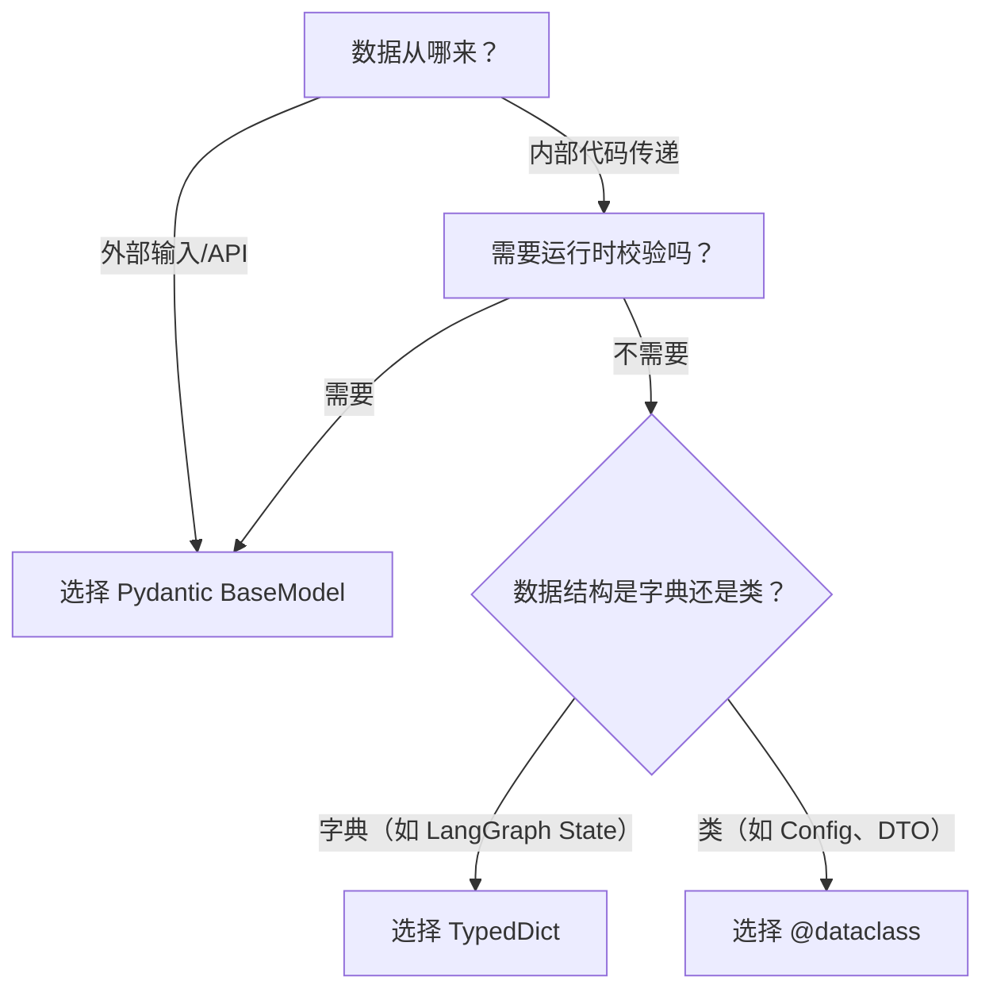

# 为什么项目中Config用的是@dataclass，ImportGraphState用的是TypedDict，而UploadResponse用的是pydantic的BaseModel，这3种模式有何区别，实际工作项目中，何时使用哪种？ 

这是一个非常专业且切中实际开发痛点的问题！这三种方式（`@dataclass`、`TypedDict`、`BaseModel`）在 Python 项目中分别扮演着不同的角色。

它们之间的核心区别在于：**数据校验时机**（运行时 vs 静态检查）、**性能开销**（有无运行时消耗）和**使用场景**（配置、内部流转、API交互）。

我用一张表帮你彻底理清，然后给你一个**实战选择指南**。

---

### 一、核心区别对照表

| 维度 | **@dataclass** | **TypedDict** | **Pydantic BaseModel** |
|------|---------------|---------------|------------------------|
| **本质** | 可变的类，用于**组织数据** | 仅用于**静态类型检查**的字典结构定义 | 用于**数据解析与校验**的模型类 |
| **运行时开销** | **极低**（基本就是普通类） | **零**（运行时直接被擦除，就是个 `dict`） | **较高**（每次实例化都会执行校验、转换） |
| **数据校验** | **无**（你传字符串就存字符串） | **无**（仅在 IDE/`mypy` 中报错，运行时不生效） | **强校验**（自动转换类型，抛 `ValidationError`） |
| **可变性** | 默认可变（可改属性值） | 可变（就是个字典） | 默认不可变（可配置 `frozen=True`） |
| **序列化** | 需要手动实现或借助 `dataclasses.asdict` | 本身就是 `dict`，可直接 `json.dumps` | 自带 `.model_dump()` 和 `.model_dump_json()` |
| **IDE 补全** | ✅ 完美支持 | ✅ 完美支持 | ✅ 完美支持 |
| **适用场景** | 内部数据传递（如 DAO、DTO） | 定义 JSON 结构（如大参数字典） | API 请求/响应、配置管理、用户输入 |

---

### 二、为什么你的项目这样用？（实战解构）

#### 1. `@dataclass` —— 用于 Config 配置类
```python
@dataclass
class MineruConfig:
    base_url: str
    api_token: str
```
- **原因**：配置通常来自环境变量或固定值，**不需要校验**（因为是你自己写的），只需要一个**轻量级的容器**把零散的变量组合在一起。
- **优势**：没有运行时开销，调用时直接 `.base_url`，清晰且性能极好。
- **适合场景**：内部 Service 层的数据传输对象（DTO）、配置类、值对象（Value Object）。

---

#### 2. `TypedDict` —— 用于 LangGraph 的 State（状态）
```python
class ImportGraphState(TypedDict):
    file_path: str
    md_content: str
    ...
```
- **原因**：LangGraph 的状态本质上是在节点之间传递的**大字典**，而字典是 LangGraph 官方推荐的状态载体。使用 `TypedDict` 只为了**给这个字典加上类型提示**，让 IDE 能自动补全 `state["file_path"]`，同时让 `mypy` 检查拼写错误。
- **优势**：**零运行时开销**！编译后就是普通 `dict`，不影响 LangGraph 的执行性能。
- **适合场景**：LangGraph 状态、复杂函数的 `**kwargs` 结构、纯数据字典且不需要校验的场景。

---

#### 3. `BaseModel` —— 用于 UploadResponse（API 响应）
```python
class UploadResponse(BaseModel):
    code: int
    msg: str
    data: dict
```
- **原因**：API 的请求/响应数据来自**外部（前端/第三方）**，数据格式、类型、字段缺失都不可控。使用 Pydantic 可以在**入口处**就进行强校验，防止脏数据流入系统内部。
- **优势**：自动抛出明确错误信息，支持复杂嵌套校验（如 `EmailStr`、`UrlStr`）、自动序列化为 JSON 响应。
- **适合场景**：FastAPI 的请求体（`request.body`）、外部 API 响应解析、用户输入表单、需要严格数据治理的地方。

---

### 三、实际工作项目中的选择指南（决策树）

你可以按照下面这个逻辑来决定用哪个：



#### 详细场景举例：

| 场景 | 推荐方案 | 理由 |
|------|---------|------|
| **项目配置文件**（Config） | `@dataclass` | 内部写入，无需校验，性能高 |
| **LangGraph 节点间状态** | `TypedDict` | LangGraph 原生用 `dict`，零开销，仅做类型提示 |
| **FastAPI POST 请求体** | `BaseModel` | 必须校验外部输入，防 SQL注入/类型错误 |
| **调用第三方 API 的返回数据** | `BaseModel` | 外部数据不可信，需强制校验格式 |
| **Service 层内部 DTO（数据传输对象）** | `@dataclass` | 内部流转，无需校验，纯粹组织数据 |
| **ORM 映射结果**（如 SQLAlchemy） | `@dataclass` | 已有 ORM 校验，无需额外开销 |
| **大型复杂嵌套 JSON 结构**（如 20+ 字段） | `TypedDict` | 不需要校验，仅做提示，避免 `BaseModel` 性能开销 |

---

### 四、性能角度的“潜规则”

- **TypedDict 性能最好**：因为它编译后就是个普通的 `dict`，完全没有任何类实例化开销。如果你的 LangGraph 节点每秒执行上万次，`TypedDict` 是最优解。
- **@dataclass 次之**：它是一个真正的类，实例化时有轻微开销，但远小于 Pydantic。
- **BaseModel 最慢**：每次实例化都会执行递归校验、类型转换，建议只在**系统的边界处**（即接收外部数据的那一层）使用，一旦校验通过，内部流转就转换为 `@dataclass` 或 `TypedDict`。

---

### 五、你的项目中的最佳实践（可以优化的点）

你现在的用法已经很符合规范了，但可以额外注意一点：

```python
# 示例：当外部数据进入内部后，转换为轻量级 dataclass
def upload_file(request: UploadRequest) -> UploadResponse:
    # 1. 边界处使用 BaseModel 校验
    validated_data = request.body  # UploadRequest 是 BaseModel
    
    # 2. 内部流转使用 dataclass（更轻量）
    internal_dto = MineruConfig(
        base_url=validated_data.url,
        api_token=validated_data.token
    )
    
    # 3. LangGraph 状态用 TypedDict
    state: ImportGraphState = {
        "file_path": validated_data.path,
        "md_content": ""
    }
    
    # 4. 返回用 BaseModel（再次到边界）
    return UploadResponse(code=0, msg="success", data={})
```

---

### 总结一句话
- **外部不可信数据用 Pydantic（守门员）**
- **内部内部传递用 @dataclass（轻量容器）**
- **LangGraph/大字典用 TypedDict（仅做提示，零成本）**

如果你在重构项目时，想把这三种模式组合得更好，可以把你现在的代码结构发出来，我帮你把“边界校验”和“内部流转”的层次划分得更清晰。


### ref
[https://chat.deepseek.com/share/yd7ds2hq6g12ozcru2]()