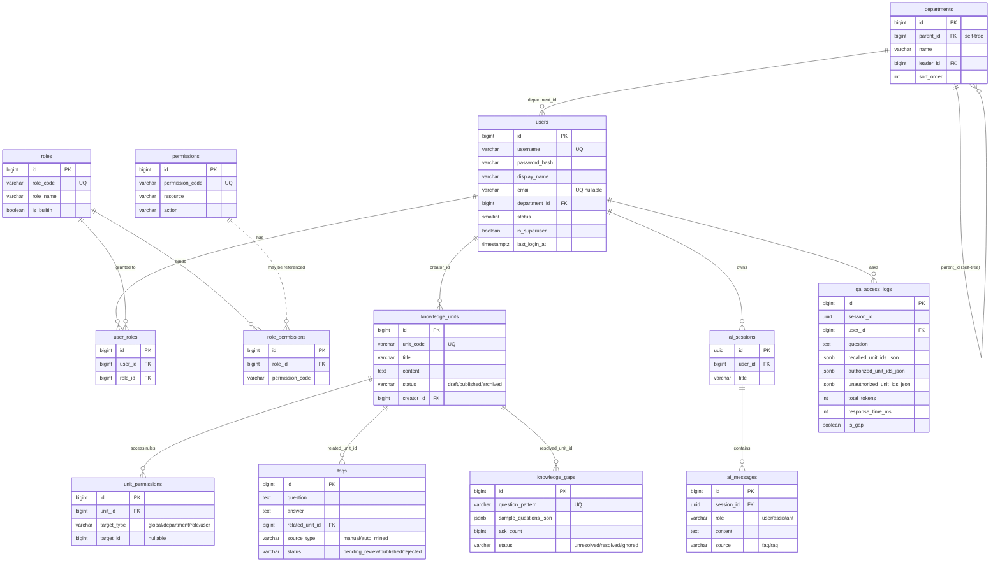

# KBMS 技术规范 (SPEC)

> 知识库管理平台 — 技术实现规范
> 版本: v1.0 · 日期: 2026-08-26 · 关联 PRD: [kbms-prd.md](./kbms-prd.md)

---

## 1. 技术选型

### 1.1 后端 (admin/)
| 类别 | 选型 | 版本 | 理由 |
|---|---|---|---|
| 语言 | Python | 3.11+ | 与现有 `app/` 同源,共享运维脚本与镜像 |
| Web 框架 | FastAPI | 0.139+ | 现有 RAG 同栈;类型驱动、Pydantic v2、SSE 原生支持 |
| ASGI 服务器 | Uvicorn | 0.51+ | 与现有 RAG 一致 |
| ORM | SQLAlchemy (async) | 2.0.30+ | 关系建模能力强,2.x 原生 async,生态成熟 |
| 迁移工具 | Alembic | 1.13+ | SQLAlchemy 官方,支持 data migration |
| Postgres 驱动 | asyncpg + psycopg2-binary | latest | async 运行时用 asyncpg;Alembic 同步用 psycopg2 |
| 密码哈希 | passlib[bcrypt] | 1.7+ | bcrypt 是工业标准;cost=12 |
| JWT | PyJWT | 2.8+ | HS256;secret 从 env 注入 |
| HTTP 客户端 | httpx | 0.27+ | async,用于调用 RAG 服务 |
| 文档解析 | pypdf, python-docx, markdown | latest | 支持 PDF/Word/Markdown/TXT |
| 定时任务 | APScheduler | 3.10+ | FAQ 挖掘与缺口识别(可改为 celery/redis-celery,本期 MVP 用 APScheduler + 内存触发) |
| 嵌入向量(用于 FAQ 语义匹配 / 缺口挖掘) | 与 RAG 共享:通过 RAG HTTP 调用 `embedder` 接口,**不引入重复依赖** | — | 避免 embedding 模型双重加载 |

### 1.2 前端 (admin-frontend/)
| 类别 | 选型 | 版本 | 理由 |
|---|---|---|---|
| 框架 | React | 18+ | 生态最大,AntD 完整支持 |
| 语言 | TypeScript | 5+ | 类型驱动,与后端 Pydantic schema 协同 |
| 构建 | Vite | 5+ | 启动快、HMR、产物优化 |
| UI 库 | Ant Design | 5+ | 中后台组件最全,Tree/Form/Table/Upload 齐全 |
| 路由 | react-router-dom | 6+ | 路由守卫 + 嵌套路由 |
| 状态 | zustand | 4+ | 轻量,存 token + user info |
| HTTP | axios | 1+ | interceptor 自动加 JWT |
| Markdown | react-markdown + remark-gfm | latest | AI 回答渲染 |
| 图表 | @ant-design/charts 或 ECharts for React | latest | 看板趋势/分布图 |
| 代码风格 | ESLint + Prettier | latest | 与 RAG 工程风格对齐 |

### 1.3 数据存储
| 类别 | 选型 | 理由 |
|---|---|---|
| 主库 | **PostgreSQL 16** | 强关系、强事务、JSONB 字段灵活(用于 `recalled_unit_ids_json` 等) |
| 缓存 | **进程内 LRU (`cachetools.LRUCache`) + 可选 Redis** | MVP 阶段不强制 Redis;FAQ 缓存量小(几百~几千条)完全可放内存 |
| 向量库 | **复用现有 Milvus** | 不重复部署;通过 RAG 服务调用 |

### 1.4 部署
| 类别 | 选型 |
|---|---|
| 容器 | Docker (python:3.11-slim) |
| 编排 | docker-compose (扩展 `postgres`、`kb-admin`) |
| 反向代理 | 生产建议 Nginx;开发 FastAPI 直连 |

---

## 2. 数据模型

### 2.1 ER 概览



> **关系说明**:
> - `users.department_id` 与 `departments.leader_id` 都是 `SET NULL on delete`,保证删部门不级联删人。
> - `user_roles` / `role_permissions` / `unit_permissions` 是 3 张关联表,M:N 解耦主表与权限/规则字典。
> - `permissions` 是权限字典(供前端渲染权限树),`role_permissions.permission_code` 是冗余存的字符串(MVP 不强引用字典,便于扩展)。
> - `qa_access_logs.question_embedding` (TEXT/JSON) 用于语义聚类(可在后期按需启用,MVP 不写入)。
> - 虚线 `permissions ||..o{ role_permissions` 表示字典与角色绑定的关系是非强引用(角色可绑尚未注册的码)。

### 2.2 表结构(Postgres)

#### users
| 字段 | 类型 | 约束 | 说明 |
|---|---|---|---|
| id | BIGSERIAL | PK | |
| username | VARCHAR(64) | UNIQUE NOT NULL | |
| password_hash | VARCHAR(255) | NOT NULL | bcrypt |
| display_name | VARCHAR(128) | NOT NULL | |
| email | VARCHAR(255) | UNIQUE NULL | |
| department_id | BIGINT | FK→departments(id) NULL | |
| status | SMALLINT | NOT NULL DEFAULT 1 | 1=active, 0=disabled |
| is_superuser | BOOLEAN | NOT NULL DEFAULT FALSE | |
| last_login_at | TIMESTAMPTZ | NULL | |
| created_at | TIMESTAMPTZ | NOT NULL DEFAULT now() | |
| updated_at | TIMESTAMPTZ | NOT NULL DEFAULT now() | |

索引:`username`、`department_id`、`status`

#### departments
| 字段 | 类型 | 约束 | 说明 |
|---|---|---|---|
| id | BIGSERIAL | PK | |
| parent_id | BIGINT | FK→departments(id) NULL | 自引用树形 |
| name | VARCHAR(128) | NOT NULL | |
| leader_id | BIGINT | FK→users(id) NULL | |
| sort_order | INT | NOT NULL DEFAULT 0 | |
| created_at | TIMESTAMPTZ | NOT NULL | |
| updated_at | TIMESTAMPTZ | NOT NULL | |

索引:`parent_id`、(可后期扩展 LTREE `path`)

#### roles
| 字段 | 类型 | 约束 | 说明 |
|---|---|---|---|
| id | BIGSERIAL | PK | |
| role_name | VARCHAR(64) | NOT NULL | |
| role_code | VARCHAR(64) | UNIQUE NOT NULL | 如 `super_admin`、`knowledge_admin` |
| description | VARCHAR(255) | NULL | |
| is_builtin | BOOLEAN | NOT NULL DEFAULT FALSE | 内置角色不可删 |
| created_at | TIMESTAMPTZ | NOT NULL | |
| updated_at | TIMESTAMPTZ | NOT NULL | |

#### permissions (静态字典,不另存表也行;本期存表便于审计和扩展)
| 字段 | 类型 | 约�� | 说明 |
|---|---|---|---|
| id | BIGSERIAL | PK | |
| permission_code | VARCHAR(128) | UNIQUE NOT NULL | 如 `knowledge:read` |
| permission_type | VARCHAR(32) | NOT NULL | `menu` / `action` |
| resource | VARCHAR(64) | NOT NULL | `knowledge`、`org`、`ai`、`dashboard`、`settlement` |
| action | VARCHAR(32) | NOT NULL | `read`、`write`、`delete`、`access` |
| description | VARCHAR(255) | NULL | |

#### user_roles
| 字段 | 类型 | 约束 | 说明 |
|---|---|---|---|
| id | BIGSERIAL | PK | |
| user_id | BIGINT | FK→users(id) NOT NULL | |
| role_id | BIGINT | FK→roles(id) NOT NULL | |
| created_at | TIMESTAMPTZ | NOT NULL | |

唯一索引:`(user_id, role_id)`

#### role_permissions
| 字段 | 类型 | 约束 | 说明 |
|---|---|---|---|
| id | BIGSERIAL | PK | |
| role_id | BIGINT | FK→roles(id) NOT NULL | |
| permission_code | VARCHAR(128) | NOT NULL | 不再 FK→permissions,允许角色绑定尚未在字典里注册的码(便于扩展) |
| permission_type | VARCHAR(32) | NOT NULL | |
| created_at | TIMESTAMPTZ | NOT NULL | |

唯一索引:`(role_id, permission_code)`

#### knowledge_units
| 字段 | 类型 | 约束 | 说明 |
|---|---|---|---|
| id | BIGSERIAL | PK | |
| unit_code | VARCHAR(64) | UNIQUE NOT NULL | `KU-{yyyymmdd}-{seq}` 自动生成 |
| title | VARCHAR(255) | NOT NULL | |
| content | TEXT | NOT NULL | |
| summary | TEXT | NULL | |
| category | VARCHAR(64) | NULL | |
| tags | JSONB | NULL | `["a","b"]` |
| source_file_name | VARCHAR(255) | NULL | 导入产生 |
| file_type | VARCHAR(32) | NULL | pdf/md/docx/txt |
| file_size | BIGINT | NULL | bytes |
| status | VARCHAR(32) | NOT NULL DEFAULT 'draft' | `draft`/`published`/`archived` |
| creator_id | BIGINT | FK→users(id) NOT NULL | |
| created_at | TIMESTAMPTZ | NOT NULL | |
| updated_at | TIMESTAMPTZ | NOT NULL | |

索引:`status`、`category`、`creator_id`、GIN(`tags`)

#### unit_permissions
| 字段 | 类型 | 约束 | 说明 |
|---|---|---|---|
| id | BIGSERIAL | PK | |
| unit_id | BIGINT | FK→knowledge_units(id) ON DELETE CASCADE NOT NULL | |
| target_type | VARCHAR(32) | NOT NULL | `global`/`department`/`role`/`user` |
| target_id | BIGINT | NULL | `global` 时为 NULL |
| created_at | TIMESTAMPTZ | NOT NULL | |

索引:`(unit_id, target_type, target_id)` 唯一

#### ai_sessions
| 字段 | 类型 | 约束 | 说明 |
|---|---|---|---|
| id | UUID | PK | `session_id` |
| user_id | BIGINT | FK→users(id) NOT NULL | |
| title | VARCHAR(255) | NULL | 第一条问题摘要 |
| updated_at | TIMESTAMPTZ | NOT NULL | |
| created_at | TIMESTAMPTZ | NOT NULL | |

#### ai_messages (会话内的问答记录,本期可与 `qa_access_logs` 合并到一张表)
| 字段 | 类型 | 约束 | 说明 |
|---|---|---|---|
| id | BIGSERIAL | PK | |
| session_id | UUID | FK→ai_sessions(id) NOT NULL | |
| user_id | BIGINT | FK→users(id) NOT NULL | |
| role | VARCHAR(16) | NOT NULL | `user` / `assistant` |
| content | TEXT | NOT NULL | |
| sources_json | JSONB | NULL | 引用来源 |
| unauthorized_unit_ids | JSONB | NULL | 无权限提示用 |
| source | VARCHAR(32) | NULL | `faq` / `rag` |
| created_at | TIMESTAMPTZ | NOT NULL | |

#### qa_access_logs (看板/FAQ 挖掘用)
| 字段 | 类型 | 约束 | 说明 |
|---|---|---|---|
| id | BIGSERIAL | PK | |
| session_id | UUID | NOT NULL | |
| user_id | BIGINT | FK→users(id) NOT NULL | |
| question | TEXT | NOT NULL | |
| question_pattern | VARCHAR(255) | NULL | 标准化(去标点/小写)用于聚合 |
| question_embedding | TEXT | NULL | JSON 序列化的 list[float],用于语义聚类(本期可为空,聚类时按需生成) |
| answer | TEXT | NOT NULL | |
| recalled_unit_ids_json | JSONB | NOT NULL | `["1","2"]` |
| authorized_unit_ids_json | JSONB | NOT NULL | |
| unauthorized_unit_ids_json | JSONB | NOT NULL | |
| source | VARCHAR(32) | NULL | `faq` / `rag` |
| prompt_tokens | INT | NOT NULL DEFAULT 0 | |
| completion_tokens | INT | NOT NULL DEFAULT 0 | |
| total_tokens | INT | NOT NULL DEFAULT 0 | |
| response_time_ms | INT | NOT NULL DEFAULT 0 | |
| is_gap | BOOLEAN | NOT NULL DEFAULT FALSE | 命中低于阈值时置 TRUE |
| created_at | TIMESTAMPTZ | NOT NULL | |

索引:`user_id`、`created_at`、`question_pattern`、`is_gap`

#### faqs
| 字段 | 类型 | 约束 | 说明 |
|---|---|---|---|
| id | BIGSERIAL | PK | |
| question | TEXT | NOT NULL | |
| question_pattern | VARCHAR(255) | NULL | |
| answer | TEXT | NOT NULL | |
| category | VARCHAR(64) | NULL | |
| related_unit_id | BIGINT | FK→knowledge_units(id) NULL | |
| source_type | VARCHAR(32) | NOT NULL | `manual` / `auto_mined` |
| status | VARCHAR(32) | NOT NULL DEFAULT 'pending_review' | `pending_review` / `published` / `rejected` |
| hit_count | BIGINT | NOT NULL DEFAULT 0 | |
| reviewer_id | BIGINT | FK→users(id) NULL | |
| reviewed_at | TIMESTAMPTZ | NULL | |
| created_at | TIMESTAMPTZ | NOT NULL | |
| updated_at | TIMESTAMPTZ | NOT NULL | |

索引:`status`、`related_unit_id`

#### knowledge_gaps
| 字段 | 类型 | 约束 | 说明 |
|---|---|---|---|
| id | BIGSERIAL | PK | |
| question_pattern | VARCHAR(255) | UNIQUE NOT NULL | |
| sample_questions_json | JSONB | NOT NULL | `["原问题1","原问题2"]` |
| ask_count | BIGINT | NOT NULL DEFAULT 1 | |
| last_asked_at | TIMESTAMPTZ | NOT NULL | |
| status | VARCHAR(32) | NOT NULL DEFAULT 'unresolved' | `unresolved` / `resolved` / `ignored` |
| resolved_unit_id | BIGINT | FK→knowledge_units(id) NULL | 关联到补建的知识单元 |
| created_at | TIMESTAMPTZ | NOT NULL | |
| updated_at | TIMESTAMPTZ | NOT NULL | |

#### audit_logs (本期可仅落 logger,后续进库;表结构预留)
| 字段 | 类型 | 约束 | 说明 |
|---|---|---|---|
| id | BIGSERIAL | PK | |
| user_id | BIGINT | FK→users(id) NULL | |
| action | VARCHAR(64) | NOT NULL | |
| resource | VARCHAR(64) | NOT NULL | |
| resource_id | VARCHAR(64) | NULL | |
| payload_json | JSONB | NULL | |
| ip | VARCHAR(64) | NULL | |
| created_at | TIMESTAMPTZ | NOT NULL | |

### 2.3 内置种子数据 (Alembic data migration)

**Permissions (permission_code)**:
- `org:read`、`org:write`
- `user:read`、`user:write`
- `role:read`、`role:write`
- `knowledge:read`、`knowledge:write`、`knowledge:delete`、`knowledge:import`
- `ai:access` — 允许访问 AI 对话工作台
- `dashboard:read`
- `settlement:read`、`settlement:write`

**内置角色**:
| role_code | role_name | permissions |
|---|---|---|
| super_admin | 系统管理员 | 全量 |
| knowledge_admin | 知识管理员 | `knowledge:*`、`ai:access`、`dashboard:read`、`settlement:*`、`org:read` |
| regular_user | 普通用户 | `knowledge:read`、`ai:access` |

### 2.4 与现有 RAG (`app/`) 的数据契约

- **不修改** RAG 的 Milvus / Mongo schema。
- admin 在 `qa_access_logs` 持久化自己的访问日志,**不依赖** RAG 的 `chat_message`(那个继续用于 RAG 的 `chat.html` 匿名端)。
- admin 调用 RAG 的 `POST /api/v1/upload` 触发摄入,通过 query string 或 header 透传 `X-User-Id`、`X-Session-Id`、`X-KB-Tag`(RAG 端忽略即可)。
- 知识单元的 `unit_code` 在 admin 端生成,RAG 端用 `file_title`(可由 admin 通过 query param 注入,如 `?file_title=KU-20260826-0001`)。

---

## 3. API 接口设计

> 全部 RESTful,前缀 `/api`,登录态接口需要 `Authorization: Bearer <access_token>`。
> AI 流式接口用 SSE(`Content-Type: text/event-stream`)。

### 3.1 认证 (无前缀,符合 PRD §2.9.8)

| 方法 | 路径 | 说明 |
|---|---|---|
| POST | `/api/auth/login` | 登录,响应 access/refresh/user_info/permissions |
| POST | `/api/auth/refresh` | 用 refresh_token 换新 access |
| POST | `/api/auth/logout` | 客户端清 token(服务端可选失效 refresh) |
| GET  | `/api/auth/me` | 当前用户身份 + 角色 + 操作权限码 |

### 3.2 组织 / 用户 / 角色 / 部门 / 权限

| 方法 | 路径 | 说明 |
|---|---|---|
| GET | `/api/org/departments` | 部门树 |
| POST | `/api/org/departments` | 创建部门 |
| PUT | `/api/org/departments/{id}` | 更新部门 |
| DELETE | `/api/org/departments/{id}` | 删除部门(有子/有员则 409) |
| GET | `/api/org/users` | 用户列表(分页 + 筛选) |
| POST | `/api/org/users` | 创建用户 |
| PUT | `/api/org/users/{id}` | 更新用户 |
| POST | `/api/org/users/{id}/reset-password` | 重置密码 |
| POST | `/api/org/users/{id}/toggle-status` | 启停用 |
| GET | `/api/org/roles` | 角色列表 |
| POST | `/api/org/roles` | 创建角色 |
| PUT | `/api/org/roles/{id}` | 更新角色 |
| DELETE | `/api/org/roles/{id}` | 删除角色 |
| GET | `/api/org/roles/{id}/permissions` | 角色已绑定权限 |
| POST | `/api/org/roles/{id}/permissions` | 全量替换角色权限 |
| GET | `/api/org/permissions` | 字典:全量权限码 |

### 3.3 知识单元 / 导入

| 方法 | 路径 | 说明 |
|---|---|---|
| POST | `/api/knowledge/import` | 单/批量上传(multipart),返回 task_id |
| GET | `/api/knowledge/tasks/{task_id}` | 任务进度 + 每文件解析结果 |
| GET | `/api/knowledge/units` | 列表(分页 + 筛选) |
| POST | `/api/knowledge/units` | 手动新建 |
| GET | `/api/knowledge/units/{id}` | 详情(含权限) |
| PUT | `/api/knowledge/units/{id}` | 更新 |
| DELETE | `/api/knowledge/units` | 批量删除 |
| GET | `/api/knowledge/units/{id}/permissions` | 该单元已配置的数据权限 |
| POST | `/api/knowledge/units/{id}/permissions` | 批量配置(全量替换) |
| POST | `/api/knowledge/check-permissions` | 入参 `{user_id, unit_ids[]}` → 出参 `{authorized_unit_ids[], unauthorized_unit_ids[]}` |

### 3.4 AI 鉴权问答

| 方法 | 路径 | 说明 |
|---|---|---|
| POST | `/api/ai/chat/stream` | SSE 流式问答 |
| GET | `/api/ai/sessions` | 会话列表 |
| GET | `/api/ai/sessions/{id}/messages` | 会话历史 |
| DELETE | `/api/ai/sessions/{id}` | 删除会话 |

**SSE 事件协议**:
```
event: recall
data: {"unit_ids": ["12","34","56"]}

event: authorized
data: {"unit_ids": ["12","34"]}

event: unauthorized
data: {"unit_ids": ["56"], "titles": ["[无标题]"]}

event: token
data: {"delta": "你"}

event: done
data: {"answer": "...", "source": "rag|faq", "prompt_tokens": 100, "completion_tokens": 200, "response_time_ms": 1500}

event: error
data: {"message": "...", "code": "rag_unavailable"}
```

### 3.5 数据看板

| 方法 | 路径 | 说明 |
|---|---|---|
| GET | `/api/dashboard/metrics?range=7d` | 核心指标 |
| GET | `/api/dashboard/rankings/questions?limit=10` | 高频问题 TOP |
| GET | `/api/dashboard/rankings/units?limit=10` | 知识热度 TOP |
| GET | `/api/dashboard/stats/tokens?range=7d` | 趋势(按日聚合) |

### 3.6 知识沉淀

| 方法 | 路径 | 说明 |
|---|---|---|
| GET | `/api/settlement/faqs/recommendations` | 待审核候选 |
| GET | `/api/settlement/faqs` | 已发布 FAQ |
| POST | `/api/settlement/faqs/{id}/review` | 审核通过/驳回 |
| GET | `/api/settlement/knowledge-gaps` | 缺口列表 |
| POST | `/api/settlement/knowledge-gaps/{id}/create-unit` | 一键建档 |

### 3.7 通用

| 方法 | 路径 | 说明 |
|---|---|---|
| GET | `/health` | 健康检查({status, db, rag_reachable}) |
| GET | `/docs` | Swagger UI |

### 3.8 错误响应统一规范
```json
{ "error": { "code": "string", "message": "string", "detail": {} } }
```
常见 code:`unauthorized`、`forbidden`、`not_found`、`conflict`、`validation_error`、`rag_unavailable`、`internal_error`。

---

## 4. 项目目录结构

```
/ (仓库根)
├── app/                       # 现有 RAG 引擎 — 核心不变,仅做最小侵入式适配
│   └── (不变)
├── admin/                     # ★ NEW — KBMS 后端(FastAPI)
│   ├── api/
│   │   ├── deps.py                    # get_db / get_current_user / require_permission
│   │   └── v1/
│   │       ├── auth.py                # /api/auth/*
│   │       ├── org/
│   │       │   ├── users.py
│   │       │   ├── departments.py
│   │       │   ├── roles.py
│   │       │   └── permissions.py
│   │       ├── knowledge/
│   │       │   ├── units.py
│   │       │   ├── permissions.py     # check-permissions / 单单元权限 CRUD
│   │       │   ├── import_tasks.py
│   │       │   └── importer.py        # 文档解析服务
│   │       ├── ai/
│   │       │   ├── chat.py            # SSE 流式
│   │       │   └── sessions.py
│   │       ├── dashboard/
│   │       │   └── stats.py
│   │       └── settlement/
│   │           ├── faqs.py
│   │           └── gaps.py
│   ├── core/
│   │   ├── config.py                  # Settings
│   │   ├── security.py                # bcrypt + JWT
│   │   ├── exceptions.py              # 业务异常类
│   │   └── logging.py                 # 日志初始化
│   ├── db/
│   │   ├── base.py                    # DeclarativeBase + async engine + session
│   │   ├── seed.py                    # 权限码、内置角色种子
│   │   └── migrations/
│   │       ├── env.py
│   │       └── versions/
│   │           ├── 0001_init.py
│   │           └── 0002_seed.py
│   ├── domain/                        # SQLAlchemy ORM 模型
│   │   ├── user.py
│   │   ├── department.py
│   │   ├── role.py
│   │   ├── permission.py
│   │   ├── knowledge_unit.py
│   │   ├── unit_permission.py
│   │   ├── ai_session.py
│   │   ├── ai_message.py
│   │   ├── qa_access_log.py
│   │   ├── faq.py
│   │   ├── knowledge_gap.py
│   │   └── audit_log.py
│   ├── schemas/                       # Pydantic 请求/响应
│   │   ├── auth.py
│   │   ├── org.py
│   │   ├── knowledge.py
│   │   ├── ai.py
│   │   ├── dashboard.py
│   │   ├── settlement.py
│   │   └── common.py
│   ├── services/                      # 业务层(无 FastAPI 依赖)
│   │   ├── auth_service.py
│   │   ├── user_service.py
│   │   ├── department_service.py
│   │   ├── role_service.py
│   │   ├── knowledge_service.py
│   │   ├── data_permission_engine.py  # ★ 核心 — check-permissions 实现
│   │   ├── ai_service.py              # 流式问答编排
│   │   ├── faq_cache.py               # ★ 内存 LRU + 持久化
│   │   ├── faq_miner.py               # ★ APScheduler 定时挖掘
│   │   ├── gap_detector.py            # ★ 缺口识别
│   │   ├── dashboard_service.py       # ★ 聚合查询
│   │   └── rag_client.py              # ★ httpx 调用 RAG
│   ├── static/
│   │   └── dist/                      # ★ admin-frontend 构建产物
│   ├── scripts/
│   │   └── create_superuser.py
│   ├── utils/
│   │   ├── pagination.py
│   │   └── patterns.py                # question 标准化
│   ├── main.py                        # FastAPI 入口
│   ├── alembic.ini
│   ├── Dockerfile
│   ├── pyproject.toml
│   ├── .env.example
│   └── README.md
├── admin-frontend/                    # ★ NEW — React SPA
│   ├── public/
│   ├── src/
│   │   ├── api/
│   │   │   ├── client.ts              # axios + JWT interceptor
│   │   │   ├── auth.ts
│   │   │   ├── org.ts
│   │   │   ├── knowledge.ts
│   │   │   ├── ai.ts                  # EventSource SSE 封装
│   │   │   ├── dashboard.ts
│   │   │   └── settlement.ts
│   │   ├── components/
│   │   │   ├── Layout.tsx             # 主框架 + 动态菜单
│   │   │   ├── PermissionSelector.tsx # ★ 数据权限选择弹窗
│   │   │   ├── KnowledgeImporter.tsx  # 拖拽上传 + 进度轮询
│   │   │   ├── StreamMarkdown.tsx     # 流式渲染
│   │   │   ├── UnauthorizedBanner.tsx # 无权限提示卡
│   │   │   └── Charts.tsx             # ECharts 包装
│   │   ├── pages/
│   │   │   ├── Login.tsx
│   │   │   ├── Dashboard.tsx          # 指标 + 排行 + 趋势
│   │   │   ├── org/
│   │   │   │   ├── Users.tsx
│   │   │   │   ├── Departments.tsx
│   │   │   │   ├── Roles.tsx
│   │   │   │   └── Permissions.tsx
│   │   │   ├── knowledge/
│   │   │   │   ├── List.tsx
│   │   │   │   ├── Edit.tsx           # 含 PermissionSelector
│   │   │   │   └── Import.tsx
│   │   │   ├── ai/
│   │   │   │   └── Workbench.tsx      # 流式对话
│   │   │   └── settlement/
│   │   │       ├── FaqReview.tsx
│   │   │       ├── Faqs.tsx
│   │   │       └── Gaps.tsx
│   │   ├── store/
│   │   │   └── auth.ts                # zustand
│   │   ├── router.tsx
│   │   ├── locales/
│   │   │   └── zh.ts
│   │   ├── App.tsx
│   │   └── main.tsx
│   ├── index.html
│   ├── package.json
│   ├── vite.config.ts
│   ├── tsconfig.json
│   └── README.md
├── docker-compose.yml                 # 扩展 — postgres + kb-admin + admin-frontend-build profile
├── .env.example                       # 扩展 — Postgres / JWT / RAG_BASE_URL
├── README.md / README.cn.md           # 扩展 — KBMS 章节
├── docs/kbms-demo.md                  # 演示链路
├── plan/
│   ├── kbms-prd.md                    # ★ 本 PRD
│   ├── kbms-spec.md                   # ★ 本 SPEC
│   └── kbms-impl-plan.md              # ★ 实施计划(后续更新)
└── (其他不变)
```

---

## 5. 关键算法与流程

### 5.1 数据权限校验 `check-permissions`
```python
async def check_permissions(db, user_id: int, unit_ids: list[int]) -> dict:
    user = await get_user_with_dept_and_roles(db, user_id)
    rules = await get_unit_permissions_for(db, unit_ids)
    authorized, unauthorized = [], []
    for uid in unit_ids:
        unit_rules = rules.get(uid, [])
        if any(_match(rule, user) for rule in unit_rules):
            authorized.append(uid)
        else:
            unauthorized.append(uid)
    return {"authorized_unit_ids": authorized, "unauthorized_unit_ids": unauthorized}

def _match(rule, user) -> bool:
    if rule.target_type == "global":
        return True
    if rule.target_type == "department" and rule.target_id == user.department_id:
        return True
    if rule.target_type == "role" and rule.target_id in user.role_ids:
        return True
    if rule.target_type == "user" and rule.target_id == user.id:
        return True
    return False
```
- `unit_rules` 为空时,该 unit 落入 `unauthorized`(默认零权限)。
- 一次 SQL 拉取所有相关 `unit_permissions`,O(1) 查询。

### 5.2 AI 鉴权问答流 (SSE)
```
1. 鉴权 → require_login
2. FAQ 缓存匹配:
   a. 精确字符串查 LRU → 命中则直接推 done (source=faq)
   b. 否则调用 RAG 嵌入接口获取 question 向量 → 缓存中做相似度比对 → 命中则 done
3. 调用 RAG /api/v1/query,传 X-User-Id、SSE 拿到 recall 事件 → 拿到 recalled_unit_ids
4. check-permissions(当前 user_id, recalled_unit_ids) → authorized / unauthorized
5. 流式事件:
   - 立刻推 recall / authorized / unauthorized
   - authorized 列表为空 → 推"暂无相关知识"提示 + done
   - 否则调用 RAG /api/v1/query 二次组装 Context 并流式生成(本期为简化,可复用 recall 的 answer 字段)
6. 异步落 qa_access_logs(包含 token/耗时)
7. 若 recall 为空或授权后为空 → 缺口检测,聚类 question_pattern 入 knowledge_gaps
```

### 5.3 FAQ 挖掘 (APScheduler,每 60 分钟)
```
触发:
  收集最近 7 天 qa_access_logs(question_pattern, count) 按 pattern 聚合 count
  过滤 count >= FAQ_MIN_FREQ_THRESHOLD (默认 5)
  排除已存在的 (status=published) FAQ
  对每个候选:
    - 取最常被引用的 related_unit_id
    - 自动生成 answer:取最近一次该 pattern 的 answer 文本(截短 500 字)
    - 写入 faqs (source_type=auto_mined, status=pending_review)
  记录 audit log: mined N new FAQ candidates
```

### 5.4 知识缺口识别
```
实时(每次问答结束):
  若 recall_unit_ids 为空 OR 全部 unauthorized OR 总相似度 < 阈值:
    normalized = normalize(question)            # 去标点/小写
    gap = upsert_knowledge_gap(pattern=normalized, sample=question[:255])
    同时标记 qa_access_logs.is_gap = True
定时:
  汇总 is_gap=True 且未被转化的 → 在 Gaps 页面按 ask_count 倒序展示
```

### 5.5 文档解析(单/批量)
```
POST /api/knowledge/import (multipart, files[])
1. 生成 task_id (UUID)
2. 每个文件:
   a. 保存到 admin/temp/{task_id}/{filename}
   b. 根据扩展名分发:
      - .pdf  → pypdf  → 拼接全文
      - .docx → python-docx → 拼接段落
      - .md   → 直接读取
      - .txt  → 直接读取
   c. 文本按 1500 字切块 → 每块作为一个 knowledge_unit(draft 状态)
   d. 自动 generate unit_code,生成 title(前 50 字),summary(LLM 调用,可选)
   e. 异步:对每个 unit 调用 RAG /api/v1/upload 把内容挂载(file_title = unit_code)
      - RAG 端解析后存入 Milvus + MinIO
3. 更新 import_task 状态(per-file),完成时总体置 done
4. 前端 GET /api/knowledge/tasks/{task_id} 轮询
```
> 解析策略:大文档按章节/页拆分为多个单元,小文档作为单单元。MVP 阶段实现"按字符数切块",后续可加 MinerU PDF 解析。

---

## 6. 安全与运维

- **密钥管理**: 所有敏感配置走 `.env.prod`,由 `.gitignore` 排除;`JWT_SECRET` 启动校验长度 ≥ 32 字符。
- **CORS**: 由 `*` 收敛为具体域名;生产部署强制 HTTPS。
- **RBAC 中间件**: 路由层 `@require_permission("knowledge:write")`,无权限返回 `403`。
- **审计**: 写操作调 `audit_log_service.record()`(本期落 logger,后续进库)。
- **健康检查**: `GET /health` 探活 PG、可选 Redis、RAG 可达性。
- **优雅停机**: FastAPI lifespan 关闭 APScheduler、关闭 asyncpg pool、flush FAQ 缓存。

---

## 7. 部署拓扑

| 服务 | 端口 | 说明 |
|---|---|---|
| `kb-import` (现有) | 8000 | RAG 摄入 |
| `kb-query` (现有) | 8001 | RAG 问答 |
| **`kb-admin`** (新) | **8002** | KBMS 后端 + 托管 admin SPA `/admin/*` |
| **`postgres`** (新) | 5432 | KBMS 主库 |
| Milvus / Mongo / MinIO (现有) | 不变 | Neo4j 从 compose 删除(代码已确认未引用) |

启动顺序:`infra` (Milvus) → `postgres` → `mongodb/minio` → `kb-import/query` → `kb-admin`。
前端构建:`admin-frontend-build` 作为一次性构建服务(`profiles: [build]`),产物输出到 `admin/static/dist/`,再启动 `kb-admin` 时挂载。

---

## 8. 待澄清问题(可在实施时定)

1. RAG 端 `/api/v1/query` 返回的 recall 是否包含 `recalled_unit_ids`?
   - 当前实现 (`app/workflows/query/main_graph.py` `node_search_embedding.py` 等) 是 LangGraph 内部状态,API 响应是纯文本流。
   - **方案**: admin 调用 RAG 时走一个**简化的"只召回"接口** `POST /api/v1/recall`,RAG 端**最小改动**(新加一个 router,返回 `unit_ids`)即可。
   - 若用户坚持不修改 RAG 代码,admin 可通过 `?file_title=` 注入召回锚点,**先用 BGE-M3 嵌入(共享配置),在 Milvus 直查**(需 admin 也能连 Milvus)。MVP 优先"加 RAG 召回接口"方案,变更极小、隔离清晰。

2. LLM Token 计数:从 RAG 响应里拿到,还是 admin 自行计算?
   - RAG 端用 DashScope,响应里已带 usage;admin 通过 SSE 透传即可。

3. FAQ 嵌入用于语义匹配:复用 RAG 的 BGE-M3 还是 admin 独立?
   - admin 通过 RAG 的 `/api/v1/embed` 提供一个最小化的接口;若不愿意,可让 admin 直接读 Milvus 向量(耦合)。
   - MVP 决定:**admin 提供一个本地 BGE-M3 加载**? 不实际。**优先**:在 RAG 加 `POST /api/v1/embed`(输入文本 → 输出向量),admin 调用该接口。改动 ~20 行。